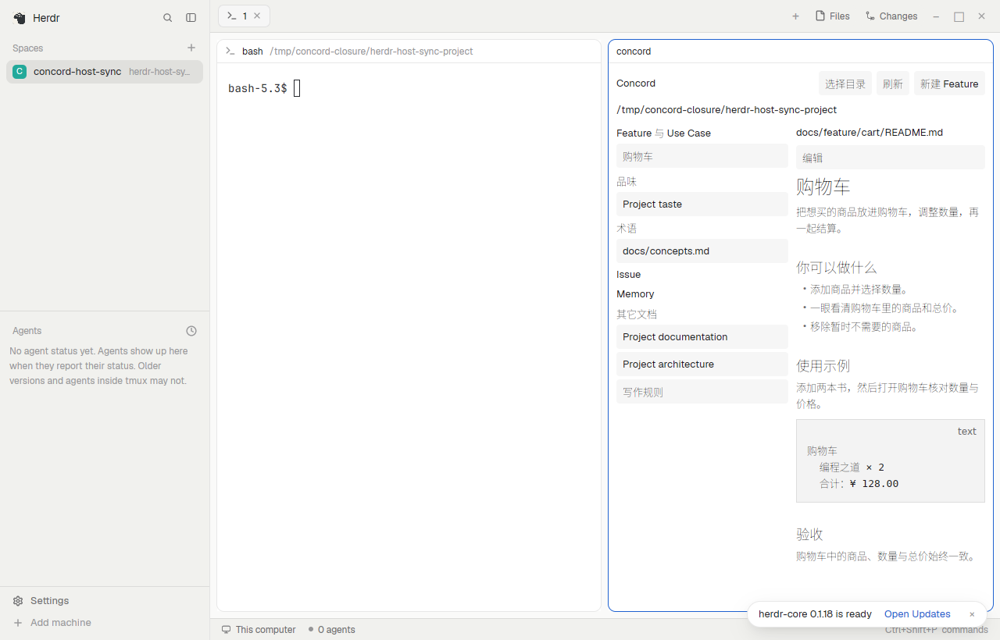

# Concord

在 coding agent 旁边读项目 Spec：左边是按文档模型分组的文档列表，右边是 Markdown 正文、守护它的测试与实现它的代码。要人处理的事（安装、升级、报错）给出一段可以复制给 agent 的请求。

## What you see

面板默认在右侧，宽 760px，是一张卡片：background 底色、1px border 边框、10px 圆角，颜色全部取 Herdr 主题颜色名。顶栏高 42px：最左是收起文档列表的按钮，然后是粗体 Concord 与 dim 色、可截断的仓库地址（本机 ~ 缩写，远程 <机器>:<路径>），右边没有按钮。下面始终两栏：文档列表宽为面板的 40%，在 160px 与 240px 之间；右栏是页面。文档列表按 Feature、Engineering、Roadmap、项目规则、Design、Issue、Memory、其它文档分组，分组与文档包可折叠，行高 28px、7px 圆角，悬停 hover、当前页 selected；页面上方是路径与“编辑”，正文下方是测试与代码。正文 13px，路径 12px，小标题 11px dim 色；图标是 icons/ 下的 Lucide SVG。状态页居中、最宽 360px：标题、muted 色的说明、交给 agent 的请求块与“复制给 agent”。

## How it behaves

打开 Concord 命令时聚焦同一 tab 的已有面板，或在当前 pane 右侧分屏；没有终端时提示先在这个 tab 里打开一个终端。缺少 CLI 时显示安装或升级 Concord 的 agent 请求，每两秒在那台机器上重新检测，装好后自动继续。较新 CLI 可以使用，并提示用 concord herdr install 更新 mod。面板跟随同一 tab 最近聚焦终端的目录与机器，根目录不变时不重新加载，有草稿时等保存或放弃后切换。点得了的东西有悬停与手形指针，小标题不能点；文档、路径、测试与代码支持右键菜单复制路径与讨论 Prompt。未初始化的仓库显示“在这里初始化 Concord”，每两秒重读，终端里 concord init 后自动显示文档；后台刷新在新结果就绪前不改变界面，不闪烁。分组标题只显示名称和数量，整行点击折叠；文件夹图标以打开或关闭的形态区分展开状态，点击只折叠目录；点文档包标题打开 README 并展开，没有 README 的目录标题切换展开状态。文档树不显示箭头，文件与文件夹图标在同层对齐；术语链接显示定义卡片；测试、代码与检查结果的行打开只读源码。编辑保存后运行检查；文件冲突保留草稿并提供磁盘版本供合并。出错时显示一条横幅，“复制给 agent”复制带原始输出的请求。本机与远程都通过 Concord CLI 读写；前台通过 workspace wait 等待变化，服务不可用时每两秒重读，后台停止等待，回前台立即刷新。切换仓库和关闭面板时回收任务与编辑器。mod 不新建文档：新建 Feature 交给 agent。此面板不显示 agent 的 working、blocked、done、idle 状态，不定义快捷键。

## Built from

mods/concord/main.js 是从源码构建的原生 Herdr View，依赖 gpui-kit、gpui-base 和 herdr，不使用网页视图或内置 mod。mod.json 声明 place=right、size=760、minimumConcordVersion=dev；icons/ 是构建时从固定版本 lucide-react 生成的 SVG；NOTICE.txt 保留 Effect 与 Lucide 的许可证。View 使用 v_flex、h_flex、v_virtual_list、TextView、Editor、svg 与 on_size_change；props.overlay 标识打开命令的浮层。通过 focused、panes、spaces 确定目录，调用 pane.focus、pane.split、closeOverlay 管理面板，通过 theme 与 settings 跟随主题和等宽字体，write_to_clipboard 复制交给 agent 的请求。exec 在终端所在机器运行 concord --version 和公开 CLI 查询及写入命令，包括 --json doctor、init、list、show、concepts index、taste、check 以及 --skill、action file.get/page.render/document.set、workspace wait。截图来自 src/entry/herdr-mod/preview.png，是在真实 Herdr 主机上截取的界面，不生成占位图。

远程等待前会运行 concord server status；服务不存在时，调用目标机器的 hc run --bg --no-parent --rm -- concord server run --root <目录>，由 Herdr core 独立托管，不创建 pane/tab。随后用 concord server status --wait 确认握手。服务与终端 CLI 共用，关闭 mod 不停止它，服务退出后托管终端自动删除。首次读取连续两次等待仍未取得投影时显示错误；同机器同仓库的 tab 切换保留页面、编辑状态和原等待，不额外刷新。

## Watch out

先读 Herdr 配置目录的 AGENTS.md 和所有 mod 文件，向用户说明会运行 concord 并读写当前项目文件；mod 自身不发网络请求。需要 PATH 上的 Concord（使用最新发布版本），安装命令为 curl -fsSL https://github.com/CorrectRoadH/Concord/releases/latest/download/install.sh | sh；Homebrew 与 Nix 安装方式见 Concord README。读取 src/entry/herdr-mod/ 来重建，使用固定 Bun 工具链运行 bun run build:herdr，保留原生 Herdr 导入、icons/ 和 NOTICE。只复制 mods/concord/（含 icons/）到用户 mods 目录，名称冲突时按 Herdr 指南调整；不复制本说明和预览，不修改布局或快捷键。没有 Git 目录时，在同一 tab 的终端里 cd 到仓库。

## Done when

对复制后的目录运行 herdr-app check；打开 Concord，核对右侧面板跟随同一 tab 的终端与远程机器；在四五百像素宽的侧栏里两栏都可读，收起按钮能隐藏文档列表；未安装或过旧 CLI 时显示 agent 请求，安装后自动继续；未初始化的仓库页面不闪烁，初始化后显示 Engineering 等分组；验证文档与关联测试和代码的阅读、编辑保存与检查、外部文件变化刷新及冲突草稿保留、报错时“复制给 agent”。用 herdr-app shot 在真实主机截图并实际查看。卸载只删除该 mod 目录，用户布局和快捷键保持原样。
