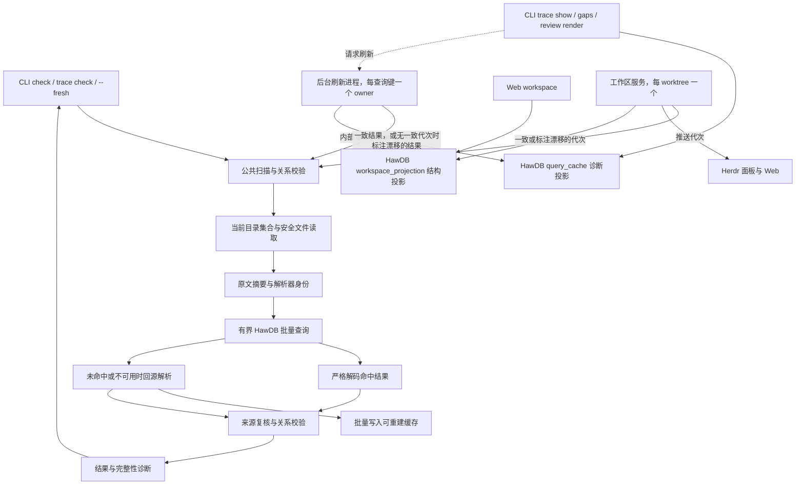

# Concord 架构与行为 Spec

## 目标与原则

Concord 让 Spec 成为软件的唯一事实来源，并为人与 coding agent 提供同一套工作方法：人审阅 Spec 的变化，agent 按 Spec 实现并用测试证明，Concord 检查三者是否一致（[为什么需要 Concord](why-concord.md)）。它是可安装到任意 Git 仓库的本地 CLI。

文档的分组、位置与字段见[文档模型](document-model.md)：身份与名称由路径和一级标题推导，只有推导不出的语义写在 frontmatter（[决策依据](design/sdd-core-model/DECISION.md)）。全部文件都可以直接编辑；Concord 从文件派生索引与反向关系，`concord check --since <base>` 检查变化是否合法。HawDB 只保存可重建缓存，事务恢复材料与缓存分开。跨功能规则见[宪法](constitution.md)，Web 界面设计见根目录 `DESIGN.md`。

## 代码结构

代码由 Effect 服务组成（[C-005](constitution.md#c-005-1)）。领域逻辑只依赖端口，文件、进程、时间、网络与缓存等副作用由基础服务提供；每种进程用一组 Layer 组合出自己被允许的能力。固定版本 Effect 已等价提供的能力直接使用，不重复实现；库未提供的保证（例如进程组清理确认、字节预算）由 Concord 的适配层补齐。

### 分层

| 层 | 内容 | 依赖 |
| --- | --- | --- |
| 入口 | CLI 命令（`effect/unstable/cli`，`--version` 与各层 `--help` 由构建时从命令定义生成的静态数据输出）、HTTP 路由（`unstable/http`）、RPC 处理（`unstable/rpc`）、终端面板 | 应用端口 |
| 应用 | 每个用户操作一个 `Effect.fn`，输入、结果与错误由 Schema 定义；CLI、HTTP、action 与 RPC 调用同一个操作。应用端口包括 Queries | 领域服务与基础服务 |
| 领域服务 | Documents、Trace、Writing、Concepts、Issues、Memory、Designs、Tests、Code、Feedback；可以依赖其它领域服务，依赖关系无环，例如 Trace 依赖 Documents、Code 与 Tests | 领域服务、基础服务与模型 |
| 基础服务 | Workspace、Sources、Publication、Cache、Git、OwnedProcess，以及 `effect` 的 FileSystem、Path 与 Clock（Node 实现来自 `@effect/platform-node`） | 平台 |
| 模型 | Schema、纯函数与算法（解析、关系推导、写作规则），不依赖任何服务 | 无 |

领域与应用代码不直接导入 `node:fs`、`node:child_process`，也不读写 `process` 的 cwd、env、argv 与标准流。

### 模块布局

源码按层分目录，每个目录是一个模块，入口文件 `index.ts` 是模块对外的唯一出口，只导出本模块的接口，不转出其它模块的实现；模块之间只通过出口导入。产品运行时代码位于 `src/`、`web/`（浏览器前端）与 `native/hawdb/`（原生绑定）；`test/`、`bench/` 与 `scripts/` 是维护的 TypeScript 源码，分别拥有验证、性能场景与构建编排。

```text
src/
  model/        纯模型：Schema、Markdown 与 frontmatter 解析、文档身份推导、关系推导、写作规则、作用域与路径算法、步骤、代码引用
  base/         基础服务：installation、workspace、sources、publication、cache、git、process
  domain/       领域服务：documents、designs、trace、tests、code、issues、memory、constitution、writing、concepts、feedback、onboarding、docs-work
  app/          应用操作、Queries 端口与 ViewAction
  entry/        入口：cli、http（Web 工作台的服务端）、server（工作区服务的主进程、计算进程与操作进程）、lsp、panel
web/            浏览器前端，只调用 HTTP 接口
native/hawdb/   HawDB 的 N-API 绑定
```

下表说明每个 Feature 的架构职责边界；同一模块被多个 Feature 使用是正常的交叉职责。实际的实现归属由源码声明派生，不维护第二份登记：

| Feature | 模块 |
| --- | --- |
| [local-sdlc](feature/local-sdlc/README.md) | `domain/documents`、`domain/trace`、`domain/tests`、`domain/code`、`domain/issues`、`domain/memory`、`entry/cli`、`entry/lsp` |
| [document-packages](feature/document-packages/README.md) | `domain/documents`、`domain/designs` |
| [documentation-quality](feature/documentation-quality/README.md) | `domain/writing`、`domain/concepts`、`model` 的写作规则 |
| [project-onboarding](feature/project-onboarding/README.md) | `domain/onboarding`、`domain/constitution` |
| [feedback](feature/feedback/README.md) | `domain/feedback`、`domain/issues` |
| [neutral-project-governance](feature/neutral-project-governance/README.md) | `domain/tests`（runner 与 adapter）、`domain/docs-work` |
| [local-data-engine](feature/local-data-engine/README.md) | `base/cache`、`native/hawdb`、`entry/server` |
| [portable-coordination](feature/portable-coordination/README.md) | `base/publication` |
| [web-workbench](feature/web-workbench/README.md) | `entry/http`、`web/` |
| [herdr-panel](feature/herdr-panel/README.md) | `entry/panel` |
| [cross-platform-release](feature/cross-platform-release/README.md) | `base/installation`、`scripts/` 与 `native/hawdb` 的发行构建 |

同一职责只有一个实现：一个关系编译器、一个文档解码器、一个 publication 协议。

### 依赖规则

| 模块 | 可以导入 |
| --- | --- |
| `model` | `effect`、纯解析依赖白名单（`yaml`、`mdast-util-*` 与 `micromark-*`、`mdast` 类型）、`node:crypto` 的摘要函数，以及其它 `model` 模块；不做文件读取、动态加载、时间、随机数、进程状态或缓存实例 |
| `base` | `model`、平台层与 `native/hawdb` 的 TypeScript 绑定；不导入领域或应用 |
| `domain` | `model`、`base` 与下表中排在它之前的 `domain` 模块 |
| `app` | `domain`、`base`、`model` |
| `entry` | `app` 与 `model`；只有各入口的组合根 `entry/<入口>/main.ts` 可以导入 `domain` 与 `base` 的 Layer 以及其它入口模块的出口；入口的其它文件互不导入 |

领域之间的依赖按以下层级，只能依赖排在前面层级的模块；同一层级的领域互不依赖，需要同层能力时由 `app` 编排或提取共享的纯模型：

1. `documents`：owner 读取、inventory 与精确引用解析；
2. `concepts`、`constitution`、`designs`、`issues`、`memory`、`docs-work`：各自拥有生命周期与采用操作，`issues` 拥有远端写入与 IssueProject 端口，`docs-work` 拥有写集规划与 scoped-clean 规则；
3. `writing`（依赖 `concepts`）、`code`、`tests`；
4. `trace`（依赖 `documents`、`code`、`tests`、`constitution`）、`feedback`（依赖 `issues`）、`onboarding`（模板、配置与初始化规则，依赖 `documents`、`concepts`、`constitution`、`writing`）。

一个入口需要启动另一个入口时（`concord view` 启动 HTTP 服务、`concord lsp` 启动语言服务），由该入口自己定义启动端口，组合根用对方入口的实现提供；协议实现留在对方入口，`app` 不感知传输。

跨领域的编排在 `app`：分析观察对关系结果的补充、初始化与配置治理、步骤改写、docs work 的检查与收尾。`code` 不回调 `trace`，`concepts` 不依赖 `writing`，共享的作用域与路径算法在 `model`。

`node:fs`、`node:child_process`、`node:net` 与 `process` 的 cwd、env、argv、标准流只在 `base` 与 `entry` 中出现。架构测试 `test/architecture.test.ts` 同时检查导入与导出图（含 `import type`、类型导入节点、字面 `import()` 与可静态枚举的内部动态目标；无法枚举的内部动态目标即失败）与 AST 中的平台能力访问；消费项目模块的动态加载只允许在受控的进程入口。领域之间的值依赖与类型依赖分别报告，二者都必须无环。

### 公开接口

安装包只导出四个子路径：

- `concord-sdlc/config`：`concord.config.ts` 的类型；
- `concord-sdlc/model`：文档 Schema 与模型类型；
- `concord-sdlc/test-adapter-protocol`：原生测试 adapter 的协议；
- `concord-sdlc/change-preview`：PR 静态预览产物的 Schema。

其余模块是内部实现，不导出。CLI 入口是 `concord` bin。

### 测试布局

测试目录对应[测试架构](engineering/concord-self-hosting/test-architecture.md)的层：`test/model/` 与 `test/domain/` 从 `src/` 导入；`test/cli/` 运行本次打包安装的 bin，`test/process/` 还可以运行该安装包中的工作进程入口。`test/process/` 中验证源码运行与原生构建的检查是例外；`test/e2e/` 是浏览器测试；`test/architecture.test.ts` 检查依赖规则。测试不导入或运行 `dist/`。

### 基础服务

| 服务 | 职责 |
| --- | --- |
| Installation | 安装包根、源码运行时的根、原生产物的定位（源码运行取自经身份校验的共享缓存，安装后取自包根）、模板与 skill 资源、工作进程入口 |
| Workspace | worktree 根、Git-private 目录与安装身份；配置快照在每次操作与刷新时重新读取与核验，不作为进程期事实缓存 |
| Sources | 路径安全的读取、乐观快照与返回前核验 |
| Publication | 租约、journal、原子替换与恢复；租约以 `Effect.acquireRelease` 在 Scope 中持有。发布前检查与恢复需要的领域校验（写作政策、概念目录、步骤重命名规划）经它要求的 `PublicationValidation` 端口取得：端口定义在 `base`，实现在 `app`，由入口的组合根提供，缺少时 Layer 无法构建 |
| Cache | 解析缓存（内存或持久）、只读快照（`CacheSnapshot`，进程内不可写的行，不经内存 HawDB）、持久命名空间的独占写入，三种能力分开提供；计算进程另有 `CacheDerivations`，只在请求内收集新产生的派生行，随结果交回主进程写入，不持有句柄或写入能力 |
| Git | 状态、diff、提交与 worktree 操作 |
| OwnedProcess | 用 `unstable/process` 的 ChildProcess 启动与发送信号；Concord 负责后代清理确认、TERM 到 KILL 的上限、输出预算、清理未知时的隔离与结果记录。leader 成功退出也核对后代 |

### 应用端口 Queries

Queries 是白名单只读查询的应用端口，有两个实现：`Queries.Local` 调用同一应用查询，`Queries.Remote` 是工作区服务的 RPC 客户端。CLI 按[工作区服务](feature/local-data-engine/architecture.md#cli-查询)的规则选择。两者实现同一份完整的操作定义：输入模式、领域结果与错误 Schema，以及从结果到退出码的同一映射；公开输出只在入口生成一次。Remote 把传输失败（断线、超时、编码失败）在适配层归类为本进程重算或既有的服务失败，不把 RPC 包装错误当作领域错误输出，也不为等待重连突破回退的截止时间。

### 服务操作

工作区服务的每个应用操作只定义一次：名称、输入、结果与错误 Schema、准入与取消、执行位置、当前或历史语义，以及发布后是否申请刷新。RPC 与 HTTP 是适配层：RPC 负责二进制序列化与帧准入，HTTP 负责 Host/Origin 校验、请求体上限、状态码、ETag 与安全头；SSE 是 `subscribe` 的 HTTP 编码，保留慢消费者合并与 `stopping` 事件。静态资源、p5 frame 与 SPA 页面只属于 HTTP（[决策依据](design/workspace-runtime/DECISION.md)）。

| 操作 | 执行位置 | 语义 | HTTP | RPC |
| --- | --- | --- | --- | --- |
| `hello`、`shutdown`、`http` 租约 | 主进程 | 控制 | — | 控制帧 |
| `subscribe` | 主进程 | 内存中的当前代次与之后的事件 | `GET /api/events`（SSE） | 是 |
| `workspace` | 主进程 | 已接受代次（历史） | `GET /api/workspace` | 是 |
| `refresh` | 主进程申请，计算进程执行 | 申请刷新，不等待 | `POST /api/workspace` | 是 |
| `read` | 计算进程 | 当前来源的定向严格读取；RPC 返回原始字节与信封，HTTP 返回 `ViewFile` | `GET /api/file` | 是 |
| `query` | 计算进程 | 白名单当前查询，见[CLI 查询](feature/local-data-engine/architecture.md#cli-查询) | — | 是 |
| `git-status`、`git-diff` | 计算进程 | 当前 Git 状态与定向 diff | `GET /api/git`、`GET /api/git/diff` | 是 |
| `p5-compile` | 计算进程 | 当前来源捕获与编译，编译器经 `OwnedProcess` | `POST /api/p5/compile` | — |
| `action` | 操作进程（写入、恢复与反馈）；`cache.*` 转给主进程维护 | 现行 ViewAction；写入后申请刷新 | `POST /api/action` | — |
| `job-start`、`job-list`、`job-cancel` | 主进程监督，runner 经 `OwnedProcess` | 单槽任务；浏览器断开不取消，取消确认子进程组退出后才释放 | `POST /api/jobs`、`GET /api/jobs`、`DELETE /api/jobs/:id` | — |
| `cache-clear` | 主进程 | 见[清理](feature/local-data-engine/architecture.md#清理) | 经 `action` | 是 |
| `feedback-merge` | 主进程 | begin、append、commit，commit 原子生效 | — | 是 |

`feedback.sync` 与 `feedback.check` 的 HTTP 请求断开时取消外部操作，任务不随连接取消。`view export` 只在 CLI 本进程执行。

### 进程能力

| 进程 | 提供 | 不提供 |
| --- | --- | --- |
| CLI | Workspace、Sources、Publication、Git、OwnedProcess、Cache（内存；无服务时持久）、Queries（Remote 或 Local） | — |
| 工作区服务主进程 | Workspace、Git、Cache 的持久独占写入、工作区投影、RPC 与 HTTP 服务、计算与操作进程的监督；Publication 只在清理作用域中、关闭持久库之后提供 | 领域计算 |
| 计算进程 | Workspace、Sources、Cache（内存解析、主进程交来的只读快照与 `CacheDerivations`）、Queries.Local；RPC 经标准输入输出，结构以 JSON 编码、入口按计算请求 Schema 严格解码，来源原文以二进制字节帧传输；日志只写标准错误 | Publication、持久 Cache、OwnedProcess 之外的子进程 |
| 操作进程 | Workspace、Sources、Publication、Git、OwnedProcess、Cache（内存）、远端读取；发布后经 `feedback-merge` 更新远端观察 | 持久 Cache |
| 面板 | RPC 客户端与终端渲染 | 文件与缓存 |

每个入口的 Layer 构建在测试中验证：缺少能力时编译或构建失败，不在运行时才发现。

### 采用的 Effect 能力

| 需要 | Effect 能力 | Concord 补齐 |
| --- | --- | --- |
| 资源生命周期 | Scope、`Effect.acquireRelease`、`Layer.effect` | — |
| 工作区服务协议 | `unstable/rpc`（请求关联、具名错误、取消、结果流）经 `unstable/socket` | 客户端协议的序列化采用 `RpcSerialization.layerSchemaBinary`（计算进程的内部 RPC 除外：固定版本的 SchemaBinary 无法编译含共享字面量前缀的元组联合，结构改用 JSON），字节字段以原生二进制传输，由真实往返与边界大小测试验收，不接受 Base64；领域 Schema 显式拒绝额外字段；单帧、累计、连接、在途与发送字节的准入由传输适配层执行，`maxBufferSize` 只限不完整消息；`feedback-merge` 以 begin、append 与 commit 分块提交，commit 原子生效 |
| 当前状态与订阅 | SubscriptionRef | 每个订阅只保留最新状态，慢订阅的旧状态被替换，计入发送预算 |
| 合并监听事件与补偿刷新 | Stream 与 Schedule | 去抖有最长等待（两秒），扫描期间只合并一次后续刷新 |
| 串行维护 | Semaphore | 只在进程内互斥；服务锁、publication 与超时各自裁决 |
| 在途请求与取消 | FiberMap、FiberSet | 键为实例、连接与请求身份；中断不替代进程组回收与 60 秒超时 |
| 启动就绪 | Deferred | — |
| HTTP 与静态资源 | HttpRouter、HttpStaticServer | Host/Origin 校验沿用现行规则 |
| 测试中的时间与协议 | TestClock；RpcTest | 服务的状态机与计时在测试进程内以 Layer 加 TestClock 验证；TestClock 不抢占同步计算，也不产生文件或进程事件，计算与操作进程、服务锁、进程退出与清理确认用真实进程验证。RpcTest 只验证逻辑；公开输出等价用真实序列化验收 |
| 性能剖析 | `Effect.fn` 的 span，按需经 `unstable/observability` 导出 | — |

## 初始化与项目治理

`concord.config.ts` 可以不存在；存在时运行时只读取这一个静态 TS 配置文件，不执行模块。配置项与默认值见[维护项目配置](feature/project-onboarding/use-case/maintain-project-config.md#配置项)，journal 分类与恢复授权见[项目接入架构](feature/project-onboarding/architecture.md)。配置快照拥有原文前像、路径与摘要，写入与恢复使用同一协议。

Memory 固定位于 worktree 根的 `memory/`。`docs/constitution.md` 存在即启用，`status` 为 draft 或 active；docs 下的页面在依据规则的句子旁链接条款或款的 ID，`check` 校验这些链接，反向引用由 `constitution show` 派生。宪法不充当测试 Spec 或自动合规证据。根 `DESIGN.md` 可选。

## 领域与 CLI

`concord --root <repo>` 指定消费者，省略时取 cwd 所在 Git worktree 的顶层。命令面、调用、输出、退出码与错误由 [local SDLC 的 CLI 页](feature/local-sdlc/cli.md)拥有；命令是执行需要运行的步骤的助手，例如修复核验、Design 裁决与 Roadmap 采用。`--skill [topic]` 在任意 cwd 读取随包 Agent 指引，不加载 host、不写文件。

只有 `test run`、`test verify` 与 `issue close --fixed` 启动仓库命令；`check` 不执行测试，`check --since` 在重放修复核验时执行。`review render` 生成本地审阅材料，不写 GitHub。`docs work` 见[并行切分文档工作](feature/neutral-project-governance/use-case/coordinate-docs-work.md)。

## 存储 Spec

文档的位置、身份与字段由[文档模型](document-model.md)与[领域与数据所有权](feature/local-sdlc/library.md#owner)拥有。模板随工具包安装，由严格 manifest 校验；`new` 与 init 用模板创建文件，模板是作者提示，不是完成状态或验收证据。init 生成布局、`docs/concord.md`、`docs/_template/` 参考模板，以及缺失的 `docs/README.md`、`docs/concepts.md` 与 `docs/architecture.md`；根 `AGENTS.md` 保留既有正文，追加或刷新一个带边界的托管区块。

测试关联是测试源码中的 Concord 标记：`@feature <path>` 或 `@use-case <path>`，可附 `@issue <path>`、`@status retired` 与 `@name`。测试身份由文件和标记派生为 `neref_...`，反向关系由当前源码派生，不写回 Spec。标记语法与发现范围见[发现测试](feature/local-sdlc/use-case/discover-annotated-tests.md)。

HawDB 位于 Git-private `cache.hawdb`，只拥有可重建缓存。查询核对路径集合、内容摘要与解析器和 schema 身份，命中仍严格解码。损坏、schema 不符或写入失败时回源编译，不返回陈旧结果。

缓存只保存解析结果和投影，不缓存授权或修复核验的判定。一次事务更新同一代投影；源文件不在事务内，通过前后摘要检测读取漂移。状态检查、clear 与 dry-run 的行为由[统一缓存 Use Case](feature/local-data-engine/use-case/use-unified-cache.md)拥有。

HawDB 句柄的所有权、只读与可写打开、dry-run 与 cache-off 的行为见[数据引擎架构](feature/local-data-engine/architecture.md#句柄与打开模式)。每个 worktree 最多一个[工作区服务](feature/local-data-engine/architecture.md#工作区服务)长期持有持久缓存、刷新工作区投影并向 Herdr 面板、Web 与 CLI 提供领域结果；持久缓存被占用时，可重建的解析缓存改用内存缓存，命令照常完成。

文档解析、静态配置解析、代码解析及 Git 测试基线使用有界 HawDB 内存命名空间，不另存解析结果 Map。每篇文档每个进程最多解析一次，元数据、标题锚点、steps 与链接事实取自同一棵语法树。当前源文件集合和字节每次读取。配置的进程内解析命中不重新打开持久库；缓存只拥有严格解码的配置值，不拥有仓库路径验证或访问授权。

CLI 与 Web 的全局扫描共用文档 inventory、测试扫描、代码扫描与引用校验。集合解析按批读取和写入缓存，逐文件保留解析失败；大批键查询使用有界命名空间扫描后选择请求的键，单键查询保持定向读取。当前来源查询的临时结果只属于当前调用。Web 工作区导航独立读取异步结构投影，不把历史代次用于当前事实授权。缓存命中仍核对原文摘要、解析器身份和 Schema，来源前后核验保留。

同次关系图编译复用相同引用与目标类型的解析结果。读取的目标及 README 边界在返回前逐一复核字节和安全路径；变化或复核失败保留 finding，不能返回完整图。临时引用结果随本次编译结束释放，不跨请求保存。



cache clear 在独占 publication lease 下执行，锁、删除阶段与保留规则见[数据引擎架构](feature/local-data-engine/architecture.md#清理)。clear 只删除 cache.hawdb 内的缓存数据，不删除源 owner、journal 和 Memory。

init 作用于 Git worktree 顶层，子目录项目与 bare repo 明确拒绝。

Roadmap 采用把目录移入 `docs/feature/`，集合内的相对链接改写，集合外链接保持原目标；规则见[采用 Roadmap](feature/local-sdlc/use-case/plan-and-adopt-contracts.md)。

Trace 与定向 Review 按 owner 汇总 Feature supporting page 与 Use Case 的测试关系，保留 exact path 与 anchor，不用目录前缀混入相邻 Feature。默认输出供人阅读，`--json` 输出结构化结果。

读写路径拒绝绝对路径、traversal、symlink 组件和超出仓库的 realpath。扫描只读取 Concord 所属目录和格式，错误的受管格式明确报错。

## 发布协调

Git-private 状态通过 `git rev-parse --git-path concord` 定位，每个 worktree 独立；journal 绑定 root 与 privateDir。发布协调只使用 Node 文件 API，见[可移植协调架构](feature/portable-coordination/architecture.md)（[决策依据](design/portable-publication/DECISION.md)）。

支持同主机、同 PID 命名空间内的 Linux 与 macOS 本地工作树，不保证网络多机协调与 Windows 执行。macOS 上防护大小写、Unicode 路径碰撞和 symlink。

普通来源查询不取得 publication lease。读取记录文件前像、缺失路径和目录集合，返回前验证观察集合与 publication.revision；合作发布开始与结束均推进随机代次，变化返回 SourceChanged。未完成 journal 仍阻断当前事实结果。缓存快照查询不加载来源 Repository。

普通文档写入的规划采用乐观读取，提交阶段才取得独占 publication lease，复核配置、全部观察与完整前像，写入 journal 后逐文件原子 rename。冲突拒绝覆盖；恢复与 Issue 关闭保持独占协调。显式低层写 snapshot 可保护必须串行化的状态转换，不能用于普通来源查询。

publication owner 通过临时目录 fsync 与 rename 公布，正常释放与死亡恢复只删除准确 token，不按年龄抢占，不递归删除 lease 目录。发布协调不持有持久缓存句柄；写入、发布与恢复不依赖工作区服务。不同协调协议的程序不得同时访问同一 worktree。

trace show、trace gaps 与 review render 默认读取 HawDB 中已完成的诊断投影，并请求后台刷新。输出明确标记历史性、构建时间及刷新错误；首次无缓存返回 QueryPending。--fresh 等待当前来源结果。完整 Spec 见[异步诊断投影](feature/local-data-engine/use-case/query-asynchronous-projections.md)。check、trace check、当前来源检索及证据裁决不使用历史投影授权成功。

`concord recover` 先回收已死 token，再在独占保护下选择唯一的普通或 Trace journal。多 journal 冲突先于 runner 具名拒绝并保留现场。恢复入口获锁后重查类型和现场，只在内容符合 preimage 或 planned digest 时恢复。

恢复完成后重新取得短独占快照，核验协调路径上的 journal 与 runner。init 回滚后不要求配置文件仍在。并发发布可使核验 Busy，此时 journal 结果不能称为恢复完成。返回值保留 `journalStatus` 并附带 coordination。

runner 为 blocked 时 CLI 失败退出，初次检查已 blocked 时不开始 journal 恢复。dry-run 执行同一规划校验，不发布 owner、journal 或缓存。短协调可能创建 Git-private 目录。`recover` 不接受 dry-run。

CLI 与 Web 测试共用独立 `runner.lease`，长执行不占文档 lease。run 状态区分 running、finalizing、quarantined；只有同主机活进程的 running 允许发布，且发布前持久标记该 run 失效，A→B→A 与回滚不撤销失效标记。

run 结束时在新快照中核对起止 candidate、配置、定义、Spec、失效与清理结果，再写入结果。父进程死亡不授权回收 runner，清理未知时保持阻断。最终快照无法取得时留下只收紧权限的 token-bound quarantine 标记。此协议不观察不合作编辑器的每次瞬时修改。

## 操作依赖与资源边界

各命令的读取范围、完整性诊断与需要完整图的结论见 [local SDLC 架构](feature/local-sdlc/architecture.md#操作依赖)，访问模式见[可移植协调架构](feature/portable-coordination/architecture.md#access-modes)，跨功能规则见 [C-013](constitution.md#c-013)。

来源读者不创建 publication token。返回当前结果前核验观察集合与发布代次；写者在 journal 删除前推进代次，完整发布即使发生于同一个独占区间内也能被读者检测。普通提交只删除自身 owner。

未知文件、其它 exclusive token 或身份改变时保留现场并拒绝。任一活 owner、host 不匹配、EPERM、PID 复用或未知 owner 都保留现场。fsync 或核验失败时保留具名错误和可恢复现场。

recover 返回 operation、journal 结果、changedPaths 和 coordination；publication 列出 reclaimedTokens。runner 状态为 absent、running 或 blocked，blocked 带具名原因。无事务且 runner 为 absent 或健康 running 时返回 clean。

runner 不确定时返回 blocked，并保留 journal 的实际处理结果。初次检查已 blocked 时，journalStatus 为 pending 或 clean，changedPaths 为空。journal 恢复后 runner 变为 blocked 时，保留 journalStatus，总 status 为 blocked。recover 不删除 runner.lease、run state、证据或未知文件。

未完成的多文件 journal 阻断普通快照。来源扫描按当前配置和安全目录读取，文件名不推导作者 ID。协调细节见[可移植协调架构](feature/portable-coordination/architecture.md)，文档读取职责见[本地 SDLC 架构](feature/local-sdlc/architecture.md)，随包步骤由 `concord --skill recovery` 提供。

## Design 逐项比较与裁决

候选比较、裁决与暂缓的行为见[逐项比较方案并明确裁决](feature/local-sdlc/use-case/compare-design-plans.md)。候选来自 `plans/` 的直接子项，裁决是 DECISION 中的 `Selected:` 行；可以直接编辑，`design decide` 与 `check --since` 用同一规则校验。已裁决的 Design 是决策记录（[C-012](constitution.md#c-012-7)）。

## 测试执行与修复核验

项目配置中的 runner 命令是用户声明的验收单元。Concord 报告命令的退出结果与可观察到的执行数量，不声称收集或证明 runner 的每个子 case，不构成正式 E2E、可靠性证书或覆盖证明（[C-004](constitution.md#c-004-1)）。runner 在消费者 cwd 下以 shell=false 执行，有 timeout；取消或超时清理进程组，信号或启动失败不记为通过。命令由项目作者信任与维护。

Issue 以 fixed 关闭前的修复核验见[核验修复并关闭缺陷](feature/local-sdlc/use-case/resolve-with-command-evidence.md)与 [local SDLC 架构](feature/local-sdlc/architecture.md#修复核验)：同一冻结命令在缺陷候选上以非零结果结束、在被接受的快照上通过，结论写入 Issue，可在声明的输入与环境下重放（[C-004](constitution.md#c-004-2)）。

## 测试标记与缓存身份

测试标记的身份只保证当前扫描集合唯一，测试演进由 Git 保存。开发者直接编辑标记并以 Git 审阅；Web 的源码保存只替换配置范围内既有的 JS/TS 文件，使用完整文件摘要与受限恢复日志。scan 与 check 不改写源文件。

测试标记不核对 runner import，不把函数名 `test` 当成测试声明。`@status retired` 的标记不能用于修复核验；命令结果的执行数量为 unknown，或由默认 Node TAP 计数观察为 nonzero、zero、skipped，零执行或全跳过的运行不计为修复核验的 red 或 green。

缓存身份包含 worktree 的 root 与 privateDir、测试与源码目录、runner 配置、完整路径集合、每文件字节摘要和解析器身份。关系验证始终使用当前 Markdown；修复核验从当前源码重新构建，不信任缓存的状态判断。

## 代码归属声明

Code Declaration 是维护者对实现与 Spec 关系的显式声明，源文件是唯一 owner。`implements` 边不成为测试声明、覆盖率、完成状态或修复核验的依据。查询引用的派生规则见[代码声明引用](feature/local-sdlc/architecture.md#代码声明引用)（[决策依据](design/derived-code-reference/DECISION.md)）。

`sourceIgnore` 按[发现 Spec](feature/local-sdlc/use-case/discover-annotated-tests.md)缩小源码与测试自动发现范围；配置参与快照身份，扫描、复核与监听共用同一匹配规则。

`sourceRoots` 默认为存在的 `src/`，配置后替换默认值，沿用安全路径验证。只扫描显式根内的 JS/TS，允许与 testRoots 重叠。代码声明解析按文件缓存在 HawDB 中，键包含 worktree、解析器身份、路径和字节摘要；命中仍严格解码，摘要不符、损坏或写失败时回源。

当前事实门禁的归属、关系和 fixed 判断从当前来源计算。诊断展示可缓存带构建时间的历史关系与缺口，不授权当前裁决。扫描核对前后文件集合及摘要。未改动的配置解析可命中同一库，使后续命令不加载 TypeScript 编译器。

三种 scope：文件头 `@concord-file`；紧邻完整 AST 节点的 `@concord-code`；同一 statement-list 内连续语句的 `@concord-begin/end`。范围标记无参数，一个 scope 最多一份声明，多目标通过相邻 implements 表达。

node 白名单为有 body 的函数声明与方法、类声明，以及单 identifier 且直接 arrow 或 function initializer 的变量语句。region 不嵌套、不截断表达式、不跨语句列表，可以包含完整函数。查询返回全部包含关系，不推断覆盖或继承。

绑定与孤立标记诊断消费真实 TS comment ranges，不从纯文本行认领字符串、模板、正则或 JSX 中的伪标记。含真实代码标记且有语法错误的文件不产生有效声明。起始块内 implements 必须连续相邻，语法与位置规则见[使用指引](../skills/concord/references/code.md)。

目标支持 Feature、Use Case 与 Engineering，沿用 owner、supporting page 与 anchor 解析，只拒绝重复 exactRef。Feature 反查汇总自身与 Use Case；Engineering 汇总自身与支持页面。反查按自动引用去重，保留匹配的 exactRefs。

引用由 canonical 源路径、scope 与完整 AST 结构位置派生，不含行号、函数体或关联目标。命名节点的定位路径与同描述前序兄弟不变时，普通编辑保持引用。文件移动、改名、作用域和顺序变化可能使引用失效或复用。引用不是永久身份、CAS 或授权，调用方须重新 list 或 locate。派生算法见[代码声明引用](feature/local-sdlc/architecture.md#代码声明引用)。

`code annotate` 与对应 action 不接收或返回 ID，在乐观 snapshot 中验证指定 canonical reference、归属链、类型和 anchor。`code list` 与 `code locate` 提供声明查询。Web 以符号、位置和显式关联呈现实现。无效 begin 仍参与边界检查，普通扫描不写源码。

代码错误阻断 code、check、trace、review 与 doctor。test list、show、run 与 verify 不包含代码投影，保留全部文档与测试关系校验；修复核验的输入不包含 code 引用。

## 测试接入边界

测试执行归项目：Concord 只通过配置的 runner 与可选 adapter 运行测试并做修复核验，所有权见[治理边界](feature/neutral-project-governance/architecture.md)，接入边界见[项目测试接入边界](repository-profile.md)（[决策依据](design/sdd-core-model/DECISION.md)）。消费者拥有 runner、执行副本与清理，以及产品构建、Preview、Examples、部署与 PR 组合。静态 trace 与 Web 不加载 host，不要求 lanes 或 executor。

## Web 工作台与 Herdr 面板

`concord view` 提供随包分发的 React 工作台，`concord panel` 在终端中提供只读的 [Herdr 面板](feature/herdr-panel/README.md)，两者都是工作区服务的客户端。Web API 与 CLI 结构化 action 共用完整应用校验；Web 保存以整文件摘要防止覆盖并发的外部编辑，变化是否合法由差异门禁判断。行为、信任边界与工作区导航投影见 [Web 工作台 Spec](feature/web-workbench/README.md)与[工作台架构](feature/web-workbench/architecture.md)，界面设计见根目录 `DESIGN.md`。

## 文档写作检查

写作政策、术语作用域与聚合门禁由[文档写作 Spec](feature/documentation-quality/README.md)拥有，规则格式见 [policy](feature/documentation-quality/policy.md)。CLI 与 Web 共用领域操作，静态命中不作为执行证据。

## 工程知识与本地观察

Memory 与 Issue 的索引、检索与更新由[记忆工具 Spec](feature/local-sdlc/use-case/recall-and-maintain-memory.md)与[本地观察 Spec](feature/feedback/use-case/manage-local-observations.md)拥有，读取范围见上文“操作依赖与资源边界”。

## 验收

独立安装包不含 `workspace:*`、外部仓库路径或运行时 import。构建产物是带 shebang 的 Node CLI，pack 为 tarball，在仓库外临时消费者安装后使用其 bin。

真实闭环：init → 写 Feature 与 Use Case → 写 Issue → 提交带 `@issue` 的失败回归测试并配置 runner → 提交修复 → `issue close --fixed` → `check --since` → trace 与 review。另覆盖错误引用、未核验的 fixed、伪造的 verification、测试源码变化、重开、退役、缓存删除与损坏、注释变化后的缓存失效、悬空与重复标注、跨 cwd 与 root、路径穿越、写冲突、并发写、journal 恢复、超时清理和独立安装。

构建脚本使用 Effect FileSystem 和 ChildProcessSpawner；测试通过 Node test adapter 执行 Effect，用 tsx 加载 TS，并纳入 typecheck。发行 tgz 携带 Linux x64/glibc 与 macOS arm64 原生产物，绑定源码、ABI、revision 和摘要；平台构建完成后统一打包，在目标平台安装同一份包验收。

`pnpm check` 构建后检查测试与脚本类型，再执行领域、恢复和 package smoke；公开 CLI 验收使用独立安装后的命令。性能预算由 `pnpm bench` 按[性能验收](engineering/concord-self-hosting/performance.md)的测量路径单独判定，不进入 `pnpm check`。
