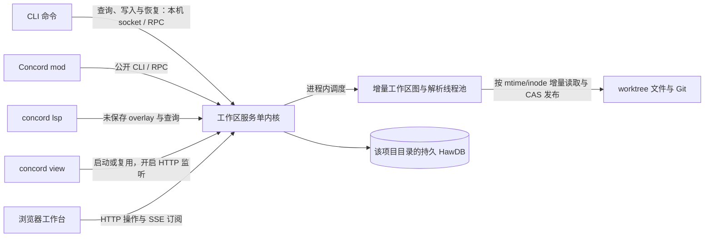
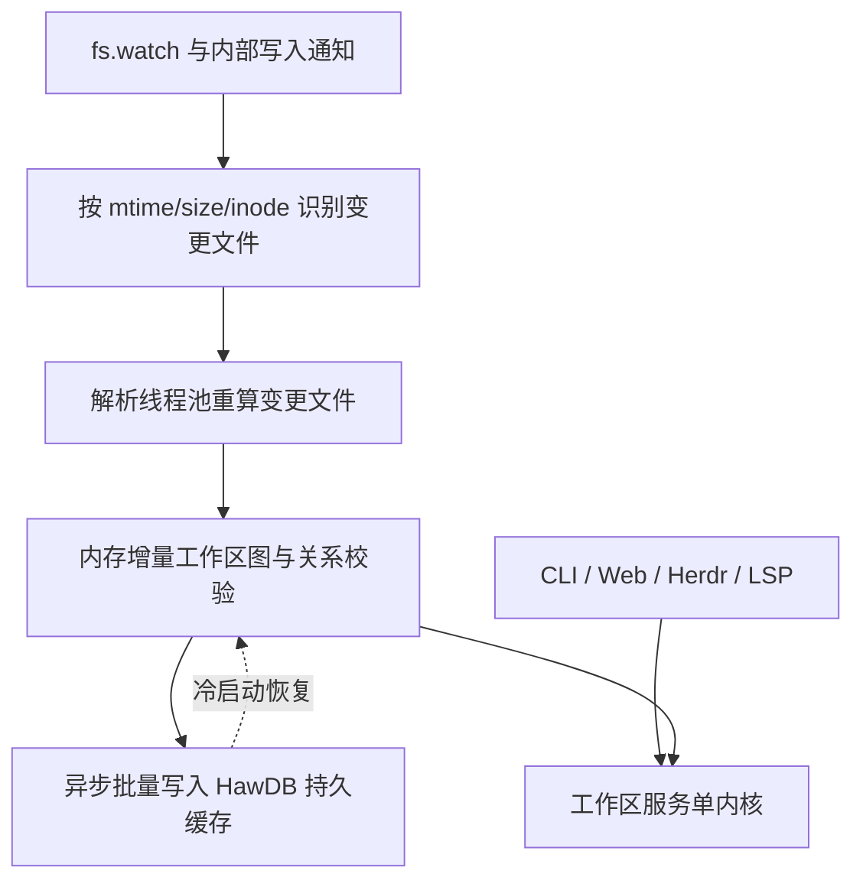

# Concord 技术架构

## 目标与原则

Concord 让 Spec 成为软件的唯一事实来源，并为人与 coding agent 提供同一套工作方法：人审阅 Spec 的变化，agent 按 Spec 实现并用测试证明，Concord 检查三者是否一致（[为什么需要 Concord](../README.md)）。它是可安装到任意 Git 仓库的本地 CLI。

Concord 只以 CLI 交付，不提供可导入的库。配置是静态数据；机器之间的接口是命令的 `--json` 输出、外部 adapter 在 stdin/stdout 上的 JSON 协议与导出产物，任何语言都能读写。需要校验时，用 `concord schema <名称>` 取得 JSON Schema，或运行对应的校验命令。使用者不导入 Concord 的模块、不调用内部入口，也不自行计算 Concord 的标识、摘要或签名：用例 ID 从 `concord test list --json` 读取，执行结果与修复核验由 `concord test run`、`concord test verify` 产生（[用自己的执行器接入](feature/local-sdlc/use-case/run-tests-with-own-runner.md)）。

文档的分组、位置与字段见[文档模型](document-model.md)：身份与名称由路径和一级标题推导，只有推导不出的语义写在 frontmatter。

全部文件都可以直接编辑。Concord 从文件派生索引与反向关系，`concord check` 检查它们是否一致。HawDB 只保存可重建缓存，事务恢复材料与缓存分开。

跨功能规则见[品味](taste.md)，Web 界面设计见[工作台视觉规范](feature/web-workbench/ui.md)。

## 运行形态

Concord 由 CLI、按需启动的工作区服务和浏览器工作台组成。使用者在当前目录运行命令，Concord 定位[项目目录](concepts.md#project-directory)，也可以通过 `concord --root <目录>` 显式选择。

每个项目目录最多一个工作区服务。同一项目下的不同子目录复用同一服务，不按命令启动位置重复创建。服务不按分支分配；在同一目录切换分支时，来源变化触发重新核验与刷新。

Concord 不规定分支或 worktree 的用法：直接在 main 开发、在同一目录切分支、使用多个 worktree 或独立 clone，都从选定的项目目录开始。不同项目目录的服务、缓存与发布协调状态彼此隔离（[适配项目的开发方式](taste.md#t-9)）。

协议相同的客户端都使用同一个服务，不论服务由哪个安装启动。项目定位、Git-private 目录、服务锁与握手是底层机制，完整规则由[工作区服务](feature/local-data-engine/architecture.md#工作区服务)拥有。

工作区服务是该项目目录唯一的常驻协调与计算内核，保持增量工作区图与解析缓存热，并为 Web、CLI 与编辑器提供统一入口（[一件事只写一次，其余推导](taste.md#t-3)）：

- CLI 的查询、写入、发布与恢复自动启动或复用服务，每次请求绑定调用者环境。协议相同就复用，不论服务由哪个安装启动；协议不同时换成当前安装的服务（见[启动与裁决](feature/local-data-engine/architecture.md#启动与裁决)）。
- 读写互斥、测试单槽任务与增量投影刷新在服务进程内通过内存锁与线程池调度，不派生独立的计算进程、刷新进程或预热操作子进程，也不跨进程搬运缓存快照与派生行。
- 浏览器操作与 `concord lsp` 共用同一服务内核与增量工作区图。

### 应用生命周期

| 阶段 | 行为 |
| --- | --- |
| 执行命令 | CLI 定位项目目录，连接或启动工作区服务（`--server=command` 或无服务模式在本进程运行同一内核）；结束后释放连接与本进程资源 |
| 启动服务 | 连接已有实例；没有可用实例时启动服务进程，由唯一的服务锁决定所有者 |
| 准备服务 | 主进程绑定 socket 并进入 `opening`，打开持久缓存、自动清理陈旧 journal、恢复工作区投影并初始化解析线程池 |
| 持续运行 | 单内核接收读写请求、维护增量工作区图、监督外部测试 runner 并持久化派生结果 |
| 维护缓存 | 停止受理相关新工作、关闭持久句柄后独占清理，完成后重新打开并刷新 |
| 停止服务 | 先通知订阅者，再收拢在途工作与外部 runner 子进程，最后释放资源 |

各阶段的补充规则：

- 启动服务的入口是 CLI 命令、`concord view`、`concord lsp` 与 `concord server start`。
- 准备服务时缓存打开失败，服务报告降级原因并用内存图继续服务。
- 持续运行时，来源监听与内部写入直接按变更文件增量更新工作区图，不启动独立的后台全量扫描子进程。
- 维护缓存前等待在途操作完成；服务锁全程保留。
- 服务在显式停止、项目目录消失，或无客户端且十分钟无请求时停止。最后释放的是句柄、socket、运行记录与服务锁。

完整状态机、超时与异常退出规则见[启动与裁决](feature/local-data-engine/architecture.md#启动与裁决)及[状态](feature/local-data-engine/architecture.md#状态)。外部 runner 子进程超时或被中断时，必须确认进程组已清理。

### Web 连接与退出

`concord view` 为选定项目目录的服务开启 HTTP 监听，默认地址为 `127.0.0.1:4317`。同一服务的相同地址共用监听引用；不同服务同时监听同一主机地址时要使用不同端口。浏览器通过 HTTP 读写，通过 SSE 接收投影与任务变化，不连接数据库。

HTTP 监听与工作区服务分别管理生命周期。退出 `view` 只释放它自己的监听引用；仍有引用或浏览器 SSE 连接时，监听继续存在。最后一个引用与连接结束后关闭监听，服务再按自身的空闲条件退出。关闭浏览器不取消已启动的测试任务。规则见[服务托管](feature/web-workbench/architecture.md#服务托管)。

默认启动的服务可以在启动它的命令结束后继续运行。`view --in-process` 需要新服务时，把服务子进程纳入当前命令的作用域，命令退出时回收；已有可用服务仍按复用规则处理。`concord server run` 在前台运行服务，`server status` 与 `server stop` 操作选定项目目录的实例。

CI 可以使用 `concord --server=command check`：服务属于本次命令，返回结果前完成回收。已有实例时拒绝接管；继承的作用域只允许同一项目目录，不能开启 HTTP。具体规则见[命令作用域查询](feature/local-data-engine/architecture.md#命令作用域查询)。

### 数据与信任边界

| 数据 | 所有者与用途 |
| --- | --- |
| Spec、代码、测试、配置与 Memory | worktree 中的文件是事实来源，由人、agent 与受校验的操作修改；Git 保存历史 |
| 服务锁、journal 与测试任务状态 | 项目目录对应的 Git-private 目录保存单实例锁与恢复材料，不能作为缓存删除 |
| 增量工作区图、远端观察与持久缓存 | 工作区服务单内核持有内存工作区图与 HawDB |
| 当前查询与历史投影 | 查询读取工作区图与投影；历史投影不授权写入或修复核验 |

没有服务时，当前命令按[打开模式](feature/local-data-engine/architecture.md#句柄与打开模式)使用 HawDB。历史投影的结果不授权写入或修复核验。

领域结果跨 CLI、RPC 与 HTTP 共用 Schema 和应用操作。各部分分别负责：

- 传输适配负责严格解码、请求预算与取消。
- 来源访问负责路径安全和前后核验。
- 发布负责前像校验与短期独占，见[发布协调](#发布协调)。

工作台面向可信的本地使用者。HTTP 默认只监听回环地址，没有身份认证；显式开放到其它网络地址，就是向可连接者授予仓库读写与测试执行能力。Host/Origin 检查及浏览器沙箱由[Web 工作台架构](feature/web-workbench/architecture.md)定义。

## 代码结构

代码按入口、应用、领域服务、基础服务与模型分层，只能依赖下层；`src/` 中每个目录是一个模块，只经 `index.ts` 出口导入。文件、进程、时间、网络与缓存等副作用由基础服务提供，每种进程用一组 Layer 组合出自己被允许的能力。分层、模块布局、依赖规则、基础服务与进程能力见[代码结构](engineering/code/architecture.md)。

## 初始化与项目治理

`concord.config.ts` 可以不存在；存在时运行时只读取这一个静态 TS 配置文件，不执行模块。配置项与默认值见[维护项目配置](feature/project-onboarding/use-case/maintain-project-config.md#配置项)，journal 分类与恢复授权见[项目接入架构](feature/project-onboarding/architecture.md)。配置快照拥有原文前像、路径与摘要，写入与恢复使用同一协议。

Memory 固定位于项目目录的 `memory/`。`docs/taste.md` 存在即生效，没有状态字段。

docs 下的页面在依据规则的句子旁链接品味条目或款的 ID，`check` 校验这些链接，反向引用由 `taste` 派生。品味不充当测试 Spec 或自动合规证据。设计说明按[文档模型](document-model.md#页面职责)放在所属 Spec 中。

## 领域与 CLI

`concord --root <目录>` 指定项目目录，省略时从当前目录定位。命令面、调用、输出、退出码与错误由 [local SDLC 的 CLI 页](feature/local-sdlc/cli.md)拥有。

命令是执行需要运行的步骤的助手，例如修复核验与 Roadmap 采用。`--skill [topic]` 在任意 cwd 读取随包 Agent 指引，不加载 host、不写文件。

哪些命令启动仓库命令见[执行管线](feature/local-sdlc/architecture.md#执行管线)；`check` 不执行测试。`review` 生成本地审阅材料，不写 GitHub。`docs work` 见[并行切分文档工作](feature/neutral-project-governance/use-case/coordinate-docs-work.md)。

## 存储 Spec

文档的位置、身份与字段由[文档模型](document-model.md)与[文档与标记格式](feature/local-sdlc/format.md#owner)拥有。

模板随工具包安装，由严格 manifest 校验。`new` 与 init 用模板创建文件；模板是作者提示，不是完成状态或验收证据。

init 生成布局、`docs/concord.md`、`docs/_template/` 参考模板，以及缺失的 `docs/README.md`、`docs/concepts.md` 与 `docs/architecture.md`。根 `AGENTS.md` 保留既有正文，追加或刷新一个带边界的托管区块。

测试关联是测试源码中的 Concord 标记：`@feature <path>` 或 `@use-case <path>`，可附 `@issue <path>`、`@status retired` 与 `@name`。测试身份由文件和标记派生为 `neref_...`，反向关系由当前源码派生，不写回 Spec。标记语法与发现范围见[发现测试](feature/local-sdlc/use-case/discover-annotated-tests.md)。

HawDB 位于 Git-private `cache.hawdb`，只拥有可重建缓存。文件读取按 `(mtime, size, inode)` 与内容摘要做增量核对，命中仍严格解码。损坏、schema 不符或写入失败时回源编译，不返回陈旧结果。

缓存只保存解析结果和投影，不缓存授权或修复核验的判定。工作区服务在内存中维护唯一一份增量工作区图，并异步刷入 `cache.hawdb` 作为冷启动持久层。状态检查、clear 与 dry-run 的行为由[统一缓存 Use Case](feature/local-data-engine/use-case/use-unified-cache.md)拥有，句柄的所有权与打开模式见[数据引擎架构](feature/local-data-engine/architecture.md#句柄与打开模式)。

CLI、Web、Herdr mod 与 LSP 共用工作区服务维护的同一张增量工作区图与[工作区投影](feature/web-workbench/concepts.md#workspace-projection)，解析结果怎样使用缓存见[缓存的使用与维护](feature/local-data-engine/architecture.md#缓存的使用与维护)。历史投影不用于当前事实授权。

cache clear 在工作区服务的写互斥下执行，锁、删除阶段与保留规则见[数据引擎架构](feature/local-data-engine/architecture.md#清理)。clear 只删除 `cache.hawdb` 内的缓存数据，不删除源 owner、journal 和 Memory。

读写路径拒绝绝对路径、traversal、受管目录下的 symlink 组件和超出仓库的 realpath。扫描只读取 Concord 所属目录和格式，错误的受管格式明确报错。

## 发布协调

发布协调通过工作区服务的进程内读写调度与轻量 CAS 前像校验，让多个命令与 agent 在同一项目目录读写而互不覆盖：读取直接访问当前工作区图，写入在提交阶段短期独占并核对目标文件摘要，中断后按单一 `journal.json` 恢复（[文件是界面，命令只是助手](taste.md#t-6)）。读取、写入与恢复的协议、错误和恢复结果由[可移植协调架构](feature/portable-coordination/architecture.md)拥有，支持范围见[跨平台标签发版](feature/cross-platform-release/README.md)。

Git-private 状态在创建工作区时通过 `git rev-parse --git-path concord` 解析一次并缓存，每个项目目录独立；journal 绑定 root 与 privateDir。

服务启动或执行恢复时，若发现未完成的 journal：目标文件仍等于前像或计划摘要时自动完成或回滚；若外部编辑器已修改目标文件，则以当前工作区文件为准清理陈旧 journal 并输出告警，不锁死仓库。

### 测试任务槽位 {#runner-租约}

CLI 与 Web 的测试共用工作区服务管理的单槽测试任务，长时间执行不阻塞文档读写。

1. 任务状态区分 running、finalizing 与 quarantined。
2. 文档或源码发布时，在内存中直接标记当前活跃任务失效。A→B→A 的编辑与回滚不撤销失效标记。
3. 任务结束时，核对起止 candidate、配置、定义、Spec、失效标记与进程组清理结果，再写入结果。
4. 外部测试子进程组清理未知时保持阻断。

## Design

Design 是一页还没定下来的取舍，见[记下一个还没定的取舍](feature/local-sdlc/use-case/compare-design-plans.md)。定下来后规则写进 Spec，页面删除（[Design](document-model.md#design)）。

## 测试执行与修复核验

项目配置中的 runner 命令是用户声明的验收单元，由项目作者信任与维护。Concord 报告命令的退出结果与可观察到的执行数量。它不声称收集或证明 runner 的每个子 case，也不构成正式 E2E、可靠性证书或覆盖证明（[证据的范围](feature/local-sdlc/README.md#证据的范围)）。runner 怎样执行见[执行管线](feature/local-sdlc/architecture.md#执行管线)。

修复核验证明同一冻结命令在缺陷提交上失败、在修复提交上通过，之后 Issue 以 fixed 关闭。可观察行为见[核验修复并关闭缺陷](feature/local-sdlc/use-case/resolve-with-command-evidence.md)，实现见[修复核验](feature/local-sdlc/architecture.md#修复核验)。

## 代码归属声明

Code Declaration 是维护者对实现与 Spec 关系的显式声明，源文件是唯一 owner。`implements` 边不成为测试声明、覆盖率、完成状态或修复核验的依据。

标记的作用域、绑定、目标、引用与查询规则见[代码声明](feature/local-sdlc/architecture.md#代码声明)，引用的派生算法见[代码声明引用](feature/local-sdlc/architecture.md#代码声明引用)，书写方法见[使用指引](../skills/concord/references/code.md)。

## 测试接入边界

测试执行归项目：Concord 只通过配置的 runner 与可选 adapter 运行测试并做修复核验。所有权见[治理边界](feature/neutral-project-governance/architecture.md)，接入边界见[项目测试接入边界](feature/local-sdlc/README.md#测试的边界)。

消费者拥有 runner、执行副本与清理，以及产品构建、Preview、Examples、部署与 PR 组合。静态 trace 与 Web 不加载 host，不要求 lanes 或 executor。

## Web 工作台与 Concord mod

`concord view` 提供随包分发的 React 工作台，是工作区服务的客户端。[Concord mod](feature/herdr-mod/README.md) 在 Herdr 中提供完整的阅读、初始化与编辑，通过公开 CLI 查询结构化数据，正文读写与文件监听由 mod 负责。

Web API 与 CLI 结构化 action 共用完整应用校验；Web 保存以整文件摘要防止覆盖并发的外部编辑。行为、信任边界与工作区投影见 [Web 工作台 Spec](feature/web-workbench/README.md)与[工作台架构](feature/web-workbench/architecture.md)，界面设计见[工作台视觉规范](feature/web-workbench/ui.md)。

## 文档写作检查

写作规则、术语表的生效范围与合并检查由[文档写作 Spec](feature/documentation-quality/README.md)拥有，规则格式见 [policy](feature/documentation-quality/format.md)。CLI 与 Web 共用领域操作，静态命中不作为执行证据。

## 工程知识与本地观察

Memory 与 Issue 的索引、检索与更新由[记忆工具 Spec](feature/local-sdlc/use-case/recall-and-maintain-memory.md)与[本地观察 Spec](feature/feedback/use-case/manage-local-observations.md)拥有，读取范围见[操作依赖](feature/local-sdlc/architecture.md#操作依赖)。

## 验收

发版归档携带内嵌 Bun 运行时的单个编译可执行文件与 ripgrep，不依赖 `workspace:*` 或外部仓库路径。解压后使用内嵌运行时执行 `bin/concord`，构建入口见[归档构建](engineering/testing/README.md#归档构建)。

真实闭环：init → 写 Feature 与 Use Case → 写 Issue → 提交带 `@issue` 的失败回归测试并配置 runner → 提交修复 → `issue close --fixed` → trace 与 review。

闭环之外还覆盖：错误引用、未核验的 fixed、伪造的 verification、测试源码变化、重开、退役、缓存删除与损坏、注释变化后的缓存失效、悬空与重复标注、跨 cwd 与 root、路径穿越、写冲突、并发写、journal 恢复、超时清理和独立安装。

构建脚本使用 Effect FileSystem 和 ChildProcessSpawner。源码测试通过官方 Bun test 执行 Effect，直接运行 TypeScript，并纳入 typecheck。

每个目标的发版归档携带该目标的原生产物，绑定源码、ABI、提交标识和摘要。平台构建完成后统一组装候选归档，在每个目标的真实系统上运行同一份候选，通过后才发版，见[跨平台标签发版](feature/cross-platform-release/README.md)。

交付分别通过测试与静态工具，检查流程由[构建与检查入口](engineering/testing/README.md#检查入口)定义。性能测量由 `bun run bench` 执行，交付者按[性能验收](engineering/performance/README.md)的测量路径单独对照预算，不进入 `bun run test`。

## 当前格式

只有当前格式，没有历史包袱（[写现在，不写过去](taste.md#t-4)）。

1. 配置、owner、journal、证据与缓存只有当前格式。运行时只按当前 Schema 严格解码，其它输入按无效输入返回具名解码错误；不识别旧版本，不提供迁移命令、兼容读取或双轨模型。无法解码的陈旧 journal 在服务启动或恢复时以当前工作区文件为准清理并输出告警，不锁死仓库。
2. 格式变化时，Concord 自身仓库与接入项目把文件直接改写为当前格式，缓存与可重建投影直接丢弃重建。缺少当前绑定的证据必须重新取证，不补字段或重算摘要伪装为当前证明。
3. 品味、Spec 与指南只描述当前格式与行为，不描述格式如何变化，也不说明如何从旧格式过渡。
4. 本条约束格式边界，不改变领域数据的含义。

## 操作依赖与发布协调

操作依赖、发布协调和证据裁决分别定义。各命令的读取范围、完整性诊断与需要完整图的结论见 [local SDLC 架构](feature/local-sdlc/architecture.md#操作依赖)，访问模式见[可移植协调架构](feature/portable-coordination/architecture.md#access-modes)。

1. 每个操作按目标与不变量声明所需输入。局部读取与精确引用验证不以无关 owner、代码或测试全部有效为前提；目标身份、来源、归属与路径安全仍须严格校验。
2. 全局诊断保留可读取记录和全部已发现错误。完整性随投影与关系输出传播，不完整输入不能授权依赖完整图的裁决。
3. 只读来源访问使用[来源快照](feature/portable-coordination/concepts.md#source-snapshot)，返回前核对观察到的文件摘要、目录集合与未完成的 journal。普通写入规划不持锁，提交使用短期独占协调与前像核验。dry-run 表达变更预览，与访问权限分别建模。未知 runner 清理状态阻断发布。
4. 恢复区分 journal 结果、实际回收 token 与 runner 状态，返回成功前核验恢复后的协调状态，不用无 journal 推断仓库整体可写。

## 凭据

凭据只用于对外读取或写入，不留在任何可读产物里。

1. 凭据只从环境变量或外部工具登录态读取，不写入 docs、配置、缓存、证据、HTTP 响应或诊断。
