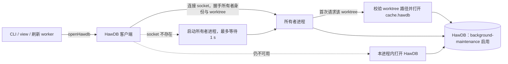

# hawdb-owner-service 架构

本页定义实现结构。命令行为、输出与错误码不变；性能预算由 [Goals](../../GOALS.md) 给出，采用后写入[本地 SDLC 性能预算](../../../../feature/local-sdlc/README.md#性能预算)。

## Entity Ownership

| 实体 | 拥有者 | 身份 | 生命周期 |
| --- | --- | --- | --- |
| 所有者进程 | 当前用户；由首个需要持久缓存的 Concord 进程以 detached 方式启动 | 所有者身份：原生产物摘要 + 协议版本 | 空闲 5 分钟且无进行中请求时退出；收到 `shutdown` 时在完成进行中请求后退出 |
| 运行目录 | 所有者进程 | `${XDG_RUNTIME_DIR:-$TMPDIR}/concord-<uid>/`，权限 0700，属主必须是当前 uid | 由首个所有者创建；内容可随时删除 |
| socket | 所有者进程 | `<运行目录>/<所有者身份前 16 位>.sock`，权限 0600 | 随进程退出删除；连接失败的陈旧 socket 由下一个启动者删除后重建 |
| HawDB 句柄 | 所有者进程 | worktree 的 Git-private `cache.hawdb` | 首次请求该 worktree 时打开，进程退出、清理或交接时关闭 |
| 所有者记录 | 所有者进程 | `cache.hawdb` 同级的 `cache.hawdb.owner`，内容 `{pid, 进程启动时间, socket, 所有者身份}` | 打开句柄后写入，关闭句柄前删除；记录的进程不存在或启动时间不符时视为陈旧 |
| 进程内持有 | 当前 CLI 进程 | — | 所有者进程不可用时，CLI 以同一实现在本进程内打开 HawDB，命令结束即关闭 |

第 1、2 阶段的所有者进程只是 HawDB 的宿主：它暴露与现有 `HawdbDatabase` 相同的操作（`get`、`put`、`scan`、`clearNamespace`、`namespaces`）以及缓存清理，不执行 Concord 命令、不读取来源文件、不做领域判断。命令逻辑、来源读取、来源一致性复核与发布协调仍在发起命令的进程中。第 3 阶段起，同一后台进程另外承载已加载的命令代码，见[命令执行](#命令执行第-3-阶段)。

## Data Flow

- `openHawdb(path, options)` 的签名与返回的 `HawdbDatabase` 接口不变，调用方（`cache-store.ts`、`config-cache.ts`、`query-cache.ts`、`workspace-projection.ts`）无需改动。返回对象的每次调用通过客户端发往所有者进程。
- 现有接口是同步的。客户端在一个 worker 线程中持有 socket，主线程以 `SharedArrayBuffer` + `Atomics.wait` 同步等待应答，主线程的调用语义与现在相同。
- 协议：长度前缀的 JSON 帧；每帧严格 Schema 解码，未知字段拒绝。请求带 `worktree`（canonical 的 Git-private 路径）、`op`、参数与请求 ID；应答带结果或具名错误码（沿用 `HawdbFailureCode`）。单帧与批量上限沿用现行预算（单条 8 MiB、批量 1000 条或 16 MiB）。
- 打开与校验：所有者进程收到某 worktree 的首个请求时，执行现行的路径安全与目录检查（`inspect_path`、`inspect_tree`、锁 inode 规则），然后以可写模式打开并长期持有。只读请求在同一句柄上开启读事务，不再区分只读与可写打开。
- 维护：`native/hawdb` 启用固定 revision 已有的 `background-maintenance` feature。所有者在空闲时调用引擎已有的维护入口。`checkpoint` 回收旧代次，保留当前与前一恢复代及 reader pin。`compact_relational_row_pages` 与 `compact_relational_overflow` 重写稀疏物理代次，`reclaim_branch_storage` 清扫不可达的 immutable 对象。
  维护结果以引擎返回的报告为准。报告超出准入上限或失败时，关闭该 worktree 句柄后按现行清理协议丢弃缓存，下一次请求冷启动重建。绑定中手写的条数淘汰与 churn 重建在引擎维护验证可用后删除。
- 清理：`cache clear` 发往所有者进程；所有者关闭该 worktree 的句柄，按现行清理协议删除数据（保留锁 inode），然后在下一次请求时重新打开。所有者不可用时，清理在本进程内按现行方式执行。
- 版本交接：所有者 B 打开某 worktree 时若引擎报告目录已被占用，读取所有者记录；记录指向另一个活着的所有者 A 时，B 通过 A 的 socket 发送 `release <worktree>`。A 拒绝该 worktree 的新请求，完成进行中的请求后关闭句柄并删除记录，再应答。A 无应答且进程已不存在时，记录视为陈旧。交接期间 B 的请求等待，上限 3 s，超时返回 `HawdbBusy`。
- 进程内持有：所有者进程无法启动（运行目录不可写、禁止 detached 子进程、socket 不可用）或 `CONCORD_CACHE_OWNER=process` 时，`openHawdb` 返回进程内实现，即现行行为。它仍受所有者记录约束：发现活着的所有者时改走 socket，不自行打开。
- Web view、查询刷新 worker 与扫描 worker 都是所有者进程的客户端，不再各自打开 HawDB。

### 持久解析投影（第 2 阶段）

- 命令照常列举来源集合、读取原文、计算摘要，返回前按现行规则复核字节与 publication.revision；本阶段只改变解析结果的来源。
- 新增持久命名空间 `document_parse_cache`：键为 canonical 路径、原文摘要与完整的解析器及 Schema 身份；值为 `decodeDocumentSource`、标题锚点与 steps 的合并结果，带写入时的路径与摘要，命中时逐项核对后严格解码。与路径无关的语法结果也只在同一路径下复用，路径相关的规则（例如 Research README 约束）总在当前路径执行。
- 依赖其它输入的结果（配置、concepts、写作政策、权限）把这些输入的摘要计入键，任一变化即失效。
- steps 与标题锚点从同一棵语法树提取，每篇文档每个进程最多解析一次。
- 命名空间计入持久逻辑预算；超预算整批拒绝写入，调用方按未命中回源。

### 分阶段

| 阶段 | 内容 | 主要验收 |
| --- | --- | --- |
| 1 | 所有者进程、客户端、进程内持有、版本交接；启用 background-maintenance | C7、C8、C13–C16；L5 |
| 2 | 持久解析投影与单次解析 | C1–C6、C9–C10、C12、C18、C19；G2、G3 |
| 3 | 后台执行命令与薄客户端；静态版本与帮助 | C11；G1 |
| 4 | 启用 full-text-search，Memory 与 Issue 检索改由引擎完成 | C17；G7 |

每个阶段独立可交付、可回滚；后一阶段不改变前一阶段的协议。

### 命令执行（第 3 阶段）

命令在 CLI 进程内的固定开销无法达到 G1：打包后的最小 Effect CLI 约 73 ms，真实 `memory index` 到命令逻辑开始约 139–206 ms（spike-startup 实测，提交 `refs/spikes/startup`）。第 3 阶段把命令执行移入已加载代码的后台进程：

- 客户端：`concord` 入口只打包 Effect 核心与 socket 通信，不加载 Effect CLI、平台层或领域模块（打包的 Effect 核心程序约 30 ms）。`--version` 与各层 `--help` 由构建时从命令定义生成的静态数据直接输出；生成结果与原 CLI 逐字节比较。
- 请求：客户端发送 argv、cwd、环境变量、stdin 是否为 TTY 与终端宽度，以及 stdin 内容流；后台以流的形式返回 stdout、stderr 与退出码，客户端原样写出并以该码退出。信号（SIGINT、SIGTERM）转发为取消请求。
- 隔离：后台用 worker 线程池执行命令，每个 worker 已加载命令代码并串行处理请求。命令通过新的调用上下文服务（Effect service）取得 cwd、环境变量、argv、stdin、stdout、stderr 与退出码，不直接读取 `process` 上的全局状态。现有约 130 处这类用法（`process.cwd`、`process.env`、`process.argv`、标准流与 `process.exitCode`）迁移到该服务。
- 回退：后台不可用时，客户端在本进程加载完整 CLI 执行（即现行行为），结果相同，只是没有达到 G1。

## Invariants

1. 任一时刻，一个 `cache.hawdb` 目录最多被一个进程打开（所有者进程或进程内持有者）。
2. 客户端的操作语义与现行 `HawdbDatabase` 一致：同一请求在所有者进程与进程内实现上得到相同结果。
3. 托管 HawDB 的代码不读取来源、不做授权或领域判断；它返回的数据仍由调用方严格解码与校验。第 3 阶段在后台执行的命令与在独立进程中执行的同一命令具有相同的来源核验、发布协调与输出。
4. 运行目录与 socket 只对当前 uid 可访问；属主或权限不符时拒绝使用并改用进程内持有。
5. 所有者进程退出前完成或明确失败全部进行中请求，并关闭全部句柄、删除所有者记录与 socket。
6. 缓存不可用（所有者崩溃、协议错误、超预算）时，调用方按现行规则回源，不返回未经校验的结果。
7. 写入、发布、恢复与证据的正确性不依赖所有者进程；后台不可用时同一命令在独立进程中得到相同结果。

## Errors

| 阶段 | 失败 | 结果 |
| --- | --- | --- |
| 连接 | socket 不存在、拒绝连接 | 启动所有者进程，1 s 内不可用则进程内持有 |
| 握手 | 所有者身份不同 | 连接该身份对应的 socket（不存在则启动）；不复用其它身份的所有者 |
| 请求中断 | 连接在应答前断开 | `get`、`scan`、`namespaces` 重试一次；`put`、`clearNamespace` 返回 `HawdbUnavailable`，调用方按缓存写入失败处理 |
| 交接 | 3 s 内未释放 | `HawdbBusy`，调用方按现行规则回源 |
| 打开 | 路径或目录检查失败 | 现行具名错误（`UnsafePath`、`HawdbIncompatible`） |
| 运行目录 | 属主或权限不符 | 进程内持有，`cache status` 报告原因 |

## Identity and Reuse

- 所有者进程只托管 HawDB 存取，不运行命令代码，因此只按所有者身份（原生产物摘要与协议版本）区分。同一用户的全部 Concord 安装、CLI、view 与 worker，只要所有者身份相同就共享同一个所有者进程及其持有的全部 worktree 句柄；开发中重建 TypeScript 产物不重启所有者。
- 原生产物或协议版本不同的两个所有者不共享进程，同一 worktree 的句柄按交接规则在它们之间转移。
- 解析投影键中的解析器身份来自执行命令的安装；不同安装的投影互不复用。

## 受影响的现行 Spec

采用后同步改写：

- [HawDB 引擎设计](../../../hawdb-data-engine/plans/native-embedded/README.md)：Mechanism 中「持久句柄在短快照内按需打开和复用，在来源快照结束前关闭，不跨网络请求或 Web 空闲时间持有」一句，改为由所有者进程长期持有。Open modes and ownership 中只读与可写打开的区分改为同一句柄上的读写事务。Resource budgets 中手写的淘汰与代次重建改为引擎维护。
- [架构 · 存储 Spec](../../../../architecture.md#存储-spec)：引擎边界一段的短快照句柄改为所有者进程；「持久句柄与事务先于 publication lease 释放」改为「发布协调不持有 HawDB 句柄」。
- [架构 · 发布协调](../../../../architecture.md#发布协调)：「持久缓存句柄在来源快照结束前关闭」一句删除，由不变量 7 替代。
- [统一缓存 Use Case](../../../../feature/local-data-engine/use-case/use-unified-cache.md)：`cache status` 报告所有者进程（pid、所有者身份、持有的 worktree 数）或进程内持有；clear 经由所有者执行。
- AGENTS.md 原生边界一段：「Persistent handles end with the source snapshot」改为所有者进程持有。

## 验证

- 第 1 阶段：C8 用 8 个并发进程反复读写，要求零 `HawdbBusy`、零目录占用失败。C7 在所有者进程中执行 10000 个写入代次，观察引擎维护后的体积与打开耗时。C13 交替两个原生产物不同的安装，并验证仅 TypeScript 产物不同的两个安装共享同一所有者。C14 在请求中 `SIGKILL` 所有者，C15 在测试运行结束后检查无残留进程与 socket，C16 在禁止 socket 的环境中运行。
- 第 2 阶段：C1–C6、C9–C10、C12、C18、C19 在缓存开启与 `--fresh` 关闭缓存下比较 `--json` 的领域事实、findings 与退出码；C1 用解析计数证明未变来源不调用解析器。
- 第 3 阶段：C11；全部命令的 `--help`、版本与无参数输出与独立进程逐字节一致（固定 NO_COLOR、TERM、COLUMNS、非 TTY）；同一命令在后台与独立进程中的 `--json` 输出相同。
- 第 4 阶段：C17。
- 性能：按[性能验收](../../../../engineering/concord-self-hosting/performance.md)的基准场景测 G1–G5。
