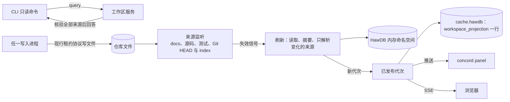

# workspace-server 架构

本页定义实现结构。面板的行为由 [Herdr 面板](../../../../feature/herdr-panel/README.md)拥有；CLI 命令行为、输出与错误码不变。

## Entity Ownership

| 实体 | 拥有者 | 身份 | 生命周期 |
| --- | --- | --- | --- |
| 工作区服务 | 取得服务锁的 Concord 进程 | worktree 的 Git-private 目录 + 安装身份 + 随机实例 token | 由面板、`concord view` 或 `concord server start` 启动；无客户端连接且 10 分钟无请求时退出；worktree 消失、收到 `shutdown` 或被同 worktree 的新安装接管时排空后退出 |
| 服务锁 | 工作区服务 | `<privateDir>/server/lock`，原生排他文件锁 | 服务存活期间一直持有；进程死亡时由操作系统释放 |
| 运行记录 | 工作区服务 | `<privateDir>/server/current.json`：`{pid, startedAt, token, installation, protocol, socket}` | 取得服务锁后原子写入；退出时按 token 删除 |
| socket | 工作区服务 | `<runtime>/concord-<uid>/<privateDir 的 sha256 前 32 位>.sock`，0600；Windows 为同名 named pipe | 取得服务锁后创建；退出时删除 |
| 持久 HawDB 句柄 | 工作区服务 | `<privateDir>/cache.hawdb` | 服务启动时打开，清理时短暂关闭，退出时关闭 |
| 解析结果 | 工作区服务 | HawDB 内存命名空间，键为 canonical 路径、原文摘要与解析器身份 | 随服务进程；容量沿用现行内存预算 |
| 已发布代次 | 工作区服务 | 单调递增的代次号 + 来源状态摘要 | 刷新成功后替换；最新代次同时写入现行 `workspace_projection` 持久行，供服务重启后立即可读 |
| 订阅 | 客户端连接 | 连接 + 订阅类型 | 随连接 |

`<runtime>` 依次取 `XDG_RUNTIME_DIR`、`os.tmpdir()`；目录必须属于当前 uid、权限 0700、不是符号链接，否则不创建服务。socket 路径超出平台上限（Linux 107 字节）时同样不创建服务，客户端按「服务不可用」处理。

## Data Flow

### 启动与裁决

1. 启动者（面板、`view` 或 `server start`）读取运行记录，按其 socket 连接并握手。握手成功且安装身份与协议相同，直接使用该服务。
2. 否则启动者以 detached 方式启动 `concord server run --root <worktree>`，最多等待 1 s 出现可握手的服务。
3. `server run` 尝试取得服务锁。失败表示已有服务，进程退出；成功后删除可能残留的 socket，绑定新 socket，原子写入运行记录，打开持久 HawDB，读取已有代次，然后开始接受连接。
4. 握手发现已有服务的安装身份不同：面板、`view` 与 `server start` 向旧服务发送 `shutdown`，等待其释放服务锁（上限 3 s）后按第 2 步启动；CLI 只读命令不接管，改为在本进程计算。

只有服务锁的持有者可以删除 socket 与运行记录。连接失败、权限错误或超时都不授权删除，只表示服务不可用。

### 刷新与代次

- 监听沿用现行[来源监听](../../../../feature/web-workbench/architecture.md#来源监听)的范围、合并与补偿定时器，另外监听 Git-private 目录中的 `HEAD`，使 Git 测试基线随提交更新。监听只产生失效信号。
- 刷新沿用现行[读取与发布](../../../../feature/web-workbench/architecture.md#读取与发布)：读取全部来源并核对摘要，只解析摘要变化的来源，漂移时按现行规则发布 `consistent:false` 代次或重试。刷新在服务内的 worker 线程中执行，不阻塞 socket 与 HTTP。
- 服务是该 worktree 唯一的刷新者，现行 `workspace-refresh` 文件租约、发布时的 `HawdbBusy` 重试与多个 View 进程之间的代次交换不再需要。
- 代次发布后，服务把代次号与变化摘要推送给全部订阅者；同一连接上未发送的旧代次被新代次替换，不排队。

### 测试状态

每个代次带测试声明与当前可见收据的对应；收据之后测试源码或其指向的 Spec 有改动的，标为过期。结果只存在于代次中，不另存。

### 协议

本机 socket 上的长度前缀 JSON 帧，每帧以严格 Schema 解码，未知字段拒绝。单帧上限 8 MiB，与工作区投影的上限一致；每个连接的待发送字节上限 16 MiB，超出时断开该连接。

| 请求 | 应答 |
| --- | --- |
| `hello {protocol, installation}` | `{protocol, installation, token, generation}`；协议或安装身份不同时只返回身份，不接受其它请求 |
| `subscribe {kind: workspace}` | 先发送当前代次，之后每个新代次推送一次 |
| `read {path}` | 与现行 `/api/file` 相同的定向严格读取 |
| `query {name, input}`（第 2 阶段） | 有类型的只读查询结果，见[CLI 查询](#cli-查询第-2-阶段) |
| `cache-clear` | 按[清理](#清理)执行后应答 |
| `shutdown` | 排空后应答并退出 |

### Web 工作台

`concord view` 连接或启动服务，请求服务开启 HTTP 监听；HTTP 处理、信任边界与 ViewAction 写入沿用现行实现，运行在服务进程中。浏览器以 `GET /api/events`（SSE）接收代次号，收到后按需读取；现行的 4 秒与 32 秒轮询改为只在 SSE 断开时使用。`view` 进程退出时 HTTP 监听随之关闭，服务按空闲规则继续或退出。

### 侧边面板

`concord panel` 是独立进程：连接或启动服务，订阅 `workspace`，按需 `read` 正文，在终端渲染，`o` 通过服务开启 HTTP 并打开浏览器。面板不打开 HawDB，不读取来源，退出时只关闭连接。渲染使用 React 的终端渲染器，与 Web 共享展示模型的派生函数；依赖按固定版本引入。

Herdr 插件随包发布 `herdr-plugin.toml`，声明 `placement = "split"` 的 pane，命令为 `concord panel`；工作树取自 Herdr 注入的插件上下文中当前 pane 的工作目录。插件上下文的字段与 split 方向需按 Herdr 当前文档核实，核实前以 `herdr pane split --direction right --cwd <dir>` 加 `herdr pane run` 实现。

### 其它进程与持久缓存

服务运行时，其它 Concord 进程打开持久 HawDB 会因目录锁失败。现行做法把它报告为 `HawdbBusy`；本方案改为：持久缓存不可用时一律降为本进程的内存缓存，命令照常完成，不等待、不重试打开、不报告失败。这一规则不依赖服务是否存在，同时解决无服务时多个 CLI 并发的争用。

### 清理

`cache clear` 先读运行记录：有服务时发送 `cache-clear`。服务暂停刷新，等待进行中的读取完成，关闭持久句柄，按现行清理协议（OwnerGuard、保留锁 inode）删除数据，再重新打开并从头刷新。服务全程持有服务锁，所以清理期间不会有第二个服务出现；其它进程可能短暂打开持久目录，服务重新打开失败时以 100 ms 间隔重试至多 3 s，仍失败则以内存缓存继续服务并在 `cache status` 中报告。没有服务时，清理在本进程按现行方式执行。

服务不持有 publication lease，也不在持有 HawDB 句柄时同步等待任何其它进程。

### CLI 查询（第 2 阶段）

只读命令（各类 `list`、`show`、`trace`、`check`、`docs check`、`memory index`）先读运行记录；有同安装身份的服务时发送 `query`，否则在本进程计算。服务回答前读取全部来源并核对摘要，变化的来源先刷新，因此回答等价于本进程同源计算。CLI 进程只加载协议与该命令的格式化代码。写命令、交互命令、`view`、`lsp` 与外部 runner 不经由服务。

查询在应答前断开时，客户端在本进程重新计算；只读查询可以安全重算。

## Invariants

1. 一个 worktree 任一时刻最多一个工作区服务，由服务锁裁决。
2. 服务运行时，只有它打开该 worktree 的持久 HawDB；其它进程使用内存缓存，结果不变。
3. 客户端不取得数据库句柄；服务返回的结果已经过与本进程计算相同的来源核验。
4. 写入、发布、恢复与证据不依赖服务：服务不存在、崩溃或版本不同时，同一命令得到相同结果。
5. 每个推送的代次来自同一来源状态；不一致代次按现行替换规则标记，不替换已有一致代次。
6. socket 与运行目录只对当前 uid 可访问；不符时不创建服务。
7. 服务退出时停止监听与定时器，完成或明确失败进行中请求，关闭 HTTP 与句柄，按 token 删除运行记录与 socket，最后释放服务锁。

## Errors

| 阶段 | 失败 | 结果 |
| --- | --- | --- |
| 连接 | 无记录、socket 不存在或拒绝连接 | 启动者启动服务；CLI 在本进程计算 |
| 启动 | 1 s 内没有可握手的服务 | 面板与 `view` 显示具名错误 `WorkspaceServerUnavailable` 并以非零码退出；`view` 可用 `--in-process` 按现行方式运行 |
| 握手 | 安装身份或协议不同 | 启动者接管（3 s 上限，超时报 `WorkspaceServerBusy`）；CLI 在本进程计算 |
| 运行目录 | 属主、权限、类型或路径长度不符 | 不创建服务，报告原因 |
| 刷新 | 漂移、配置变化、需要恢复 | 沿用现行刷新状态表，推送状态而不推送新代次 |
| 连接中 | 客户端写缓冲超限或协议错误 | 断开该连接，其它客户端不受影响 |
| 服务崩溃 | 进程被杀 | 操作系统释放服务锁；下一个启动者删除残留 socket 并启动；面板显示重连中并自动重连 |

## Identity and Reuse

- 安装身份沿用现行工作区投影身份中的安装部分（安装目录全部 JS 与原生产物摘要）。服务只为同身份的客户端回答查询；不同身份不共享进程、代次或内存缓存。
- 服务按 worktree 区分，不跨 worktree、不跨用户。测试中的临时仓库只有在测试主动打开面板或 `view` 时才有服务，测试结束时由测试显式 `shutdown`。

## 分阶段

| 阶段 | 内容 | 主要验收 |
| --- | --- | --- |
| 1 | 服务锁、运行记录、socket 协议、监听刷新与代次推送、`concord panel` 与 Herdr 插件、由服务托管的 Web 与 SSE；持久缓存不可用时降为内存缓存 | herdr-panel 全部 Use Case；C8、C14–C16、C20–C24；G8 |
| 2 | CLI 只读查询经由服务；查询客户端的最小加载 | C1–C12、C18、C19；G1、G2、G5 |

第 1 阶段回滚只需停止启动服务、恢复 `view` 的进程内运行；第 2 阶段回滚只需让 CLI 不再读取运行记录。两个阶段都不改变持久数据格式。

## 受影响的现行 Spec

采用后改写：

- 宪法 C-005-4，文字见设计 README 的修订提案。
- [Web 工作台架构](../../../../feature/web-workbench/architecture.md)：刷新所有权一节的 `workspace-refresh` 租约、发布重试与多 View 协调改为由服务唯一刷新；轮询改为 SSE 加断线回退。
- [使用 Web 工作台](../../../../feature/web-workbench/use-case/use-web-workbench.md)：与多个刷新者、`RepositoryBusy` 重试和租约等待有关的验收条目按服务模型重写。
- [统一缓存](../../../../feature/local-data-engine/use-case/use-unified-cache.md)：`cache status` 报告服务（pid、安装身份、代次）；clear 经由服务；持久缓存不可用时降为内存缓存。
- [架构 · 存储 Spec](../../../../architecture.md#存储-spec) 与 AGENTS.md 原生边界一段：持久句柄由工作区服务长期持有。
- 原生绑定新增服务锁的取得与释放，属于 `native/hawdb` 的目录所有权职责。

## 验证

- 第 1 阶段：herdr-panel 各 Use Case 的打包 CLI 与真实终端测试（面板在伪终端中运行，断言渲染文本）。C21 用 4 个只读命令与 1 个写命令并发，断言零 `HawdbBusy`；C24 三个启动者同时启动，断言一个服务。C14 在刷新中 `SIGKILL` 服务；C22 删除 worktree；C15 断言临时仓库在只运行 CLI 时不产生服务进程。
- 第 2 阶段：同一命令在经由服务、本进程计算与缓存关闭三种方式下比较 `--json` 输出、findings 与退出码。缓存关闭须使用明确禁止持久访问的入口，不以 clear 后运行代替。
- 性能：面板首屏、代次推送延迟与第 2 阶段查询各有 `bench/` 场景与 Feature 预算行，分别记录服务已运行与首次启动两组。
