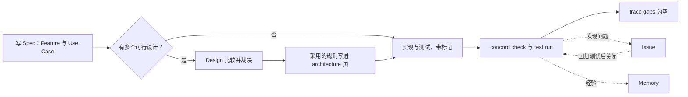

# convention-first 命令与工作方法

## 命令面

| 命令 | 作用 |
| --- | --- |
| `concord init` | 创建 `docs/` 布局、`AGENTS.md` 区块与可选配置 |
| `concord new <类别> <名称>` | 按模板创建 Feature、Use Case、Engineering、Design、Research、Issue 或 Memory |
| `concord show <路径或 ID>` | 显示一个文档、它的关系、测试与实现 |
| `concord list [类别]` | 列出文档；`--open` 只列打开的 Issue |
| `concord check` | 放置、关系、修复、写作与概念的全部检查 |
| `concord trace` | 关系图；`trace gaps` 列出没有测试的 Use Case |
| `concord test` | `test list`、`test run`；`test verify <issue>` 在修复提交与父提交上复现回归测试 |
| `concord issue close <id> --as <结论>` | 写入关闭结论；fixed 时检查至少一个回归测试指向它 |
| `concord memory supersede <id> --by <id>` | 标记 Memory 被替代 |
| `concord view` / `concord panel` | Web 工作台与终端面板 |

另有维护命令 `cache`、`recover`、`doctor`、`lsp` 与 `review`，不属于日常工作流。

删除的命令：

- `author` 与各类 `page`：Spec 没有元数据，直接编辑；
- `roadmap`：未实现的方向是没有测试的 Feature；
- `design decide`：编辑 DECISION 的 `Selected:` 行；
- `constitution adopt/amend`：直接编辑宪法，用 `new memory` 记录理由；
- `memory resolve/reopen/activate/promote/retire` 与证据相关的命令：缺陷在 Issue 中跟踪，修复由 `test verify` 复现。

## 工作方法

1. 写 Spec。每项能力是一个 Feature，每条用户路径是一个 Use Case，写目标、主流程与验收。人审阅的是这些文件的 diff。
2. 有取舍才写 Design。候选在共同的 Goals 与 Limits 下比较；裁决后，采用的规则写进 Feature 或 Engineering 的 architecture 页，Design 留作理由。
3. 实现与测试。实现用代码标记指向 Spec，测试用测试标记指向 Use Case；每条验收至少一个测试。
4. 验证。`concord check` 无 finding，测试通过，`trace gaps` 为空即完成。
5. 记录。错误行为与待办写 Issue，修复时写一个指向它的回归测试再关闭；排障中学到的东西写 Memory，并链接到相关 Spec。

agent 开始会话时运行 `concord list --open` 与 `concord show <要改的 Feature>`，读到当前约定、未完成的工作与相关知识。
