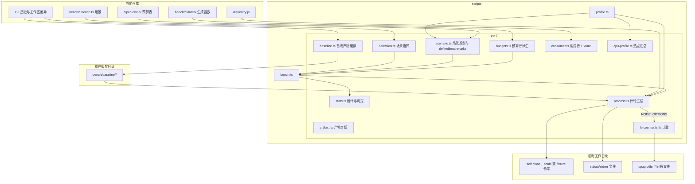

# 自举架构

`vp run concord` 执行当前 checkout 的 `dist/entry.js`，不依赖全局安装或 link。文档 mutation 通过该 CLI 创建 owner 或使用 digest-aware page/author 命令更新；不手写 frontmatter。

测试关系由 `test/*.test.ts` 中的注释拥有。自举 smoke 先只读解析当前项目格式、runner argv、sourceFiles 与构建版本，再按配置复制全部 sourceRoots、testRoots、Memory 来源、docs 与 runner sourceFiles 到隔离 Git 消费者。扫描该副本并运行当前构建产物的 `check` 与 `trace check`。输出 JSON 严格解码。缓存或检查副作用只发生在临时消费者，不修改当前仓库、不创建当前仓库证据，也不递归启动完整检查。

静态检查阶段通过当前构建的 `dist/entry.js --json --dry-run check` 检查当前 checkout，保留 CLI 的退出码。这一步不发布 owner 或证据，不打开持久缓存；来源协调可创建 Git-private 目录。它与隔离 smoke 一同进入完整门禁。

隔离 smoke 必须观察到 `repository/engine.ts` 的实现声明，并验证副本中失效的 repository Spec 引用使公开 CLI 检查失败。临时消费者结束后删除；复制来源集合由项目配置派生。

Git-private cache/evidence/journal 不提交。删除 cache 后仍可从 Markdown 与源码恢复关系；因此自举验收必须同时覆盖冷/热扫描边界和当前 owner 完整性。

## 性能测量

[性能验收](performance.md)的测量路径同样在本仓库自举：被测产物是当前 checkout 的构建，默认消费者是本仓库某个 commit 的独立 clone。预算从 Spec owner 正文派生，测量步骤由 `bench/` 下的场景源码拥有。写入范围按对象区分：入口先在当前 checkout 执行 `vp build`，替换 `dist/`；`--compare` 的基线产物位于用户缓存目录；`self`、`scale` 与 fixture 消费者及进程输出位于临时工作目录，结束后删除（`--keep` 除外）。

路径消费者原地测量，只改动其 Git-private 目录中的可丢弃 HawDB 缓存；`--out` 指定测量或 profile 输出位置。profile 未指定 `--out` 时，在系统临时目录创建输出目录并保留。测量不修改源 owner、不写 Memory，测量者审阅记录后用 Concord 的 Memory 命令保存结论。

`scripts/perf/` 中的模块按职责划分：

- `scenario.ts` 定义场景的严格类型、`defineBenchmarks` 与场景执行器；执行器只通过公开 CLI、HTTP 与文件系统操作消费者。
- `budgets.ts` 扫描 `docs/feature/` 下的页面，解析 `性能预算` 与 `刷新上限` 标题下的预算表，返回 owner、标题、场景 ID 与阈值；解析函数不访问文件系统，便于测试直接喂入 owner 正文。
- `selection.ts` 把场景 ID、feature-id 与 `--changed` 的改动文件映射为场景集合；文件到 Feature 的映射读取当前构建 CLI 的代码归属声明输出，不自行解析注释。
- `baseline.ts` 准备、校验、复用与淘汰基线产物，失败使用具名 `PerfError`。
- `stats.ts` 只做 p50、有效性、回退和上限判定，是纯函数。
- `process.ts` 以文件描述符重定向 stdout 与 stderr 并计时，失败使用具名 `PerfError`。
- `consumer.ts` 准备 `self`、`scale`、fixture 与路径消费者，返回带 commit 的冻结描述，并在每次 `beforeEach` 后恢复冻结状态。
- `artifact.ts` 读取产物 commit、源码是否有未提交改动及 `dist` 摘要，摘要覆盖 `.js`、`.node` 与 `artifact.json`。
- `cpu-profile.ts` 严格解码 `.cpuprofile` 并按函数和层汇总自身耗时。
- `fs-counter.ts` 由 `NODE_OPTIONS` 预加载，包装 `node:fs` 调用后执行 `syncBuiltinESMExports()`，退出时按 pid 写出计数与 `process.resourceUsage()`；它不改变调用结果，未设置输出目录环境变量时不做任何事。

`bench/` 与 `scripts/` 一同纳入 `tsconfig.scripts.json` 的严格类型检查。覆盖规则的一致性、命令覆盖与冒烟检查位于 `test/perf-coverage.test.ts`，冒烟复用 `scenario.ts` 的执行器，只把消费者换成小规模 fixture 并跳过计时判定。`scripts/measure-view-requests.ts` 的请求测量迁入 `web-workbench` 场景，不再保留单独的测量入口。

macOS 的临时目录位于 symlink 之后，Concord 会拒绝该路径；所有工作目录先取 realpath。
