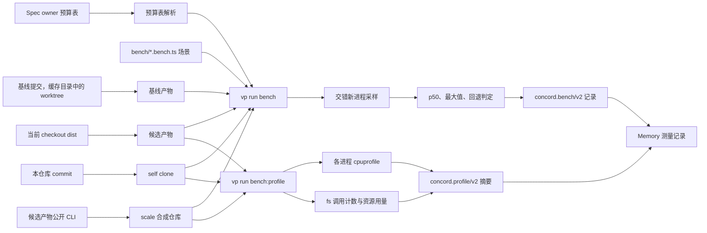

# 性能验收

本页统一规定 Concord 命令性能的测量方法、测量路径与失败判据，适用于 [C-014](../../constitution.md#c-014)。命令预算由拥有该命令的 Feature 包页面声明，测量工具从 `docs/feature/` 的[预算表](#预算表格式)派生，不维护第二份 owner 清单。

## 测量 Spec

- 参照消费者：预算表声明的本仓库 commit 的独立 Git clone，冻结后测量。每组预算绑定该 commit、完整命令参数与参照环境。
- 参照环境：预算表声明的机器与 Node 精确版本，使用构建后的 `dist/entry.js`。绝对预算只在参照环境判定；其它机器只做同机交错对照，判定回退比例。
- 测量记录：消费者 commit、纳入测量的来源及规模、基线与候选产物身份、Node 精确版本及硬件信息。
- 基线：对照时的基线是 `--compare` 指定提交（默认 `origin/master` 与 HEAD 的 merge-base）的构建产物，测量前确定，不在测后挑选。两套产物在同一冻结消费者上分别预热。
- 引擎版本不能共用缓存时，`self` 消费者上的 `--compare` 测量使用 `--isolated-caches`。两套产物读取同一冻结提交的独立 clone，各自初始化缓存并交错采样；记录包含各消费者的路径、提交和缓存状态。
- 冷暖状态：warm 表示参照消费者已执行一次同一命令、HawDB 缓存有效；cold 表示执行 `concord cache clear` 后的首次运行。预算按 warm 判定，cold 只记录。
- 计时边界：从启动 `node dist/entry.js` 进程到进程退出的 wall time，stdout 与 stderr 重定向到文件。
- 采样：先预热一次，再对每条命令运行至少 7 次全新进程，取中位数（p50）。对照测量时新旧产物交错运行。
- 统计与阈值：p50 不超过所属 Spec 的预算，并且同机交错对照中 p50 相比基线的回退不超过 20%。
- 波动：同一命令的最大值超过 p50 的 2 倍时，该组样本无效，须重新测量；连续两组无效视为失败。
- 进程上限：Spec 声明为上限的命令（例如后台刷新扫描）按最大值判定，在任何机器上超出都判失败，因为超时进程的结果不会被发布。

## 预算表格式

预算数字只在 Spec owner 中声明，测量步骤只在[基准场景](#基准场景)源码中声明，二者以场景 ID 对应，不另存预算清单。拥有高频公开操作的 Feature 在其包内页面（README、支持页面或 Use Case）的 `## 性能预算`（按 warm p50 判定）或 `## 刷新上限`（按最大值判定）标题下写一张 Markdown 表：首列以行内代码列出一个或多个场景 ID，中间列用文字说明测量内容，末列为 `<整数>ms`。同一行的场景共用该阈值。测量工具扫描 `docs/feature/` 下全部页面派生预算行，不维护 owner 列表；Design、Engineering 与 Research 页面中的数字不是预算。

```markdown
## 性能预算

| 场景 | 测量内容 | p50 预算 |
| --- | --- | ---: |
| `local-data-engine/trace-gaps-warm`、`local-data-engine/review-render-warm` | 已有投影时读取关系缺口与审阅材料 | 600ms |
```

场景 ID 的格式为 `<feature-id>/<名称>`，`feature-id` 必须是拥有该预算行的 owner 所属 Feature。场景引用的 owner 不存在于所测消费者时，该场景在记录中标为 `skipped` 并写明原因，不参与通过判定；`self` 消费者上出现 `skipped` 视为场景或预算表失效，判失败。

## 基准场景

每个拥有预算行的 Feature 在 `bench/<feature-id>.bench.ts` 中用严格 TypeScript 与 Effect 定义自己的基准场景，文件默认导出 `defineBenchmarks(featureId, scenarios)`。场景是可执行的测量定义，与测试源码同样由源码拥有；它不带 `@feature` 测试标记，不计入测试覆盖，也不证明行为正确。

| 字段 | 含义 |
| --- | --- |
| `id` | 场景 ID，在全仓唯一，必须被恰好一个预算行引用 |
| `consumer` | `self`、`scale` 或 `fixture:<名称>`；fixture 由 `bench/fixtures/` 下的生成函数通过公开 CLI 建立并提交冻结 |
| `state` | `warm`（采样前执行一次同一场景并确认缓存 `ready`）或 `cold`（每次采样前 `concord cache clear`） |
| `prepare` | 每个产物采样前执行一次的准备步骤，不计时 |
| `beforeEach` | 每次采样前执行的步骤（例如修改 k 个文件），不计时，结束后消费者必须可以恢复到冻结状态 |
| `run` | 计时的 Concord argv；`{ argv, concurrency }` 同时启动 n 个进程，计时到全部退出；`{ request }` 对 `prepare` 启动的 view 服务发出一次 HTTP 请求，计时到响应体读完 |
| `expect` | 期望的退出码，以及可选的 `--json` 输出 Schema；不符即该样本失败 |

计时边界与采样规则沿用[测量 Spec](#测量-spec)：只计 `run` 进程从启动到退出的 wall time（`request` 形式计请求发出到响应体读完），`prepare` 与 `beforeEach` 不计时。场景只能通过公开 CLI 与文件系统操作消费者，不导入 `src/` 内部模块。

### 覆盖规则

`pnpm check` 的 Node 测试包含三项不计时的检查，保证预算与场景同步，场景不会失效：

1. 一致性：每个预算行引用的场景都存在；每个场景恰好被一个预算行引用，且场景 ID 的 Feature 与该行 owner 的 Feature 一致；场景文件名与其 `featureId` 一致。
2. 命令覆盖：CLI 定义中的每个顶层命令组至少出现在一个场景的 `run` 中，或列在下方豁免表中。新增命令组必须在同一改动中补充场景与预算行，或补充豁免理由。
3. 冒烟：每个场景在其最小消费者上执行一次（`fixture` 优先，`self` 与 `scale` 换成同形的小规模 fixture），检查 `expect`，不判定耗时。冒烟在空闲参照机上约 16 秒，目标不超过 30 秒，由完整门禁的耗时记录观察；测试时限只用于发现挂起，不作为耗时断言。

| 豁免的命令组 | 理由 |
| --- | --- |
| `init` | 每个仓库只执行一次 |
| `recover` | 只在异常中断后执行 |
| `feedback sync`、`feedback import` | 耗时由远端决定；本地部分由 `feedback list` 场景覆盖 |
| `test run`、`docs work` | 耗时由被执行的 runner 与检查决定 |
| `view` | 长期运行的服务，请求耗时由 `web-workbench` 场景测量 |
| `lsp` | 长期运行的编辑器服务 |

## 测量路径

测量与 profile 都在本仓库自举：被测产物是当前 checkout 的构建，默认消费者是当前仓库某个 commit 的独立 clone。测量入口为 `vp run bench`，profile 入口为 `vp run bench:profile`；入口先执行 `vp build`，结果以 JSON 输出到 stdout，可用 `--out` 另存。

```text
vp run bench [<场景 ID | feature-id> ...] [--changed [<base>]] [--compare [<rev>]] [--quick] [--reference]
             [--consumer self|scale|<path>] [--commit <rev>] [--scale <sources>,<tests>,<pages>]
             [--isolated-caches] [--samples 7] [--out <file.json>] [--keep]
vp run bench:profile <场景 ID> [--warm] [--out <dir>] [--keep]
vp run bench:profile cli [--consumer ...] [--warm] [--out <dir>] [--keep] -- <concord 参数>
```

| 选择与模式 | 行为 |
| --- | --- |
| 场景 ID 或 feature-id | 只运行指定场景，或该 Feature 的全部场景；都省略且未给 `--changed` 时运行全部场景 |
| `--changed [<base>]` | 选择受本次改动影响的场景。改动文件为 `<base>`（默认 `origin/master` 与 HEAD 的 merge-base）到工作区的全部差异，包括未提交改动。改动文件通过代码归属声明（`@concord-implements`）映射到 Feature，选中这些 Feature 的场景；改动了 `bench/<feature-id>.bench.ts` 的选中该文件的场景；改动了 `scripts/perf/` 或 `bench/fixtures/` 的选中全部场景 |
| `--compare [<rev>]` | 与基线产物交错对照，`<rev>` 默认同 `--changed` 的 base。基线按下文自动准备 |
| `--quick` | 每组 3 次样本，只输出 p50 与预算的对照，用于开发中快速反馈；记录的 `acceptance` 恒为 false |
| `--reference` | 声明当前机器为参照环境，判定绝对预算 |

刷新上限场景以 `{ scan }` 形式运行内部扫描入口 `dist/query-scan-worker.js <root> <query-json>`，即后台刷新进程实际执行的扫描，按最大值对照上限。读取异步投影的 `warm` 场景在采样前等待投影发布，等待不超过刷新上限加 30 秒；等不到投影时测量失败，记录最后一次输出的 `QueryPending` 及 `refresh` 详情。读取采样期间每次调用都照常请求后台刷新，结果包含这一竞争。

`profile <场景 ID>` 用 V8 CPU profiler 和 fs 调用计数执行该场景的一次 `run`，`profile cli` 对任意一条命令做同样的 profile。profile 用于定位热点，不作为预算或上限证据。

profile 通过 `NODE_OPTIONS` 注入 `--cpu-prof` 与计数模块，因此 Concord 启动的嵌套 Node 进程同样产出 profile。profile 的 wall time 含 profiler 开销，只用于 profile 之间比较，不作为预算样本。

### 消费者

| `--consumer` | 来源 | 用途 |
| --- | --- | --- |
| `self`（默认） | 本仓库 `--commit`（默认 `HEAD`）的独立 clone；未提交改动不进入消费者 | 自举预算与回退对照 |
| `scale` | 候选产物通过公开 CLI 初始化的合成仓库，按 `--scale` 生成源码、测试与支持页面后提交冻结 | 大仓库规模与刷新上限 |
| 路径 | 已有的干净 Git consumer，原地测量 | 复现外部仓库问题 |

`scale` 默认 3600 个源码文件、600 个测试文件、1000 个支持页面，对应已接入的大型游戏仓库规模。源码文件带 `@concord-file` 与 `@concord-implements`，测试文件带 `@use-case`，支持页面链接到所属 Feature，使扫描覆盖文档、测试与代码归属三类来源。`self` 与 `scale` 消费者准备完成后执行一次 `concord cache rebuild`，并以 `cache status` 确认为 `ready`，记录中 `consumer.cache` 为 `ready`；否则测量失败，因为没有有效缓存时 warm 样本实际是 cold。原地测量的路径消费者必须没有未提交改动；测量只改动可丢弃的 HawDB 缓存，`cold` 场景会清空该缓存。

### 基线

`--compare` 自动准备基线产物，位置为 `${XDG_CACHE_HOME:-~/.cache}/concord/bench/baseline/<commit>/`。准备时以 `git worktree add --detach` 检出基线提交，再执行 `pnpm install --frozen-lockfile --offline` 与 `vp build`；原生产物按[原生绑定复用](README.md#原生绑定复用)取得，不需要 Cargo。同一提交的基线产物在后续测量中复用，构建前后都校验产物身份；保留最近 3 个基线，更早的以 `git worktree remove` 删除。候选产物可以有未提交改动，记录中 `dirty` 为 true。

省略 `--compare` 时只测候选产物，判定只包含样本有效性、刷新上限，以及声明 `--reference` 时的绝对预算。

候选改变受管格式、基线产物无法解码同一冻结消费者时，同一消费者上的相对比较不成立。这次交付只按候选产物的绝对预算判定，交付说明与 Memory 记录断点提交；之后的交付以断点提交为基线恢复相对比较。基线不为此读取旧格式，也不改写冻结消费者（[C-009](../../constitution.md#c-009-1)）。



## 测量记录

`concord.bench/v2` 记录一次测量的全部判定，每条判定对应一个场景，用两个字段区分诊断结论与验收结论：

- `pass`：没有任何判定失败。为 false 时进程退出码为 1。
- `acceptance`：可作为预算验收证据。仅当 `pass` 为 true、每组至少 7 次样本、全部样本组有效，未使用 `--quick`，且声明了 `--reference` 或使用了 `--compare` 时为 true；否则为 false，并在 `acceptanceGaps` 列出缺少的条件。

`acceptanceGaps` 按条件依次包含 `failed verdicts`、`samples < 7`、`invalid sample groups`、`quick mode`、`no baseline and not reference`。未命中任何条件时不输出该字段。

交付验收引用 `acceptance` 为 true 的记录；`pass` 为 true 而 `acceptance` 为 false 的记录只用于定位。

```json
{
  "format": "concord.bench/v2",
  "selection": { "changed": "origin/master...worktree", "scenarios": ["local-data-engine/trace-gaps-refresh"] },
  "environment": { "node": "v24.19.0", "platform": "darwin", "arch": "arm64", "cpu": "Apple M4", "cpuCount": 10, "memoryBytes": 34359738368 },
  "reference": false,
  "samples": 3,
  "consumer": { "kind": "scale", "cache": "ready", "commit": "4f0c…", "scale": { "sources": 3600, "tests": 600, "pages": 1000 } },
  "artifacts": [{ "label": "candidate", "commit": "2241a72…", "dirty": false, "digest": "sha256:…" }],
  "verdicts": [{
    "scenario": "local-data-engine/trace-gaps-refresh",
    "budget": { "owner": "docs/feature/local-data-engine/use-case/query-asynchronous-projections.md", "heading": "刷新上限" },
    "limitMs": 120000, "limitKind": "max", "withinLimit": false,
    "candidate": { "samples": [178000, 176500, 177000], "p50": 177000, "max": 178000, "valid": true },
    "pass": false, "reasons": ["max 178000ms exceeds 120000ms"]
  }],
  "snapshots": [{ "scenario": "local-data-engine/trace-gaps-warm", "artifact": "candidate", "lastError": "{\"ok\":false,\"error\":\"QueryPending\",…}" }],
  "pass": false,
  "acceptance": false,
  "acceptanceGaps": ["failed verdicts", "samples < 7", "quick mode", "no baseline and not reference"]
}
```

`concord.profile/v2` 标明场景 ID 或命令，按进程列出 CPU 自身耗时最高的函数、按层（`dist/<模块>`、依赖包、`node:internal`、原生）汇总的耗时，以及 user/system CPU、最大 RSS 和各 `node:fs` 调用的次数与同步耗时。原始 `.cpuprofile` 留在输出目录，可用 Chrome DevTools 或 speedscope 打开。

```json
{
  "format": "concord.profile/v2",
  "scenario": "local-data-engine/trace-gaps-refresh",
  "command": ["concord", "--json", "--fresh", "--dry-run", "trace", "gaps"],
  "wallMs": 181204,
  "processes": [{
    "pid": 41872,
    "resources": { "userMs": 82470, "systemMs": 100380, "fs": { "lstatSync": { "count": 1843210, "ms": 61210 } } },
    "layers": [{ "name": "node:internal", "selfMs": 64012, "share": 0.36 }],
    "functions": [{ "name": "lstatSync node:internal:1520", "selfMs": 58120, "share": 0.33 }]
  }]
}
```

示例中的数字只说明字段形状，不是测量结论。

## 失败判据

超出预算或上限、回退超过 20%、样本无效或缺少必需测量证据，都不能判为通过。命令的输出、退出码与失败边界必须与优化前一致，不能以跳过校验换取时间。

测量结果、阶段分解与 profile 结论保存在 Memory；本页只声明方法与路径。`test/cli-startup.test.ts` 保护只读命令的模块加载范围；预算表解析、统计规则与[覆盖规则](#覆盖规则)由 Node 测试覆盖。Node 测试不断言绝对耗时，`pnpm check` 只运行不计时的冒烟，不运行测量。

## 开发与交付流程

| 时机 | 命令 | 要求 |
| --- | --- | --- |
| 开发中 | `vp run bench --changed --quick` | 可随时运行，查看受影响场景的 p50 与预算的距离 |
| 交付前 | `vp run bench --changed --compare` | 改动选中任一场景时必须运行；全部判定通过才可交付 |
| 新增 Feature 的高频操作或新命令组 | 同一改动中增加预算行与场景 | 覆盖规则在 `pnpm check` 中强制 |
| 有意改变预算 | 修改 Spec owner 中的阈值，说明理由 | 附 `--compare` 记录，结论写入 Memory |

交付前的 `--compare` 记录不是参照环境上的绝对预算验收；它判定同机回退不超过 20%。预算的绝对验收仍按[测量 Spec](#测量-spec)在参照环境以 `--reference` 执行。回退或超预算时先用 `bench:profile <场景 ID>` 定位，修复后用同一命令复测。记录的结论用 `concord memory add` 保存，不提交原始 JSON。
