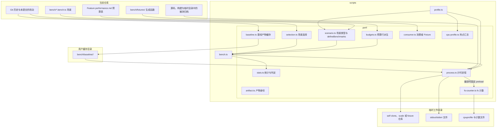

# 性能测量实现

本页声明测量脚本的模块、写入范围与数据流。测量方法见[性能测量](README.md)，命令见[测量命令](cli.md)。

## 写入范围

被测产物是当前 worktree 构建出的归档，默认消费者是本仓库某个 commit 的独立 clone。写入范围按对象区分：

- 入口把被测归档构建到临时目录。
- `--compare` 的基线归档位于用户缓存目录。
- `self`、`scale` 与 fixture 消费者及进程输出位于临时工作目录，结束后删除（`--keep` 除外）。
- 路径消费者原地测量，只改动其 Git-private 目录中的可丢弃 HawDB 缓存；`--out` 指定测量或 profile 输出位置。

测量不修改 Spec、不写 Memory，测量者审阅记录后用 Concord 的 Memory 命令保存结论。

所有工作目录先取 realpath，因为 macOS 的临时目录位于 symlink 之后，Concord 会拒绝该路径。

## 基线

`--compare` 自动准备基线产物，位置为 `${XDG_CACHE_HOME:-~/.cache}/concord/bench/baseline/<commit>/`。准备时把基线提交克隆为该目录下独立的 Git clone，执行 `vp install --frozen-lockfile --offline`，由 Vite+ 按基线提交声明的包管理器安装，再用该提交自带的构建入口构建。原生产物按[原生绑定复用](../build/architecture.md#原生绑定复用)取得，不需要 Cargo。

这个 clone 不是开发 worktree，其中出现 `dist/` 不违反开发 worktree 没有 `dist/` 的规则。

同一提交的基线产物在后续测量中复用，构建前后都校验产物身份；保留最近 3 个基线，更早的 clone 直接删除。候选产物可以有未提交改动，记录中 `dirty` 为 true。

测量器按每份产物自身的入口运行扫描：编译归档使用内部角色，携带 Node 的基线使用其随包 Node 与实际扫描模块，源码使用固定 Bun 和 TypeScript 入口。缺少相应入口时报告 `PerfError`；不改写基线，也不借用当前源码替代被测实现。

## 数据流

## 模块

`scripts/perf/` 中的模块按职责划分：

- `scenario.ts` 定义场景的严格类型、`defineBenchmarks` 与场景执行器；执行器只通过公开 CLI、HTTP 与文件系统操作消费者。
- `budgets.ts` 读取 `docs/feature/*/performance.md`，解析 `性能预算` 与 `刷新上限` 标题下的预算表，返回所在页面、标题、场景 ID 与阈值；解析函数不访问文件系统，便于测试直接喂入页面正文。
- `selection.ts` 把场景 ID、feature-id 与 `--changed` 的改动文件映射为场景集合；文件到 Feature 的映射读取当前构建 CLI 的代码归属声明输出，不自行解析注释。
- `baseline.ts` 准备、校验、复用与淘汰基线产物，失败使用具名 `PerfError`。
- `stats.ts` 只做 p50、有效性、回退和上限判定，是纯函数。
- `process.ts` 以文件描述符重定向 stdout 与 stderr 并计时，失败使用具名 `PerfError`。
- `consumer.ts` 准备 `self`、`scale`、fixture 与路径消费者，返回带 commit 的冻结描述，并在每次 `beforeEach` 后恢复冻结状态。
- `artifact.ts` 读取产物 commit、源码是否有未提交改动及安装目录摘要，摘要覆盖 `.js`、`.node` 与 `artifact.json`。
- `cpu-profile.ts` 严格解码 `.cpuprofile` 并按函数和层汇总自身耗时。
- `fs-counter.ts` 由 profile 专用可执行文件的固定 preload 预加载，包装 `node:fs` 调用，退出时按 pid 写出计数与 `process.resourceUsage()`；它不改变调用结果，未设置输出目录环境变量时不做任何事。

`scripts/bench.ts`、`scripts/profile.ts` 与 `scripts/perf/*.ts` 是严格 TypeScript，由 Node 自带的类型擦除直接执行，副作用通过 Effect 管理；`bench/` 与 `scripts/` 一同纳入 `tsconfig.scripts.json` 的严格类型检查。不新增 JavaScript 脚本或测量依赖。

消费者准备与 cli/view 路径走公开 CLI；刷新测量调用构建产物中的内部 query-scan-worker，并以 `src/query-scan-protocol` 的 Schema 解码其消息。fs 计数模块与 CPU profiler 只在 profile 路径注入，bench 样本不带任何注入。profile 先复制归档到自己的临时目录，保留 symlink 的原始内容，再用同一 Bun 编译参数重新生成其中的可执行文件，通过 `--compile-exec-argv` 固定 `--cpu-prof`、输出目录与计数模块。内部子进程复用这个可执行文件，因此一同采样；共享归档与 bench 产物不被改写。记录绑定 profile 专用产物摘要，收尾停止自有服务后读取所有进程证据。

汇总只纳入注入本次采样环境的进程，以 fs counter 标识这些进程；每个 counter 必须有同 pid 的 CPU profile，缺少本次测量证据时失败。准备和清理调用可因编译参数产生 CPU 文件，但未注入采样环境的进程不进入汇总；原始文件保留在输出目录（[只声称证明过的](../../taste.md#t-5)）。

冷启动记录执行场景本身并校验其预期结果；mod、HTTP 与扫描操作不能替换为没有执行该操作的 CLI 调用。准备失败与采样失败均即时输出场景及原因；对照进度包含双方的 p50、最大值和样本有效性。中断前的进度不是完成全部产物与消费者复核后的验收记录。

清理只识别同时匹配刷新角色和完整消费者根参数的进程，覆盖编译内部角色、TypeScript 源码与基线 JavaScript 入口；准备前已有的进程不属于本次测量。等待和超时终止采用同一识别规则，不以根路径子串授权终止其它进程。

## 测试

- `test/perf-budgets.test.ts` 用当前 `performance.md` 正文验证预算表能被解析、每条命令的子命令存在于当前 CLI，并覆盖 p50、无效样本、回退与上限判定。它不运行测量路径，也不断言绝对耗时。
- `test/perf-coverage.test.ts` 检查[覆盖规则](format.md#覆盖规则)的一致性、命令覆盖与冒烟；冒烟复用 `scenario.ts` 的执行器，只把消费者换成小规模 fixture 并跳过计时判定。
- `test/cli-startup.test.ts` 保护只读命令的模块加载范围。
