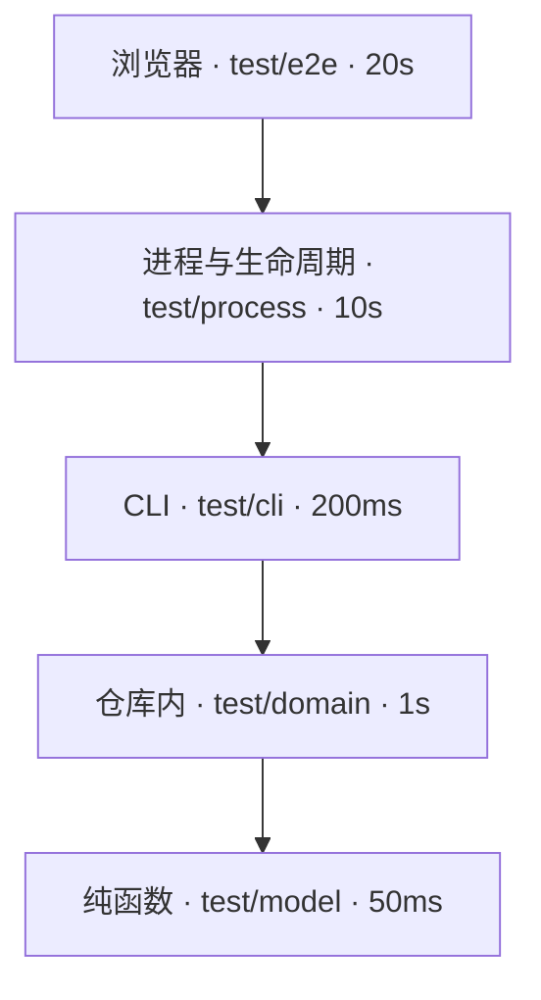

# 测试

测试是 Use Case 验收的可执行证据（[用 Concord 管理自身](../self-hosting/README.md#用-concord-管理自身)）。本文档包写给在本仓库写测试和改测试基础设施的维护者与 agent：一个测试怎么写、放在哪一层、怎么运行，以及交付前要满足什么。

一个好的测试在行为被破坏时失败，在行为不变的重构后仍然通过，结论不受机器负载影响，成本与它守护的行为相称。命令与参数见[测试命令](cli.md)，runner、Fixture 与浏览器的机制见[测试实现](architecture.md)。产品向消费项目提供的测试接入由 [local SDLC](../../feature/local-sdlc/README.md#测试的边界) 声明，不属于本主题。

## 上手示例

下面为[无外部服务时管理本地 Issue](../../feature/feedback/use-case/manage-local-observations.md) 的步骤 `#close` 写一个仓库内层测试。这一步的验收是：关闭后 Issue 文件消失，命令输出一段可以写进提交说明的结论。

1. 生成指向这个步骤的标记。

   ```sh
   pnpm concord test marker --contract 'docs/feature/feedback/use-case/manage-local-observations.md#close'
   ```

   输出：

   ```text
   // @use-case docs/feature/feedback/use-case/manage-local-observations.md#close
   ```

2. 新建 `test/domain/issue-close.test.ts`。`withConsumer` 复制一个已初始化的临时仓库，`createDocument` 经领域写入入口创建 Issue，测试直接调用 CLI 使用的同一个 `closeIssue`。

   ```ts
   import assert from 'node:assert/strict';
   import { existsSync } from 'node:fs';
   import { join } from 'node:path';
   import test from 'node:test';
   import { withConsumer } from '../support/consumer.ts';
   import { createDocument } from '../support/operations.ts';
   import { closeIssue } from '../../src/domain/issues/index.ts';

   // @use-case docs/feature/feedback/use-case/manage-local-observations.md#close
   test('closing a handled Issue deletes its file and prints a commit conclusion', () => withConsumer((repo, root) => {
     createDocument(repo, 'issue', { id: 'output-confusion', title: 'Output confusion' });
     const closed = closeIssue(repo, 'output-confusion', '帮助文本改为按任务分组');
     assert.equal(existsSync(join(root, 'docs/issues/output-confusion.md')), false);
     assert.match(closed.conclusion, /^Closed docs\/issues\/output-confusion\.md\nReason: 帮助文本改为按任务分组/u);
   }));
   ```

3. 运行受改动影响的测试。

   ```sh
   pnpm gate --changed
   ```

   预期输出（节选；只有这一处改动时只选中这个文件，耗时与路径随运行变化）：

   ```text
   # Test diagnostics: /home/me/Code/Concord/.test-results/run-Ab12Cd
   ok 1 - closing a handled Issue deletes its file and prints a commit conclusion
   # Node file: /home/me/Code/Concord/test/domain/issue-close.test.ts; 2.209s; success=true; logs=…
   # Node layer domain: files=1; cases=1; countedFiles=1; 2.209s (sum of file durations)
   ```

4. 确认关联已建立：`pnpm concord use-case steps docs/feature/feedback/use-case/manage-local-observations.md --fresh` 在 `close` 步骤的 `tests` 下列出这个测试。

交付前还要让新测试失败一次，见[质量标准](#质量标准)中的“会失败”。

## Use Case

| 我要 | 看 |
| --- | --- |
| 为一个 Use Case 步骤或结果表写测试 | [写行为测试](use-case/write-behavior-test.md) |
| 为一个缺陷写回归测试，修复后关闭 Issue | [写回归测试](use-case/write-regression-test.md) |
| 验证 Web 工作台的一条用户路径 | [写浏览器测试](use-case/write-browser-test.md) |
| 增加测试共用的仓库构造、等待或资源回收 | [扩展 Fixture](use-case/extend-fixtures.md) |
| 处理超出耗时上限的测试文件 | [拆分慢测试](use-case/split-slow-test.md) |

## 分层

每条验收在能观察到其结果的最低一层测试。上一层只为该层新增的边界写测试，不重复枚举下层已经覆盖的领域情形。



越往下越便宜、越稳定，测试数量也应越多。门禁按测试文件所在目录归层；`test/` 根下的 `*.test.ts` 属于纯函数层。

| 层 | 目录 | 边界 | 适用 | 单个测试 p50 上限 |
| --- | --- | --- | --- | ---: |
| 纯函数 | `test/model/` | 内存中的输入，直接调用领域函数 | 解析器、Schema、写作规则、关系推导、trace 编译、步骤与锚点、路径规范化 | 50ms |
| 仓库内 | `test/domain/` | 真实临时 Git 仓库，进程内调用 LocalRepository、领域操作，以及 CLI 命令调用的同一组应用层函数 | 发布、journal 与恢复、CAS、路径安全、缓存命中与失效、Memory 与 Issue 生命周期 | 1s |
| CLI | `test/cli/` | [进程内 CLI](architecture.md#进程内-cli)：同一命令程序在测试进程里运行，注入 argv、cwd、环境与标准流，隔离消费者 | 参数与帮助、`--json` 结构、退出码、具名错误、人读输出的呈现 | 不启动服务的命令 200ms |
| 进程与生命周期 | `test/process/` | 真实的多个进程、信号、原生模块、常驻服务与外部程序 | 只验证[跨进程保证](#跨进程保证) | 10s |
| 浏览器 | `test/e2e/` | e2e engine 拥有的真实浏览器 | Web 工作台的用户路径、导航、草稿保护、呈现 | 20s |

### 选哪一层

| 要回答的问题 | 层 | 例子 |
| --- | --- | --- |
| 给定一段文本或一组值，函数返回什么 | 纯函数 | `test/model/view-addresses.test.ts` 直接调用 `viewAddresses` |
| 在真实仓库里执行一个操作后，文件与结果是什么 | 仓库内 | `test/domain/current-owners.test.ts` 调用 `closeIssue` 后检查 Issue 文件 |
| 这条命令的参数、`--json` 结果和退出码是什么 | CLI | `test/cli/issue-local.test.ts` 用进程内 CLI 调用 `issue close` 并断言 `IssueReferenced` |
| 多个进程同时运行、被信号中断或常驻时保证什么 | 进程与生命周期 | `test/process/server-lock.test.ts` |
| 用户在浏览器里完成一条路径时看到什么 | 浏览器 | `test/e2e/view-performance-browser.e2e.ts` 从健康提示进入诊断 |

一个 CLI 或进程层测试若只是在验证领域情形，就下沉到仓库内层。

### 跨进程保证

进程层的断言必须依赖真实的 OS、进程生命周期或外部协议边界。只经公开应用入口就能观察的输入组合、错误矩阵、字段映射与状态转换，下沉到仓库内层，经应用层函数（例如 `executeQuery`、`runApplication`）验证；CLI 呈现由 CLI 层验证。

每个 `test/process/` 测试文件在开头的注释块声明它主要依赖的边界类别与具体保证，例如 `// 跨进程保证：OS 锁与互斥——持有者被杀后另一个进程恢复租约`。[架构守护](architecture.md#架构守护)检查声明存在且类别取自下表；保证是否必要由审阅核对实际断言。共享的 support 与 fixture 文件不需要声明。

| 类别 | 例子 |
| --- | --- |
| 进程终止与信号 | 持有者被杀后恢复、取消回收整个进程组、`server stop` 等服务进程退出 |
| OS 锁与互斥 | 多个进程争用写入租约、服务锁交接 |
| 服务与 IPC | 工作区服务的启动、复用、交接、断连后退出 |
| 文件监听 | 真实 watcher 观察新增、删除与重建 |
| 外部程序 | 测试 adapter、language server、`gh`、runner 等外部子进程的协议与退出 |
| 原生模块与句柄 | HawDB 原生绑定的加载、跨进程句柄占用与释放 |
| 运行环境 | 最小 `PATH`、没有构建输出、启动快路径、真实入口的退出码 |
| 网络 | 真实 HTTP 套接字的响应与连接回收 |

相互独立的具体保证可以放在不同文件。同一边界的代表用例可以覆盖必要的不同失败路径，数量由行为差异决定，不按类别各留一个。需要工作区服务、但不验证服务生命周期的用例使用[共享服务](architecture.md#共享服务)。

## 检查入口

`pnpm gate`（等价于 `vp run gate`）是唯一的检查入口，满足[用 Concord 管理自身](../self-hosting/README.md#用-concord-管理自身)。默认运行完整门禁，日常开发和 CI 使用同一条命令，不提供只做部分检查的入口。

| 阶段 | 内容 |
| --- | --- |
| 静态检查 | 源码、测试与脚本类型检查与[自举检查](../self-hosting/README.md)并行执行 |
| 构建 | 不构建归档。Web 产物与原生绑定取自按输入摘要共享的缓存，缺失时构建一次，见[从源码运行](../build/architecture.md#从源码运行) |
| 测试 | 全部测试层运行源码，与静态检查并行，不依赖任何构建产物的文件布局。唯一的打包测试见[打包测试](#打包测试) |

门禁不复制源码、不另建 worktree，检查的是 worktree 当前的文件，包括其它 agent 尚未提交的改动。本地交付与 CI 分片的用法见[完整门禁](cli.md#完整门禁)。按文件、标题、改动或分片选择测试时，静态检查与构建仍完整执行，交付说明写明运行的是哪一部分。

### 打包测试

归档的内容与启动只由打包测试验证。它从[共享构建缓存](../build/architecture.md#共享构建缓存)取得本机目标平台的[归档](../../feature/cross-platform-release/cli.md#发布资产)，解压到临时目录。

它在只含系统基础命令与 Git 的 `PATH` 中运行 `bin/concord`：没有真实的 `node`、`pnpm` 与 `rg`，另放以非零退出的 `node` 与 `rg` 探针，确认应用不回退到 `PATH`。

选中打包测试时，门禁一开始就与静态检查并行准备归档。共享构建缓存未命中时的构建是准备阶段，耗时单独报告，计入完整门禁的耗时上限；打包测试文件的单文件上限从归档就绪开始计时。

主机必须能运行通用的 glibc 二进制：NixOS 需要启用 nix-ld，否则打包测试以 `PackagedRuntimeUnavailable` 失败并给出启用方法，不跳过。核对以下结果：

| 核对 | 通过条件 |
| --- | --- |
| 文件清单 | 归档只含[归档构成](../../feature/cross-platform-release/architecture.md#归档构成)列出的部分，包括许可证文本，不含源码、测试或 worktree 路径 |
| 版本 | `concord --version` 输出包元数据中的版本 |
| 原生绑定 | 归档内的 HawDB 原生绑定通过身份校验并被实际加载 |
| Web 资源 | 归档内的 Web 资源存在，工作区服务能提供页面 |
| 帮助 | `concord --help` 以零退出 |
| 项目闭环 | 在临时 Git 仓库中 `concord init` 与 `concord check` 成功，退出后没有残留的服务进程 |

发版前另在每个目标的真实系统上验证候选归档，见[从标签发版](../../feature/cross-platform-release/use-case/release-from-tag.md#verify)。

## 质量标准

| 标准 | 规则 |
| --- | --- |
| 指向验收 | 每个测试用标记指向它验证的那条验收：产品测试指向 Feature、Use Case 或其步骤，仓库自身的检查（例如架构测试）指向 Engineering 页或其中的 anchor。一个测试验证一条验收；失败消息带输入、期望与实际，能直接定位到那条验收 |
| 断言可观察结果 | 只通过公开入口断言：CLI 的 `--json` 结果与退出码、HTTP 响应、库 API 的返回值、仓库文件的字节。不断言内部函数是否被调用、私有状态或日志措辞，写法见[断言](#断言) |
| 会失败 | 新测试在交付前至少对未实现或故意回退的实现运行一次并失败，交付说明记录这次失败。修复 Issue 的回归测试按[修复核验](../../feature/local-sdlc/use-case/resolve-with-command-evidence.md)取证 |
| 确定 | 不依赖时长、调度顺序、机器负载或网络；时钟、端口与随机数由测试注入或向系统申请。等待方式见[共享资源与同步](#共享资源与同步) |
| 便宜 | 在能观察到该结果的最低一层测试（[分层](#分层)），单个测试与整个门禁都有成本上限，见[成本与稳定](#成本与稳定) |

## 断言

- 结构化输出用公开 Schema 严格解码后比较领域事实；错误按 `error` 代码断言，不按消息文本。
- 人读输出只在呈现测试中断言，规范化动态值（摘要、时间、路径前缀）后与期望文本比较。
- Use Case 验收表按行参数化，每行一个子测试，子测试名带行号（例如 C10）。
- 子进程断言失败时输出 exit code、signal、耗时与截断后的 stdout/stderr，以区分「输出已完整但未退出」与「没有输出」。
- 断言具体值，不断言「不为空」「大于零」这类任何实现都能满足的条件；集合按排序后的完整内容比较。
- 测试源码不手写受管格式的 frontmatter、配置或 JSON，受管文件由格式的 owner 生成（[Fixture](architecture.md#fixture)）。验证无效输入的测试集中在一张无效输入表中，每行给出输入、所属格式与期望的具名错误。

## 共享资源与同步

并发执行只有在每个测试不改坏他人、也不被他人的负载误判时才可信。以下规则适用于测试、Fixture 与测试进程调用的脚本。

| 方面 | 规则 |
| --- | --- |
| 并发隔离 | 测试拥有各自的临时目录、动态端口与进程组；依赖全局状态的用例在文件内串行，不降低全局并发 |
| 私有副本 | 会修改、损坏、删除或替换安装文件的测试与脚本只使用自己临时目录中的副本，不改动 worktree；调用这类脚本的测试同样使用私有副本 |
| 替换文件 | 替换可能被其它进程打开或映射的文件（`.node`、安装目录中的 JS、缓存与锁之外的产物）时，先写同目录的新文件，再 rename 覆盖，不原地截断或改写。原地改写已映射的原生库会使正在运行的进程崩溃 |
| HTTP 客户端 | 测试中的请求默认每次使用新连接，不复用 keep-alive 连接；只有验证连接复用的测试显式复用。事件循环停顿可能超过服务端空闲超时，复用的连接会在请求时被重置 |
| 等待 | 断言等待真实的产品状态：具体的请求与响应、投影结果或文件内容。固定时长只是等待上限；不以延长超时、重试整段操作或 mock 成功响应代替同步 |
| 内存 | 完整门禁在默认并发下的内存峰值（含 swap）不超过参照机器物理内存的一半，在 31 GiB 的参照机上为 15 GiB；门禁记录每次运行的峰值。门禁在独立的 systemd scope 中运行并以该上限为 `MemoryMax`，超出时只终止门禁本身，不影响同一会话中的其它进程。每次门禁另建一个只属于它的 slice 包住这个 scope，slice 设同样的 `MemoryMax` 且禁用 swap；报告的峰值读自 slice，因为较旧的 systemd 删除被 OOM 终止的 scope 时不保留其峰值。门禁的调用方在报告写完后回收 scope 与 slice。没有 systemd user scope 的环境（例如 macOS 与容器化 CI）直接运行，并发仍按内存计算，报告写明 `memoryIsolation: "unavailable"` 与原因，不因此失败 |
| 负载 | 同一台机器同时只运行一次完整门禁。失败报告记录运行时的 load average 与并发运行的其它门禁；过载下的超时与连接重置，须在空闲机器上复跑后才能归因 |
| 诊断 | reporter 与诊断代码不得因测试产生的异常对象（循环引用、超大输出）而失败，原始失败事件仍交给 runner |

确定性测试不配置模型，不需要凭据，不发出付费模型调用。重试和结果缓存关闭。失败保留 trace、截图与 runner 报告；诊断不得依赖测试通过之后才能执行的代码。

## 自然语言用例

自然语言用例表达用户目标，精确断言判断结果。适合的操作包括创建 Unicode Feature 与 Use Case、打开和刷新深链接、切换文档、删除本地草稿，以及从健康提示进入诊断。文件持久化、准确路由、删除范围和草稿保护仍由确定性断言验证。

请求计数、CAS 冲突、乱序响应、时钟推进、CSS 几何、剪贴板权限和沙箱边界使用确定性测试。自然语言不负责推断请求顺序、等待固定时间或判断精确像素。

| 用例 | 自然语言操作 | 始终保留的精确检查 |
| --- | --- | --- |
| Unicode Feature / Use Case | 创建 Spec 并打开详情 | 编码路由、刷新恢复、文件中的 Unicode ID |
| Memory 与本地草稿 | 桌面和移动导航、确认删除草稿 | 当前选择、正文、索引中不存在已删除草稿 |
| 工作区健康提示 | 打开诊断并关闭提示条 | URL anchor、具体错误文件、提示消失后诊断仍存在 |

新流程实际覆盖旧用例的行为与关键断言后，删除对应旧用例；部分覆盖只移除已覆盖部分。未执行的自然语言用例不能替代完整门禁中的回归保障。两种运行方式共用场景的机制见[浏览器与诊断](architecture.md#浏览器与诊断)，运行命令见[自然语言运行](cli.md#自然语言运行)。

## 可追溯

测试与 Spec 的关系由测试标记拥有，`concord trace gaps` 从标记派生没有测试的 Use Case。本仓库的目标是零缺口：新增或修改 Use Case 的交付同时提交对应测试。

尚未实现的 Use Case 留在缺口列表中，由一个打开的 Issue 跟踪实现：该 Issue 的 `spec` 关系指向这个 Use Case 或其所属 Feature 的 README（`concord issue link <id> --role spec <路径>`）。自举测试只检查是否存在这样的打开 Issue，不检查它的正文是否足以承担这项工作；`spec` 关系也不区分缺陷与缺口，需要精确跟踪时链接具体的 Use Case。

`test/domain/trace-gap-issues.test.ts` 对本仓库派生 `trace gaps` 的 `contracts`，其中 `missing` 含 `test` 的项没有这样的 Issue 即失败，失败信息列出缺少 Issue 的路径。只缺 `code` 的项如实留在列表中，不为归零补写不对应实现的代码声明；例如测试教程的示例在 `test/` 下，`install.sh` 不在代码扫描的语言范围内。已有测试能观察某个 Use Case 的结果时，给该测试加标记，不另写重复测试。测试不指向 Roadmap、Design 或已删除的行为；行为删除时，对应测试在同一次交付中删除。

## 成本与稳定

| 指标 | 上限 |
| --- | --- |
| 完整门禁 | 参照机器空闲时单机不超过 5 分钟；CI 四个分片每片不超过 2 分钟 |
| 单个测试文件 | 不超过 60 秒 |
| 单个测试 | 所在层的 p50 上限 |

完整门禁与 CI 分片是否达标只看墙钟时间。各层另有期望的成本分配，用来定位重复的进程启动与不必要的边界；它们是维护预算，不能由层的合计推出门禁达标：

| 层 | 文件耗时之和 | 子进程与工作区服务 |
| --- | ---: | --- |
| 纯函数 | 60 秒 | 不启动 |
| 仓库内 | 300 秒 | 只启动 Git |
| CLI | 60 秒 | 不为调用另起 CLI 宿主进程；命令自身需要的服务按文件共享 |
| 进程与生命周期 | 500 秒 | 普通服务用例每个文件冷启动一个共享服务；冷启动、重启、交接、崩溃或独占状态的用例使用私有服务 |
| 浏览器 | 400 秒 | 每个 worker 一个共享服务；独占状态用例的私有服务另计并回收 |

门禁报告分别列出：Node 测试文件的 elapsed 之和、浏览器 attempt 耗时之和、worker 与共享 fixture 的启停耗时、构建与归档准备、静态检查、串行的打包阶段、整体墙钟与内存峰值，并写明选择范围与并发。缺测、失败或未计时的部分标为未知。

报告按层统计 Concord 子进程与工作区服务。Concord 子进程指测试文件进程之后新启动的 Concord CLI、worker、服务、计算与操作进程，按角色分别计数；Node runner 的文件进程、Git、浏览器与外部 runner 不计入。工作区服务分别报告启动尝试、就绪的实例与复用的连接。计数来自进程启动时记录的事件：测试支持代码与产品的进程启动适配都记录事件，带本次运行与测试文件的关联 ID 传给后代，每个进程写自己的事件文件，由 runner 合并去重。没有接入事件的启动路径不能报告为 0。

门禁报告列出耗时超出上限的文件，但不因此以失败退出：耗时随机器负载波动，以耗时判失败会制造不稳定的门禁。上限由交付与[验收](#验收)执行。Runner 另给每个 Node 测试文件 5 分钟的超时，只用来终止挂起的文件，不是成本上限。

交付使某个文件或某一层超出上限时，把领域情形下移一层，或拆分文件以便并发，不提高上限（[拆分慢测试](use-case/split-slow-test.md)）。

把测试下沉到另一层时，旧测试的每条独特保证在新层仍有观察者：逐个用例对应旧的输入、期望输出与文件副作用，保留真实边界的代表，并让新测试对故意回退的实现失败一次。新旧测试并存运行、结果一致后才删除旧测试。用例数与断言数相等、trace 标记一致都不能代替这一步；对应记录留在交付材料中，不写进仓库。

不稳定的测试是缺陷：门禁不重试测试。空闲机器复跑通过的失败登记为 Issue，写明失败输出与运行时负载；修复时找到同步缺失或共享资源冲突，不以延长超时、重试整段操作或降低断言消除失败。修复必须改动回归测试或 `runner.sourceFiles` 中的文件时，缺陷在测试自身（例如没有等待真实的保存结果）或测试基础设施（门禁脚本、runner、support），无法走 `--fixed` 核验，因为核验要求两次运行之间这些文件不变。这类缺陷仍先提交能复现失败的测试或记录失败的定向命令输出，再提交修复，然后用 `concord issue close <id> --reason` 关闭，原因写明根因、失败证据、修复提交和修复后同一定向命令的结果；不称作 fixed。根因在产品行为时按 `--fixed` 流程处理。

## 验收

- `concord trace gaps` 中缺测试的 Use Case 都有对应 Issue。
- 测试源码中除无效输入表外没有手写的受管格式文本。
- 最近一次完整门禁的耗时报告满足[成本与稳定](#成本与稳定)；超出项都有 Issue。
