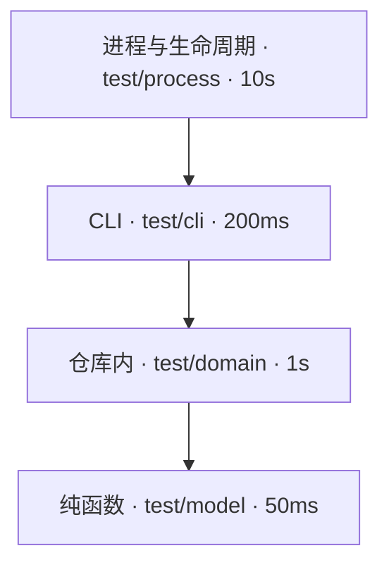

# 测试

测试是 Use Case 验收的可执行证据（[用 Concord 管理自身](../self-hosting/README.md#用-concord-管理自身)）。本文档包写给在本仓库写测试和改测试基础设施的维护者与 agent：一个测试怎么写、放在哪一层、怎么运行，以及交付前要满足什么。

一个好的测试在行为被破坏时失败，在行为不变的重构后仍然通过，结论不受机器负载影响，成本与它守护的行为相称。命令与参数见[测试命令](cli.md)，runner 与 Fixture 的机制见[测试实现](architecture.md)。产品向消费项目提供的测试接入由 [local SDLC](../../feature/local-sdlc/README.md#测试的边界) 声明，不属于本主题。

## 上手示例

下面为[无外部服务时管理本地 Issue](../../feature/feedback/use-case/manage-local-observations.md) 的步骤 `#close` 写一个仓库内层测试。这一步的验收是：关闭后 Issue 文件消失，命令输出一段可以写进提交说明的结论。

1. 生成指向这个步骤的标记。

   ```sh
   bun run concord test marker --contract 'docs/feature/feedback/use-case/manage-local-observations.md#close'
   ```

   输出：

   ```text
   // @use-case docs/feature/feedback/use-case/manage-local-observations.md#close
   ```

2. 新建 `test/domain/issue-close.test.ts`。`withConsumer` 复制一个已初始化的临时仓库，`createDocument` 经领域写入入口创建 Issue，测试直接调用 CLI 使用的同一个 `closeIssue`。

   ```ts
   import assert from 'node:assert/strict';
   import { existsSync } from 'node:fs';
   import { join } from 'node:path';
   import test from 'node:test';
   import { withConsumer } from '../support/consumer.ts';
   import { createDocument } from '../support/operations.ts';
   import { closeIssue } from '../../src/domain/issues/index.ts';

   // @use-case docs/feature/feedback/use-case/manage-local-observations.md#close
   test('closing a handled Issue deletes its file and prints a commit conclusion', () => withConsumer((repo, root) => {
     createDocument(repo, 'issue', { id: 'output-confusion', title: 'Output confusion' });
     const closed = closeIssue(repo, 'output-confusion', '帮助文本改为按任务分组');
     assert.equal(existsSync(join(root, 'docs/issues/output-confusion.md')), false);
     assert.match(closed.conclusion, /^Closed docs\/issues\/output-confusion\.md\nReason: 帮助文本改为按任务分组/u);
   }));
   ```

3. 运行受改动影响的测试。

   ```sh
   bun run test --changed
   ```

   预期输出（节选；只有这一处改动时只选中这个文件，耗时与路径随运行变化）：

   ```text
   # Test diagnostics: /home/me/Code/Concord/.test-results/run-Ab12Cd
   test/domain/issue-close.test.ts:
   (pass) closing a handled Issue deletes its file and prints a commit conclusion
   1 pass
   0 fail
   ```

4. 确认关联已建立：`bun run concord use-case steps docs/feature/feedback/use-case/manage-local-observations.md --fresh` 在 `close` 步骤的 `tests` 下列出这个测试。

交付前还要让新测试失败一次，见[质量标准](#质量标准)中的“会失败”。

## Use Case

| 我要 | 看 |
| --- | --- |
| 为一个 Use Case 步骤或结果表写测试 | [写行为测试](use-case/write-behavior-test.md) |
| 为一个缺陷写回归测试，修复后关闭 Issue | [写回归测试](use-case/write-regression-test.md) |
| 增加测试共用的仓库构造、等待或资源回收 | [扩展 Fixture](use-case/extend-fixtures.md) |
| 处理超出耗时上限的测试文件 | [拆分慢测试](use-case/split-slow-test.md) |

## 分层

本仓库维护纯函数、仓库内、CLI 与进程测试。浏览器交互、自然语言操作以及真实 Node/Vitest 消费者兼容场景及依赖 Node runner 的修复核验集成场景不属于自动验收范围；产品仍支持这些消费项目的 adapter，但门禁不证明其真实运行时兼容性。开发与 CI 不安装 Node 或浏览器。

每条验收在能观察到其结果的最低一层测试。上一层只为该层新增的边界写测试，不重复枚举下层已经覆盖的领域情形。



越往下越便宜、越稳定，测试数量也应越多。门禁按测试文件所在目录归层；`test/` 根下的 `*.test.ts` 属于纯函数层。

| 层 | 目录 | 边界 | 适用 | 单个测试 p50 上限 |
| --- | --- | --- | --- | ---: |
| 纯函数 | `test/model/` | 内存中的输入，直接调用领域函数 | 解析器、Schema、写作规则、关系推导、trace 编译、步骤与锚点、路径规范化 | 50ms |
| 仓库内 | `test/domain/` | 真实临时 Git 仓库；进程内调用 LocalRepository、领域操作与 CLI 使用的同一组应用层函数 | 发布、journal 与恢复、CAS、路径安全、缓存命中与失效、Memory 与 Issue 生命周期 | 1s |
| CLI | `test/cli/` | [进程内 CLI](architecture.md#进程内-cli)：同一命令程序在测试进程里运行，注入 argv、cwd、环境与标准流，隔离消费者 | 参数与帮助、`--json` 结构、退出码、具名错误、人读输出的呈现 | 不启动服务的命令 200ms |
| 进程与生命周期 | `test/process/` | 真实的多个进程、信号、原生模块、常驻服务与外部程序 | 只验证[跨进程保证](#跨进程保证) | 10s |

### 选哪一层

| 要回答的问题 | 层 | 例子 |
| --- | --- | --- |
| 给定一段文本或一组值，函数返回什么 | 纯函数 | `test/model/view-addresses.test.ts` 直接调用 `viewAddresses` |
| 在真实仓库里执行一个操作后，文件与结果是什么 | 仓库内 | `test/domain/current-owners.test.ts` 调用 `closeIssue` 后检查 Issue 文件 |
| 这条命令的参数、`--json` 结果和退出码是什么 | CLI | `test/cli/issue-local.test.ts` 用进程内 CLI 调用 `issue close` 并断言 `IssueReferenced` |
| 多个进程同时运行、被信号中断或常驻时保证什么 | 进程与生命周期 | `test/process/server-lock.test.ts` |

一个 CLI 或进程层测试若只是在验证领域情形，就下沉到仓库内层。

### 跨进程保证

进程层的断言必须依赖真实的 OS、进程生命周期或外部协议边界。只经公开应用入口就能观察的输入组合、错误矩阵、字段映射与状态转换，下沉到仓库内层，经应用层函数（例如 `executeQuery`、`runApplication`）验证；CLI 呈现由 CLI 层验证。

每个 `test/process/` 测试文件在开头的注释块声明它主要依赖的边界类别与具体保证，例如 `// 跨进程保证：OS 锁与互斥——持有者被杀后另一个进程恢复租约`。[架构守护](architecture.md#架构守护)检查声明存在且类别取自下表；保证是否必要由审阅核对实际断言。共享的 support 与 fixture 文件不需要声明。

| 类别 | 例子 |
| --- | --- |
| 进程终止与信号 | 持有者被杀后恢复、取消回收整个进程组、`server stop` 等服务进程退出 |
| OS 锁与互斥 | 多个进程争用写入租约、服务锁交接 |
| 服务与 IPC | 工作区服务的启动、复用、交接、断连后退出 |
| 文件监听 | 真实 watcher 观察新增、删除与重建 |
| 外部程序 | 测试 adapter、language server、`gh`、runner 等外部子进程的协议与退出 |
| 原生模块与句柄 | HawDB 原生绑定的加载、跨进程句柄占用与释放 |
| 运行环境 | 最小 `PATH`、没有构建输出、启动快路径、真实入口的退出码 |
| 网络 | 真实 HTTP 套接字的响应与连接回收 |

相互独立的具体保证可以放在不同文件。同一边界的代表用例可以覆盖必要的不同失败路径，数量由行为差异决定，不按类别各留一个。需要工作区服务、但不验证服务生命周期的用例使用[共享服务](architecture.md#共享服务)。

## 检查入口

测试、性能采样、静态工具分别调用，不设置聚合入口（[用现成的能力，不重写](../../taste.md#t-10)）。

| 命令 | 职责 |
| --- | --- |
| `bun run test` | 官方 Bun 源码测试；文件、标题、changed 与 shard 参数见[测试入口](cli.md#测试入口) |
| `bun run bench` | Mitata 性能测量，按[性能验收](../performance/README.md)对照预算 |
| `bun run typecheck` | 产品源码类型检查 |
| `bun run typecheck:test` | 测试类型检查 |
| `bun run typecheck:scripts` | 脚本与 benchmark 类型检查 |
| `bun run typecheck:web` | Web 类型检查 |
| `bun run lint` | Oxlint 静态规则 |
| `bun run concord --json --dry-run check` | 自举文档、术语与关系检查 |

交付分别运行适用命令，报告实际范围与失败。完整交付运行全部静态检查与源码测试；性能受影响时另跑 benchmark。检查 worktree 当前文件，编辑使结果过时后重跑（[Spec 随时可改](../../taste.md#t-12)）。Web 与原生产物按各自缓存准备，不构建归档。

### 归档构建

CI 发版工作流在每个目标宿主构建最终归档；编译、资源构建或组装失败直接使构建命令非零退出。两个目标构建和同一标签 commit 的完整检查成功后，发布原始归档字节，见[从标签发版](../../feature/cross-platform-release/use-case/release-from-tag.md#package)。日常测试运行源码测试，不构建归档，也不维护单独的 release 测试套件（[快到每次都愿意跑](../../taste.md#t-7)）。

## 质量标准

每个测试满足以下五条标准。

1. **指向验收**：测试用标记指向它验证的那条验收。产品测试指向 Feature、Use Case 或其步骤；仓库自身的检查（例如架构测试）指向 Engineering 页或其中的 anchor。一个测试只验证一条验收，失败消息带输入、期望与实际，能直接定位到那条验收。
2. **断言可观察结果**：只通过公开入口断言，即 CLI 的 `--json` 结果与退出码、HTTP 响应、库 API 的返回值和仓库文件的字节。不断言内部函数是否被调用、私有状态或日志措辞。写法见[断言](#断言)。
3. **会失败**：新测试在交付前至少对未实现或故意回退的实现运行一次并失败，交付说明记录这次失败。修复 Issue 的回归测试按[修复核验](../../feature/local-sdlc/use-case/resolve-with-command-evidence.md)取证。
4. **确定**：不依赖时长、调度顺序、机器负载或网络。时钟、端口与随机数由测试注入或向系统申请，等待方式见[共享资源与同步](#共享资源与同步)。
5. **便宜**：在能观察到该结果的最低一层测试（[分层](#分层)）。单个测试与整个门禁都有成本上限，见[成本与稳定](#成本与稳定)。

## 断言

- 结构化输出用公开 Schema 严格解码后比较领域事实；错误按 `error` 代码断言，不按消息文本。
- 人读输出只在呈现测试中断言，规范化动态值（摘要、时间、路径前缀）后与期望文本比较。
- Use Case 验收表按行参数化，每行一个子测试，子测试名带行号（例如 C10）。
- 子进程断言失败时输出 exit code、signal、耗时与截断后的 stdout/stderr，以区分「输出已完整但未退出」与「没有输出」。
- 断言具体值，不断言「不为空」「大于零」这类任何实现都能满足的条件；集合按排序后的完整内容比较。
- 测试源码不手写受管格式的 frontmatter、配置或 JSON，受管文件由格式的 owner 生成（[Fixture](architecture.md#fixture)）。验证无效输入的测试集中在一张无效输入表中，每行给出输入、所属格式与期望的具名错误。

## 共享资源与同步

并发执行只有在每个测试不改坏他人、也不被他人的负载误判时才可信。以下规则适用于测试、Fixture 与测试进程调用的脚本。

1. **并发隔离**：测试拥有各自的临时目录、动态端口与进程组。依赖全局状态的用例在文件内串行，不降低全局并发。
2. **私有副本**：会修改、损坏、删除或替换安装文件的测试与脚本，只使用自己临时目录中的副本，不改动 worktree。调用这类脚本的测试同样使用私有副本。
3. **替换文件**：替换可能被其它进程打开或映射的文件（`.node`、安装目录中的 JS、缓存与锁之外的产物）时，先写同目录的新文件，再 rename 覆盖，不原地截断或改写。原地改写已映射的原生库会使正在运行的进程崩溃。
4. **HTTP 客户端**：测试中的请求默认每次使用新连接，只有验证连接复用的测试才显式复用 keep-alive 连接。事件循环停顿可能超过服务端空闲超时，复用的连接会在请求时被重置。
5. **等待**：断言等待真实的产品状态，即具体的请求与响应、投影结果或文件内容。固定时长只是等待上限；不以延长超时、重试整段操作或 mock 成功响应代替同步。
6. **负载**：测试与 benchmark 不同时占用参照机器；负载下的超时和连接重置在空闲机器上复跑后才能归因。使用 Bun 官方 `--parallel` 设置文件并行数，不维护共享队列或内存准入机制。
7. **诊断**：保留 Bun 原始失败日志；可选的产品生命周期诊断只记录产品资源，不重建测试 reporter。

确定性测试不配置模型，不需要凭据，不发出付费模型调用。重试和结果缓存关闭。失败保留日志与 runner 报告；诊断不得依赖测试通过之后才能执行的代码。

## 可追溯

测试与 Spec 的关系由测试标记拥有，`concord trace gaps` 从标记派生没有测试的 Use Case。自动验收范围内的新增或修改 Use Case 同时提交对应测试。Web 工作台的浏览器 Use Case 与依赖真实 Node 清单的[未关联测试发现](../../feature/local-sdlc/use-case/find-unlinked-tests.md)允许没有测试，`trace gaps` 如实保留这些缺口，不为已明确取消的浏览器验收建立待补测 Issue。

尚未实现的 Use Case 留在缺口列表中，由一个打开的 Issue 跟踪实现。该 Issue 的 `spec` 关系指向这个 Use Case 或其所属 Feature 的 README（`concord issue link <id> --role spec <路径>`）。

自举测试只检查这样的打开 Issue 是否存在，不检查它的正文是否足以承担这项工作。`spec` 关系也不区分缺陷与缺口，需要精确跟踪时链接具体的 Use Case。

`test/domain/trace-gap-issues.test.ts` 对本仓库派生 `trace gaps` 的 `contracts`。自动验收范围内 `missing` 含 `test` 的项没有这样的 Issue 即失败，失败信息列出缺少 Issue 的路径。

只缺 `code` 的项如实留在列表中，不为归零补写不对应实现的代码声明。例如测试教程的示例在 `test/` 下，`install.sh` 不在代码扫描的语言范围内。

已有测试能观察某个 Use Case 的结果时，给该测试加标记，不另写重复测试。测试不指向 Roadmap、Design 或已删除的行为；行为删除时，对应测试在同一次交付中删除。

## 成本与稳定

| 指标 | 上限 |
| --- | --- |
| 完整门禁 | 参照机器空闲时单机不超过 5 分钟；CI 十六个源码分片每片不超过 2 分钟，打包任务不超过 5 分钟 |
| CI 原生产物准备 | 最终产物缓存命中或下载时均不超过 1 分钟 |
| CI 故障注入 | 含测试产物校验与门禁，不超过 5 分钟 |
| 单个测试文件 | 不超过 60 秒 |
| 单个测试 | 所在层的 p50 上限 |

CI 的任务耗时从 runner 开始执行到任务清理完成，包含 checkout、工具安装、缓存恢复、产物传输与校验。单独列出 `bun run test` 耗时不能代替任务耗时。原生产物准备、故障注入与分片分别报告，缓存命中与首次下载分开验收。

整条 CI 另外报告从本次运行开始到全部必需任务结束的墙钟，包含排队与任务依赖等待。准备任务成功后的分片与故障注入并行；执行链不超过 6 分钟。runner 排队时间单列，不能通过移动步骤隐藏准备成本。

完整门禁与 CI 分片是否达标只看墙钟时间。测试文件交给 Bun 的[文件并发](cli.md#并发)，不按内存预算排队。每个 Fixture 在结束前释放自有产品资源，整次调用结束时确认残留得到回收。

排程估算使用文件耗时与文件并发数；文件不能切分，分片不均衡仍可能使墙钟超限。参照机留 60 秒，CI 分片留 30 秒给启动、静态检查与回收。每个分片以实际运行时间验收。

各层另有期望的成本分配，用来定位重复的进程启动与不必要的边界。它们是维护预算，各层合计在预算内不代表门禁达标：

| 层 | 文件耗时之和 | 子进程与工作区服务 |
| --- | ---: | --- |
| 纯函数 | 60 秒 | 不启动 |
| 仓库内 | 300 秒 | 只启动 Git |
| CLI | 60 秒 | 不为调用另起 CLI 宿主进程；命令自身需要的服务按文件共享 |
| 进程与生命周期 | 500 秒 | 普通服务用例每个文件冷启动一个共享服务；冷启动、重启、交接、崩溃或独占状态的用例使用私有服务 |

验收保留官方文件耗时、JUnit 与日志，人工记录各命令和 CI 的墙钟。没有观测的资源数据标为未知，不按 worker PID 推断单文件资源。

官方 timings 用于查找慢文件，不以历史耗时决定测试通过。耗时随机器负载波动，成本上限由交付与[验收](#验收)执行。

测试超时由 Bun 执行，整个调用的异常终止期限由 CI 控制。超时用于终止挂起，不是成本上限，不为成本报告维护逐文件 runner。

交付使某个文件或某一层超出上限时，把领域情形下移一层，或拆分文件以便并发，不提高上限（[拆分慢测试](use-case/split-slow-test.md)）。

### 下沉测试

把测试下沉到另一层时，旧测试的每条独特保证在新层仍要有观察者：

1. 逐个用例对应旧的输入、期望输出与文件副作用。
2. 保留真实边界的代表。
3. 新测试对故意回退的实现失败一次。
4. 新旧测试并存运行、结果一致后，才删除旧测试。

用例数与断言数相等、trace 标记一致，都不能代替这一步。对应记录留在交付材料中，不写进仓库。

### 不稳定的测试

不稳定的测试是缺陷，门禁不重试测试。空闲机器复跑通过的失败登记为 Issue，写明失败输出与运行时负载。修复时找到同步缺失或共享资源冲突，不以延长超时、重试整段操作或降低断言消除失败。

根因在产品行为时，按 `--fixed` 流程处理。根因在测试自身（例如没有等待真实的保存结果）或测试基础设施（门禁脚本、runner、support）时，修复必须改动回归测试或 `runner.sourceFiles` 中的文件。`--fixed` 核验要求两次运行之间这些文件不变，所以这类缺陷按以下步骤关闭：

1. 先提交能复现失败的测试，或记录失败的定向命令输出。
2. 再提交修复。
3. 用 `concord issue close <id> --reason` 关闭。原因写明根因、失败证据、修复提交和修复后同一定向命令的结果；这样的关闭不称作 fixed。

## 验收

- `concord trace gaps` 中缺测试的 Use Case 都有对应 Issue。
- 测试源码中除无效输入表外没有手写的受管格式文本。
- 最近一次完整门禁的耗时报告满足[成本与稳定](#成本与稳定)；超出项都有 Issue。
