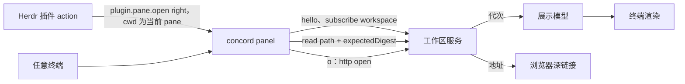

# Herdr 面板的实现

面板是[工作区服务](../local-data-engine/architecture.md#工作区服务)的只读客户端。可观察行为见 [README](README.md) 与各 Use Case。

## Entity Ownership

| 实体 | 拥有者 | 生命周期 |
| --- | --- | --- |
| `concord panel` 进程 | 启动它的终端或 Herdr pane | 用户退出或终端关闭时结束 |
| 服务连接 | 面板进程 | 启动时连接或启动服务；服务退出后自动重连 |
| 展示模型 | 面板进程 | 由最新代次与按需读取的正文派生，不持久化 |
| Herdr 插件 | Concord 安装包中的 `herdr/herdr-plugin.toml` | 用户通过 Herdr 安装插件；插件只含清单，命令指向安装它的那一份 Concord 的入口 |

面板不打开 HawDB，不扫描来源，不取得 publication 或文件租约；按 `o` 时向服务取得一个 HTTP 监听租约。条目、关系、测试状态与诊断全部来自服务推送的代次；正文通过服务的 `read` 定向读取。

## Data Flow

1. 启动：按[启动与裁决](../local-data-engine/architecture.md#启动与裁决)连接或启动服务，订阅 `workspace`。先渲染服务的当前代次；服务尚无代次时显示构建中。
2. 更新：每个新代次替换展示模型。选中项按条目路径保持；路径消失时选中所属条目，没有所属条目时选中列表首项。滚动位置按条目保留。
3. 正文：打开条目时发送 `read {path, expectedDigest}`，期望摘要取自当前展示代次。实际摘要相同才与该代次的关系一起显示；不同时保留已匹配的旧正文或显示正在更新，等待下一个代次后重读，不把新正文拼进旧关系。结果按摘要缓存在进程内。
4. Web：`o` 发送 `http {open, host: 127.0.0.1, port: 4317}`，以返回的地址加条目深链接调用系统浏览器；没有可用浏览器时只显示地址。

## 渲染

终端渲染使用 React 的终端渲染器，依赖按精确版本固定。展示模型的派生函数（分类、Feature 与 Use Case 树、实现与测试分组、测试状态汇总）与 Web 工作台共用一份 TypeScript 模块，两端对同一代次得到相同结果。Markdown 由现有 Markdown 语法树转换为终端文本，Mermaid 与 p5 图块只显示源码与提示。概念标记使用代次中当前文档目录的有效概念。

宽度不少于 60 列时双栏，更窄时单栏。遵守 `NO_COLOR`；状态同时用文字或符号表示。

## Herdr 插件

`herdr-plugin.toml` 声明一个 action 与一个受管 pane。action 读取调用时插件上下文中的 `focused_pane_cwd` 与 `focused_pane_id`，调用 `plugin.pane.open`，以 `direction: right`、`target_pane_id` 与该 cwd 打开受管 pane。manifest 中 pane 的命令固定为安装插件时写入的这份 Concord 入口的绝对路径加 `panel`，不依赖 PATH；action 在 `plugin.pane.open` 的 cwd 中传入已验证的工作目录，面板以进程工作目录所在的工作树为 root。

上下文没有 cwd 时以具名错误 `PanelWorktreeUnknown` 提示，不用插件目录或当前焦点代替。

面板启动的工作区服务运行在 Concord 安装目录中，不在插件目录中；插件的安装、链接与卸载不影响服务，服务按自身规则退出。

## Invariants

1. 面板不写入仓库文件，不打开持久缓存，不取得 publication 或文件租约。
2. 面板与 Web 对同一代次显示相同的条目、关系、测试状态与诊断。
3. 面板退出时释放自己的连接、输入、定时器与渲染资源；服务及由面板开启的 HTTP 租约按工作区服务的规则继续或释放。

## Errors

| 阶段 | 失败 | 结果 |
| --- | --- | --- |
| 启动 | 不在 Git 工作树中或没有 Concord 配置 | 显示原因与 `concord init` 提示，非零退出 |
| 启动 | 服务不可用 | `WorkspaceServerUnavailable`，非零退出 |
| 启动 | Herdr 插件上下文没有当前 pane 的 cwd | `PanelWorktreeUnknown`，不打开 pane |
| 运行 | 服务连接断开 | 保留当前画面，显示重连中，自动重连后替换为最新代次 |
| 运行 | 某个 owner 无法解析 | 在该条目位置显示诊断 |
| `o` | 没有可用浏览器 | 只显示地址 |

## Identity and Reuse

面板只与同安装身份的服务交互；身份不同时按服务的交接规则启动新服务。进程内的正文缓存以路径与摘要为键，随进程结束。
