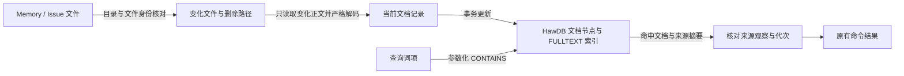

# 统一缓存与检索引擎的实现

本页声明 HawDB 的原生边界、句柄与清理所有权、工作区服务、资源预算，以及诊断投影的刷新与发布。可观察行为见 [README](README.md) 与各 Use Case。

## 原生边界

Concord 通过官方 `@nowledge/hawdb-bun` 适配器调用 HawDB 官方发行的普通 C ABI 动态库，不维护 Rust 或 N-API fork；原生例外的范围遵守[技术栈](../../engineering/build/README.md#技术栈)。适配器版本、动态库的来源信任、官方清单与安装收据由[原生绑定复用](../../engineering/build/architecture.md#原生绑定复用)拥有，运行时只加载经验证的显式库路径。官方适配器提供参数化 Cypher 与 SQL、同步事务回调，以及明确的数据库与库释放；这些调用阻塞调用线程。

发行产物使用官方 default profile。Concord 只使用关系表与图属性 `FULLTEXT` 索引，供[Memory 与 Issue 检索](#knowledge-search)使用；不使用向量检索、embedding、图分析或显式引擎维护。

关系缓存使用参数化 SQL。子串查询与排序不称为 BM25 或语义检索。HawDB 不替代事实 owner、发布恢复日志或 agent 的验证结果。

检索投影使用 HawDB 的图属性 `FULLTEXT` 索引与参数化 Cypher。TypeScript 负责来源安全、严格解码、文本归一化、发布协调和输出；候选查找、文本谓词与事务可见性由 HawDB 执行，不在 Concord 中维护倒排表或 n-gram 算法（[用现成的能力](../../taste.md#t-10)）。数据库 Worker 只传递有界查询、事务和结果，不决定搜索语义。

官方库报告的锁争用映射为 `HawdbBusy`，该分类贯穿 schema 与事务准入。事务获取失败保留具名错误，真正的 schema 形状错误为 `HawdbIncompatible`。

### 数据库 Worker

工作区服务进程持有一个专用 Bun Worker。它独占持久 HawDB 句柄并串行执行缓存与检索请求，使同步 FFI 调用不在服务的 socket 事件循环上执行。主线程只传递经严格 Schema 解码的有限请求和值，不传递句柄、指针、事务对象、SQL、Cypher 或调用者提供的函数。

Worker 只接受固定操作：打开、缓存批量读取、扫描与写入、命名空间清空、缓存状态、合并派生结果、合并反馈、替换工作区观察、检索更新与读取、关闭。请求与结果各自严格解码。

- 一个请求在 Worker 内使用官方 `database.transaction(callback)`，全部内部批次在同一个同步回调中完成。回调不返回 Promise，事务不离开回调。
- 反馈合并在 Worker 内调用同一 TypeScript 规则，在一个事务中读取、比较并写入。
- `query_cache` 与 `workspace_projection` 的更新按[比较替换](data-model.md#compare-and-replace)执行：主线程从读到的前像计算候选值，Worker 在事务中比较精确前像后原子替换；冲突时重新计算，最多再试两次，不做无条件写入。

持久库故障直接使请求失败，不切换内存库。显式内存模式的 HawDB 由数据库 Worker 持有，主线程不执行任何 HawDB 调用。解析线程不打开持久库，只持有本线程的内存实例；内存实例在所属线程或没有服务的当前命令进程中同步调用官方适配器，生命周期不跨线程或进程。`--dry-run` 与 cache-off 的状态只属于一次调用，不访问持久库，也不改变共享代次。

#### 请求、取消与排空 {#worker-requests}

每个请求携带 Worker 实例标识、递增请求号、共享原子取消位，以及基于 `process.hrtime.bigint()` 的绝对期限。主线程以 `Atomics.store` 设置取消位；普通消息不承担同步调用中的取消。Worker 在出队、事务开始前、每批之间、正则复核前、回调返回前与交付结果前检查同一控制状态。

请求只有排队、执行、完成三个阶段，完成分为成功、失败与取消。队列在请求之间调度：前台查询与写入先于后台刷新与冷启动快照写入；已开始的请求不被抢占，一次原子更新也不拆成多个请求。每个 owner 最多排队 16 个请求，待执行输入合计最多 128 MiB，超额以 `HawdbLimit` 拒绝。排队中的取消直接移除请求；开始执行后必须等原生调用退出，才确认完成并归还准入额度。过期请求不开始执行，实例标识或请求号不匹配的结果丢弃。

官方 C ABI 的每个函数都是同步阻塞调用，没有中断入口，取消必须等当前调用返回。批次限制约束传入工作量，不构成固定的耗时上限。取消后不开始后续批次或来源回退；已进入 commit 时允许整个事务完成，但不返回成功，下次复用前重新核对来源。

close 停止准入、取消排队项并标记执行项取消，等真实执行确认后关闭数据库和库，最后等待 Worker 退出。clear 使用同一屏障；调用方 Promise 被取消不是排空的证据。正常关闭不使用 `terminate()`。

Worker 意外出错或退出时，全部待处理请求失败，工作区服务进入 stopping。整个服务进程退出前不重启第二个持久 owner，也不清理数据库目录。Bun Worker 是线程边界，不隔离进程级的原生崩溃。

## 故障传播 {#failure-propagation}

缓存操作的打开、读写、解码、身份校验、锁和预算失败直接传播具名错误。注解、代码、分析观察、文档解析树与写作检查均遵守这条规则，不能将故障转换为未命中、空列表或替代计算（[失败就报错](../../taste.md#t-17)）。

缓存键不存在、正常来源代次变化和按需补充 Markdown 是正常计算。显式 cache-off、dry-run 及入口解析内存库是预先选定的模式，所选模式本身失败仍报错。已关闭的解析 owner 再次使用报告 `HawdbClosed`。

配置定位固定从来源及入口内存解析缓存取得，不在持久 owner 绑定前直接打开持久库。持久配置派生写入由现有 owner 完成。

服务故障状态保留诊断、显式 clear 与停止入口，业务请求传播原始错误。后台刷新失败后不把旧投影当作本次成功；客户端已有内容可以保留，但错误不能清除。同一依赖重新打开并成功刷新后才恢复正常结果。

数据库打不开但 Worker 存活时，维护命令使用该 Worker。Worker 已关闭时，先验证安装并在同一 owner 下建立维护通路；数据库打开失败不阻止安全的显式 clear。安装验证及 Worker 初始化失败仍报告。Worker 致命退出沿用停止服务的规则，后续命令在旧 owner 释放后创建新 owner。

clear 的验证、排空、删除与重开任一阶段失败，均保留原因并退出 `draining` 或 `opening`。不能为了恢复而绕过锁或重放来源操作。

## 句柄与打开模式

持久库位于 Git-private `cache.hawdb`，各类持久缓存以命名空间隔离。持久句柄只有一个所有者：持有 `server/lock` 的[工作区服务](#工作区服务)内核，由它的[数据库 Worker](#数据库-worker) 打开和关闭（[缓存与原生边界的约束](#缓存与原生边界的约束)）。

### 锁

| 锁 | 持有者与原语 | 范围 |
| --- | --- | --- |
| 服务锁 `<privateDir>/server/lock` | 服务主线程，以 Bun FFI 调用系统 `flock` | 服务整个生命周期，最后释放；路径、inode 与具名失败见[进程与资源](#进程与资源) |
| Concord 准入锁 `cache.hawdb.concord.lock` | 持久 owner，位于缓存根之外 | 覆盖打开、使用、关闭、显式 clear 与重开全过程；只协调 Concord，不能阻止直接使用官方库的外部程序 |
| 引擎锁 | 官方库 | 正常打开时由官方库取得根 `owner.hawdb.lock`、`branches/metadata.hawdb.lock` 与实际分支、runtime、root-pins 的锁；宿主不重复锁这些 inode |

- 服务进程中的多个 Worker 同样遵守 Concord 准入锁。取不到准入锁或引擎锁时报告 `HawdbBusy`，不切换执行模式。
- 根锁空闲或 `open` 成功都不证明数据库无人使用：惰性打开的外部句柄在实际访问前不持有分支锁。
- 客户端、解析线程与测试子进程都不打开持久库。
- `--dry-run` 与 cache-off 调用不打开持久库，只使用本次调用的内存实例。

原生事务不跨请求逃逸。

### 打开与恢复模式

可写打开接受上游 `AutoRepairTornTail`，它只修复物理不完整的尾部及被隔离的未同步后缀。只读打开由官方 API 强制 Strict，只用于独立的缓存读取。

普通腐败、未知引擎错误与[提交结果未知](#事务与提交结果)都保留现场，使持久缓存 degraded，不自动删除。Busy、权限、路径安全、安装完整性与单次预算失败也不触发删除。确认 schema 版本失效时按[自动失效处理](#cache-schema-invalidation)处理，其它不兼容错误直接报告并保留现场。

### 缓存 schema 自动失效 {#cache-schema-invalidation}

成功读取 schema 表且恰有一行合法的 `concord.cache/vN`，版本与当前不同，报告 `HawdbCacheSchemaMismatch`。只有持久数据库 Worker 的打开操作允许消费此错误，按既有 clear 协议自动清理并重开一次。

确认版本失配时，在原生句柄仍持锁的阶段记录完整缓存树的路径、设备、inode、类型、链接数、长度、mtimeNs 与 ctimeNs。关闭失败句柄后保留 Concord 准入锁，取得完整清理锁，再核对同一观察。仅精确路径 `branches/<规范 UUID>/root-pins/roots.hawdb` 的失活 pin 记录允许 inode、长度和时间戳变化，其直接父目录允许长度和时间戳变化；记录仍须为普通文件且设备、链接数不变，父目录设备、inode、类型、链接数不变。全套写互斥独占后该记录不再具有活跃读者或持久数据权威；此例外不证明期间没有外部访问。完整文件与目录路径集合、其它数据和所有锁仍严格比较，两个现场各自执行完整安全检查。其它变化或无法核对都以 `UnsafePath` 失败并保留现场。

核对通过才删除允许的数据，保留全部锁及承载目录。释放清理锁后只重开一次；清理或重开失败立即返回，不递归删除或切换内存库（[失败就报错](../../taste.md#t-17)）。

缺表、零行、多行、畸形版本、原生打开失败、安装身份错误及未知损坏都不授权自动删除。只读打开只报告错误，不清理。来源文件、本地 Issue、证据及发布 journal 不变；远端缓存观察失效后需要显式刷新，不自动联网补齐。

验收从真实数据库 Worker 打开旧版本，核对来源及锁 inode 保留、缓存行失效和后续打开成功。另覆盖缺失与畸形版本、打开或清理失败，以及原生句柄关闭后外部官方打开者改写缓存的竞争；同大小修改也必须拒绝沿用旧观察删除。

### 事务与提交结果

持久搜索使用可写 owner 上的普通 `transaction(callback)` 承载同一快照，内存搜索使用内存库的同一 API。只读打开不承担需要此事务的检索，不伪造官方未导出的只读事务方法。

回调执行失败或提交前取消会回滚。提交阶段报错属于结果未知：不声称回滚，也不盲目重试非幂等写入。整个目标集合、宿主快照与来源身份状态立即失效；关闭句柄后按正常锁协议重新打开一次，再完整核对来源。重开失败时保留现场并返回原始错误。

检索替换、删除与代次写入使用稳定路径和完整期望值，重建是幂等的。恢复不重跑文件发布，不返回旧集合，也不以事务原子性代替文件来源核验。

### 持久库不可用时

持久库因引擎锁被直接调用 HawDB 的外部程序占用、文件损坏或原生产物不可用而打不开时，服务进入 degraded：

- 业务请求立即失败，保留 `HawdbBusy`、`HawdbUnavailable` 等原始具名原因；不改用内存实例或来源扫描。
- 远端反馈快照不是解析缓存，持久库不可用时如实报告不可用，不把空内存实例当作已读取的快照，不自动联网。
- 损坏、预算与原生产物失败保留各自的具名失败。

### 内存实例

纯解析入口不依赖 Repository 或磁盘目录；命名空间区分数据，源摘要与解析器身份区分结果。内存实例没有文件锁，关闭或失效后可以重建。哪些解析使用内存实例见[缓存的使用与维护](#缓存的使用与维护)。

### 关闭持久缓存

Repository 的只读属性 `persistentCache: 'use' | 'off'` 独立于来源访问权限，dry-run 强制为 `off`。中央 `withPersistentCache` 对关闭的读取提供 absent database，对误入的写入返回 `HawdbUnavailable`。配置解析在关闭时不传缓存目录，进程内解析缓存仍可用。

## 清理

`cache clear` 发送给工作区服务。服务全程持有服务锁与 Concord 准入锁，按以下顺序执行：

1. 服务进入 draining，在[写互斥](../../concepts.md#write-exclusion)下停止准入并[排空数据库 Worker](#worker-requests)，等待官方 close 完成。
2. 非阻塞取得根 `owner.hawdb.lock`、`branches/metadata.hawdb.lock` 及已存在子目录中的全部引擎锁，包括实际分支、runtime、root-pins 与数据目录的锁。锁操作使用与固定上游 Unix `File::try_lock` 相同的 `flock(LOCK_EX | LOCK_NB)`；每取得一把都重新核验根、目录与文件身份，全部取得后再核对完整目录集合。
3. 持有全部这些锁，只删除经完整安全预检的数据文件和其它空目录；锁 inode 及承载它们的目录保留。
4. 释放引擎清理锁，通过官方 open 重开，再从内存工作区图批量写回解析缓存。Concord 准入锁仍保持。

锁缺失时，只允许在已经取得上级排他权且目录身份未变的既定位置创建，不推断任意文件为引擎锁。清理后只含锁的目录视为无缓存，残留锁不是有效数据。

任一外部持有者、目录替换、symlink、特殊文件、外部硬链接或锁身份变化都停止删除，分别返回 Busy 或具名安全失败 `CleanupFailed`。close 与取得清理锁之间被外部程序抢占时，整个 clear 失败；不存在试锁成功后先释放、再删除的窗口。

外部官方打开者在重开前抢先取得引擎锁时，重开报告 `HawdbBusy`，不再次删除。清理失败保留服务锁与现场并结束本次尝试，服务按[状态](#状态)进入 blocked；只有关闭整个 owner 后才释放 Concord 准入锁。清理只影响缓存，不删除源 owner、证据或发布 journal。

## 工作区服务

每个[项目目录](../../concepts.md#project-directory)最多一个工作区服务，与分支名或 worktree 的用法无关。它长期持有该目录的持久 HawDB，保持解析结果热，监听来源并刷新工作区投影，通过本机 socket 向 [Web 工作台](../web-workbench/architecture.md#工作区投影)与 CLI 提供领域结果。客户端不取得数据库句柄。

Git 适配把项目目录定位到 worktree 顶层，通过 `git rev-parse --git-path concord` 取得该目录独立的 Git-private 状态位置。普通 clone 的工作目录与 linked worktree 使用同一协议；同一目录切换分支不改变服务归属。以下以 worktree 表述这项底层隔离边界。

### 进程与资源

| 实体 | 身份 | 拥有与生命周期 |
| --- | --- | --- |
| 工作区服务（单内核） | worktree 的 Git-private 目录 + 协议 + 随机实例 token | 持有唯一服务锁、数据库 Worker、内存增量工作区图、内部解析线程池、socket、HTTP 监听与订阅，执行全部查询、写入、恢复与投影更新 |
| 数据库 Worker | 服务进程内的专用 Bun Worker，带实例标识 | 独占持久 HawDB 句柄，串行执行固定操作，见[数据库 Worker](#数据库-worker) |
| 解析线程池 | 服务进程内的轻量工作线程 | 执行 CPU 密集的 Markdown 与 TypeScript AST 解析，只持有本线程的内存实例，不打开持久库或写源文件 |
| 服务锁 | `<privateDir>/server/lock`，主线程以 Bun FFI 调用系统 `flock` 取得的排他锁，单链接普通文件，按 device/inode 校验 | 服务存活期间一直持有，清理期间也不释放，最后释放；进程死亡时由操作系统释放 |
| 运行记录 | `<privateDir>/server/current.json`：`{state, pid, startedAt, token, lock, installation, protocol, socket}`，严格解码 | 只由服务锁持有者在锁内原子写入与按 token 删除 |
| socket | `<runtime>/concord-<uid>/<privateDir 的 sha256 前 32 位>.sock`，0600 | 只由服务锁持有者在锁内创建；删除前核对其 inode 与运行记录一致 |
| HTTP 监听 | `(host, port)`，每次开启返回绑定实例 token 的监听引用 | 按引用与活跃连接计数，见 [Web 工作台架构](../web-workbench/architecture.md#服务托管) |

- [写互斥](../../concepts.md#write-exclusion)、缓存清理与[外部观察任务槽位](../../architecture.md#observation-slot)在服务进程内通过内存信号量与读写互斥协调，不再派生独立的计算子进程、刷新计算子进程或预热操作子进程。
- 单次计算请求的预算是 600 秒，超出时这次请求以 `ComputeRequestTimedOut` 失败，附已用时间与上限。
- 后台增量刷新不阻塞前台只读查询；缓存清除等维护操作等待在途读写与刷新完成（[名字说出区别](../../taste.md#t-13)）。
- 服务锁、Concord 准入锁与引擎锁各自独立，见[锁](#锁)。
- 运行记录的 `pid` 与 `startedAt` 只用于诊断，不参与裁决。

`<runtime>` 依次取 `XDG_RUNTIME_DIR` 与 `os.tmpdir()`。目录必须属于当前 uid、权限 0700、不是符号链接，socket 路径不超过平台上限（Linux 107 字节），否则不创建服务并报告原因。

持久命名空间与内存增量工作区图均由服务单内核统一读写。

### 本地操作的缓存快照

CLI 的读写与查询操作统一连接工作区服务执行；`--server=command` 或无服务单次模式在本进程内运行同一内核。

可重建的配置、代码、测试观察与写作检查行在操作完成后直接更新内存工作区图并批量写入持久缓存，不再通过跨进程 `cache-snapshot` 与 `cache-derived` 分块会话搬运数据。

持久缓存写入失败时不重跑来源操作：

- 只产出缓存的 `test discover` 与 `code analyze` 返回失败。
- 已完成来源操作的后处理失败返回 `CacheUpdateFailed`。`details` 含 `operationCompleted: true`、完整 `receipt` 与原始 `reason`；消息明确不要重放。来源写入结果保持现状。

### 远端观察的合并

远端观察由工作区服务或当前单次命令在完成来源写入后，直接在同一个持久缓存事务中校验单调时间戳与同版本冲突并合并，返回 warnings，不再走跨进程的 `feedback-merge` 分块流式会话。

持久缓存不可用或合并失败时，按缓存更新失败处理：来源写入结果不变，返回上述 `CacheUpdateFailed` 失败回执，不重跑来源写入。

### 启动与裁决

服务原子替换运行记录时，读取者若观察到普通文件链接数为零，重新读取路径元数据，最多三次。符号链接、多重硬链接、特殊文件和超限记录仍立即拒绝；重试不能代替实例 token、socket 与服务锁校验。

CLI 查询、`concord view` 与 `concord server start` 自动启动或复用选定项目目录的服务。`concord server run` 是前台服务入口。`server status` 与 `server stop` 不启动服务。`view --in-process` 需要新服务时，以受当前命令管理的子进程启动；已有服务仍可复用。所有启动方式先取得同一服务锁。

会回收全部命令后代的宿主必须独立托管前台 `server run`，不能只依靠 detached 使服务越过宿主的回收边界。Herdr 的远程托管由 [Concord mod](../herdr-mod/architecture.md#远程服务与读取终止)拥有；服务本身的锁、句柄与退出协议不变，普通 CLI 不依赖 Herdr。

`server status --wait` 只观察外部启动者创建的服务，复用同一个 10 秒握手期限；连接可握手即返回状态（可以仍为 `opening`），超时返回 `WorkspaceServerUnavailable`。每次失败尝试释放连接，不启动、替换或停止服务。无 `--wait` 时仍立即返回状态或 `absent`。

1. 启动者读取运行记录，核对 worktree、privateDir 与协议，连接 socket 并发送 `hello`；应答的实例 token 必须与记录一致。
2. 没有可用服务时，启动者以 detached 方式启动 `concord server run --root <worktree>`。
3. `server run` 尝试取得服务锁。只有 WouldBlock 表示已有服务，此时进程退出，启动者回到第 1 步等待胜者。权限、I/O、类型或身份失败以具名错误 `ServerLockUnavailable` 报告。
4. 胜者在锁内删除残留 socket，绑定新 socket，写入 `state: opening` 的运行记录并开始应答 `hello`。然后打开持久库、读取最近一份已接受的结果并启动计算进程与刷新计算进程，最后把记录改为 `state: running`。打开失败时记录故障，拒绝业务计算；诊断与显式维护通路保留。
5. 启动者等待自己拉起或竞争中胜出的服务完成握手，最多 10 秒；连接已在运行的服务时握手最多 1 秒。`opening` 已可握手，项目查询等待服务就绪。

运行记录无法解码或其文件身份失效时，客户端通过服务锁判断是否仍有持有者。只有实际取得并释放服务锁，才把该记录视为没有服务；新服务仍须重新取锁，并在锁内发布自己的记录。服务是否存在以服务锁与持锁进程存活状态为准，握手失败不能等同于服务不存在；记录处于 stopping 或锁被存活进程占用时，启动者等待退出或报告 CleanupFailed，不得拉起新实例引发争锁。锁被占用时保留记录并报告原错误，权限、I/O 或锁身份错误也不能作为无服务的依据。`server stop` 对这种已无持有者的残留记录成功返回，不启动服务。

服务锁以 Bun FFI 调用系统 `flock`，不依赖 HawDB 产物。HawDB 原生产物缺失或无法加载时服务不启动，查询按 [CLI 查询](#cli-查询)处理。

配置无效不阻止控制接口与查询入口启动，查询返回原有配置诊断。

`hello {protocol, installation, scope?}` 返回 `{protocol, installation, token, state, sourceDigest}`；`shutdown {token, scope?}` 显式停止实例。

一个项目目录同时只运行一个服务。复用要求 `protocol` 与 `installation` 都等于当前 CLI；安装身份的计算见[从源码运行](../../engineering/build/architecture.md#从源码运行)。安装包更新后，即使协议未变，下一次需要服务的命令也自动替换实例。安装路径和显示版本号不代替产物身份。

不匹配时，启动者先核对记录与握手的实例 token，再向该实例发送 `shutdown`。按[退出](#退出)确认进程退出、服务锁及自有资源释放后，才由当前安装启动服务并重新握手。停止失败保留现场，返回 `CleanupFailed`；不使用强制杀进程或删除锁来冒充交接完成。握手失败仍按持锁状态裁决，不推断为版本不匹配。

版本替换发生在提交本次业务请求之前。在途工作按停止服务的语义结束；结果未知的写入不自动重放。已建立的订阅收到停止通知后重新连接；mod 通过当前 CLI 恢复读取，不保留旧安装的启动路径。远程服务继续由 Herdr core 托管，遵守[远程服务与读取终止](../herdr-mod/architecture.md#远程服务与读取终止)。

同一安装的并发启动者复用胜者，取得服务锁后仍须重新核对身份。一次命令最多发起一次实例替换；若另一安装再次抢先取得服务，返回 `WorkspaceServerBusy` 并报告双方安装身份，不循环替换。不同安装之间不按版本号选优先级，用户显式运行的 CLI 决定本次要求的安装；长期客户端重连使用当前 CLI。

`server status`（含 `--wait`）保持只读，`server stop` 只停止，不因身份差异启动服务。继承命令作用域的调用只使用该作用域实例；身份不符返回 `WorkspaceServerScopeExpired`，不得替换它。升级只影响本次访问的项目目录，不遍历或停止其它项目服务。


### 状态

| 状态 | 接受的工作 | 离开条件 |
| --- | --- | --- |
| opening | `hello`、订阅（推送 opening 状态） | 持久库打开成功进入 running，失败进入 degraded |
| running | 全部请求 | clear、提交结果未知后的重开或 shutdown 进入 draining |
| degraded | 诊断、状态、订阅、停止与显式 clear；业务请求返回原始错误 | 同一依赖重新验证并成功刷新后恢复；未知损坏需显式 clear |
| draining | 新的相关请求排队，已受理的请求完成 | 进入 clearing、opening 或 stopping |
| clearing | 只读订阅与 `hello` | 成功后进入 opening；异常时进入 blocked |
| blocked | 只读订阅与 `hello`，状态给出具名原因 | 保留现场，不自动恢复或重开；用户处理后重启服务 |
| stopping | 无新请求 | 进程退出 |

- degraded 只发生在已取得服务锁之后。原因映射为 Web 的 unavailable:native 与 unavailable:corrupt。原生产物按一秒退避重新验证；安全失败不当作缓存缺失。
- clearing 中出现部分删除、路径或身份异常、清理未确认时，进入 blocked。
- 数据库 Worker 意外出错或退出时进入 stopping，不重启持久 owner。
- 提交结果未知时，服务在 draining 中关闭持久句柄，再经 opening 重新打开一次；重开失败进入 degraded。

clear、重开与 shutdown 串行执行。

服务在受理请求、绑定、发布与清理前，核对服务锁路径的 device/inode 与自身持有的一致；监听事件后与每 5 秒也核对一次。不一致时（例如 privateDir 被删除重建）进入 stopping，不再发布，只删除仍与自身 token 和 inode 一致的 socket 与记录。

### 退出

服务在三种情况下退出：无客户端连接且 10 分钟无请求；worktree 消失后 5 秒内；收到 `shutdown`。退出按以下顺序：

1. 停止受理新工作，向全部订阅者与 SSE 连接发送 `stopping` 事件，并关闭长期订阅。
2. 在 3 秒内完成或明确失败在途请求。3 秒是请求与交接的等待上限，不授权跳过清理确认。
3. 经 `OwnedProcessService` 收拢自有收集与语言分析子进程，确认进程组清理。子进程未在期限内响应时升级为强制终止。
4. 关闭解析线程池与 HTTP，排空并关闭数据库 Worker，按 token 删除记录与 socket，最后释放服务锁。

进程组清理无法确认或清理挂起时按 CleanupFailed 处理，并报告未完成的清理阶段。

运行记录的 `cleanup` 保存当前关闭阶段 `phase` 与正在等待的 `pid`；阶段为 `requests`、`operations`、`foreground-computation`、`background-computation`、`rpc`、`http`、`cache` 或 `resources`。计算子进程先经 owner 的有界 TERM/KILL 清理，再关闭 RPC 作用域；并发关闭等待同一次清理完成。数据库 Worker 仍等待真实关闭确认与 Worker 退出，不用超时伪装锁释放。

客户端确认退出最多等待 10 秒。超时的 `CleanupFailed.details` 包含 `phase`、`pid`、`servicePid`、`token` 与记录的 `state`；尚未进入关闭流程的失联持锁实例报告 `handshake`，记录尚未发布时报告 `service-lock`，锁已释放但进程尚未退出时报告 `process-exit`。阶段是观察到的阻断位置，不推断为底层根因。`server status` 只有确认原生服务锁释放且记录中的 PID 已退出才返回 `absent`，活跃实例握手失败返回具名错误。

### 刷新与推送

服务是该 worktree 唯一的工作区图与投影维护者，增量刷新在服务进程内执行。

- 监听只产生变更信号，范围与合并沿用 [Web 工作台的来源监听](../web-workbench/architecture.md#来源监听)，另外监听 Git-private 目录的 `HEAD`。
- 收到文件变更信号或内部写入完成后，服务按 `(mtime, size, inode)` 与内容摘要只重新解析变更的文件，增量更新内存工作区图，并异步写入 `workspace_projection` 作为服务重启后的冷启动快照。

订阅、`GET /api/workspace` 与经服务的 `workspace projection` 从内存返回，不读持久库。

一份结果由它的来源摘要 `sourceDigest` 识别：参与计算的全部来源文件摘要，加上解析器与 Schema 身份的组合摘要。订阅以 `(token, sourceDigest)` 识别当前结果。

首次订阅与重连先发送完整状态。之后结果、`lastAttempt`、错误、状态与任务变化都发送事件；`sourceDigest` 与上次推送相同时不重发结果。同一连接上未发送的旧事件被新的完整状态替换，不排队。

### 协议

协议由固定版本 Effect 的 `effect/rpc` 实现：每种请求是一个 Rpc，经 `effect/socket` 在本机 socket 上传输。下文的帧、字节帧与额度是对 Rpc 消息的约束，字节帧对应 `Uint8Array` 字段。

客户端写入 socket 失败时返回 `WorkspaceServerUnavailable`，消息保留底层原因（例如 `EPIPE`），不把传输故障作为运行时 defect 逃逸。

- 客户端协议以 `RpcSerialization.layerSchemaBinary` 序列化。
- 字节字段以原生二进制传输，不接受 Base64，由真实往返与边界大小测试验收。
- 领域 Schema 严格解码，显式拒绝未知字段。
- 单帧、累计、连接、在途与发送字节的准入由传输适配层执行；`maxBufferSize` 只限不完整消息。

数据请求带 `requestId` 与截止时间，可取消。结果按不超过 1 MiB 的块分帧，逐块准入，不预先分配声明的长度；全部块到齐并严格解码后才交给调用者。

帧分两种：JSON 帧携带结构，字节帧携带来源原文。

`read` 只返回目标与归属链各文件的原始字节（字节帧）和一个信封：路径、摘要、长度与具名诊断代码。客户端用与服务相同的共享解码函数在本地解析 frontmatter 与正文，不由服务把元数据编码进 JSON。

额度这样计算：

- 来源大小上限按原始字节判定（例如定向文件读取 32 MiB），每个文件的字节不超过来源上限；归属链长度沿用定向读取的上限。
- `read` 的信封与控制帧的 JSON 合计不超过 1 MiB。
- 领域请求与结果（例如 `action`、`query`）的 JSON 按各自的额度累计。

每个连接未完成的输入不超过 32 MiB。超限返回具名失败，不截断。

操作的定义、执行位置与 HTTP 对应见[服务操作](../../engineering/code/architecture.md#服务操作)，下表给出 RPC 的应答。

| 请求 | 应答 |
| --- | --- |
| `hello`、`shutdown` | 见启动与裁决 |
| `subscribe` | 完整状态，之后的事件 |
| `workspace` | 内存中已接受的结果 |
| `refresh` | 受理即应答，触发增量刷新 |
| `git-status`、`git-diff {path, area}` | 当前 Git 状态与定向 diff |
| `read {path, ifUnchanged?}` | 与 Web `/api/file` 相同的定向严格读取的原始字节与信封，另附实际摘要 |
| `query {name, input, environment, cache}` | 只读及编辑器 overlay 查询的结果或具名错误，见 CLI 查询 |
| `action {input, environment}` | 写入、恢复、反馈同步或缓存操作的结果 |
| `http {open \| close, host, port, ref?}` | 监听地址与监听引用 |
| `cache-clear`、`cache-status`、`cache-rebuild` | 服务内核执行清理、读取状态或重建缓存后应答 |

每个服务最多 64 个连接，每个连接最多 8 个在途请求。全服务最多 256 个尚未应答的请求（含正在执行的；RPC 与 HTTP 共用这一计数），待发送字节合计不超过 64 MiB。超限按请求或连接以 `WorkspaceServerBusy` 失败，其它连接不受影响。

### CLI 查询

CLI 查询与受管操作默认自动启动或复用协议与安装身份均匹配的工作区服务，在服务内核中基于增量工作区图与当前文件摘要执行。传输断开后可以重新连接并重试一次；领域错误原样输出，不重算。

`--dry-run` 与 cache-off 调用在本进程执行同一应用查询，不启动或连接工作区服务，也不读取或写入持久缓存，保持[打开模式](#句柄与打开模式)的无持久状态约束。

原生产物缺失或摘要不符时，服务不启动。此时依赖该产物的查询直接报告安装故障，不自动改用 cache-off。

- 缓存状态报告 `unavailable`，诊断与 `cache status` 相同，含产物路径、预期与实际摘要和修复安装的提示。
- 需要服务的历史诊断投影报告不可用，不当作空集合。
- `server start` 与 `server run` 返回 `HawdbUnavailable`。

请求携带本次调用的完整环境映射，最多 256 KiB；缺失变量保持缺失，不从服务启动环境补齐。服务为每次请求组合独立的 `RuntimeEnvironment`，请求结束后释放。环境不进入运行记录、缓存、事件、诊断或日志。

### 命令作用域查询

`concord --server=command check` 为本次查询启动受管工作区服务，取得结果后先停止服务并确认进程组回收，再退出命令。已有实例时返回 `WorkspaceServerBusy`，不能附着后停止它。默认模式是 `--server=shared`。

`--server=existing` 供外部宿主托管服务的客户端使用：需要服务时只连接协议与安装身份匹配的实例，缺失或不匹配返回 `WorkspaceServerUnavailable`，不启动、不替换、不在传输失败后改用自动启动。无需服务的本进程操作不受影响。

命令作用域标识绑定规范项目根、Git-private 目录与随机能力值，通过受管进程环境传递，RPC 每次核验。

- 继承标识的同根调用只连接所属实例。
- 跨根或无效标识返回 `WorkspaceServerScopeMismatch`，所属实例失联返回 `WorkspaceServerScopeExpired`，均不启动共享工作区服务。
- 外部 RPC 与 HTTP 监听返回 `WorkspaceServerScoped`。

继承作用域的 cache-off 查询也须核验同根与所属实例，通过既有实例执行，且不使用请求缓存；不能用 `--dry-run` 绕过作用域约束。

服务通过父子 IPC 的断开事件感知所有者退出，并执行同一停止流程；不能仅凭 PID 判断所有权。CLI 正常结束、失败与中断均关闭本次作用域。`--help`、`--version`、`--skill` 和随包资源读取不启动服务。

### 不变量

1. 一个 worktree 任一时刻最多一个工作区服务，由唯一服务锁裁决；服务锁在清理期间也不释放。
2. Concord 进程在发现运行中的服务后，不直接打开该 worktree 的持久库；Concord 之间最多一个持久 owner，由 Concord 准入锁保证，官方引擎锁另行排除外部程序的实际访问。
3. 服务内核统一协调读写互斥与持久库访问；清理持久库前先在写互斥下排空数据库 Worker 并关闭持久句柄。
4. 客户端不取得数据库句柄；经由服务的查询结果与本进程计算相同。
5. 写入、发布、恢复与证据仍由来源及 `journal.json` 决定；缓存回写失败不改变已完成的来源结果，也不重跑操作。
6. 协议与安装身份均匹配时复用已有服务；任一不匹配时按[启动与裁决](#启动与裁决)停止旧实例并确认清理后替换，不能绕过其缓存所有权。

| 失败 | 结果 |
| --- | --- |
| 拉起的服务 10 秒内没有完成握手 | 客户端报 `WorkspaceServerUnavailable` 并以非零码退出 |
| 已运行的服务 1 秒内没有完成握手 | 重新发现实例；不能在客户端计算 |
| 服务锁无法取得（非 WouldBlock） | `ServerLockUnavailable`，details 给出原因 |
| 运行目录不符合要求 | 不创建服务，报告原因 |
| 活跃服务的协议或安装身份不同 | 停止它并启动当前安装的服务，见[启动与裁决](#启动与裁决) |
| 单次计算超出预算 | 当前请求以 `ComputeRequestTimedOut` 失败，不把它报成 `WorkspaceServerUnavailable` |
| 服务进程被杀 | 操作系统释放服务锁，下一个启动者删除残留 socket 后启动；面板与浏览器显示重连中 |

## 资源预算

预算按序列化 UTF-8 字节计入命名空间、key、source envelope 与 payload。超过上限返回具名失败，不返回替代或截断成功。

| 命名空间 | 条目上限 | 字节上限 |
| --- | ---: | ---: |
| 内存 `document_parse` | 10000 | 16 MiB |
| 内存 `code_parse` | 10000 | 16 MiB |
| 内存 `git_baseline` | 128 | 4 MiB |
| `annotation_cache` | 64 | 24 MiB |
| `code_cache` | 20000 | 32 MiB |
| `config_cache` | 128 | 8 MiB |
| `feedback_cache` | 10000 | 32 MiB |
| `query_cache` | 64 | 16 MiB |
| 检索投影（两个标签合计） | 20000 个文档 | 64 MiB |

内存 `document_parse` 中，文档占 9872 条、15 MiB，静态配置占 128 条、1 MiB。

解析内存总逻辑预算 36 MiB，显式内存检索另有最多 64 MiB 逻辑预算；持久总逻辑预算 96 MiB，持久检索与各命名空间共享总预算。普通缓存淘汰按插入顺序；自身超过预算的新批次整批拒绝。检索按[整个集合失效](data-model.md#capacity)，不能逐条淘汰后返回不完整结果。

内存实例按累计写入与删除量有界重建，避免引擎 tombstone 无限累积；重建期间新旧实例合计不超过两份逻辑预算。

静态配置解析使用独立的解析器身份。配置命中只复用严格解码的值，每次操作仍读取配置原文并执行仓库安全与协调检查。

缓存表、唯一键、插入顺序淘汰、准入与字节预算由 TypeScript 适配器维护，写入仍在真实 HawDB 事务中。普通缓存的单条输入最多 8 MiB，每批最多 1000 条、16 MiB。类型与累计上限在传给数据库 Worker 前校验，内部多批不能重置累计预算。同批重复的 feedback identity 按输入顺序与本批已合并值比较，最后一次 putBatch 原子发布。

### 资源能力矩阵

| 限制 | 持久库 | 内存库 | 实施层 |
| --- | --- | --- | --- |
| 检索集合 | 20000 文档、64 MiB；共享持久逻辑预算 96 MiB | 20000 文档、64 MiB，独立于解析缓存 | TypeScript 在写入前检查完整目标集合 |
| 完整变化 / 单文档 / 内部批次 | 64 MiB / 8 MiB / 1000 条或 16 MiB | 相同 | 传输前与事务内按 JSON 的 UTF-8 字节累计 |
| 结果行 | 打开时显式设 `maxReadResultRows: 20000` | 官方没有可设的行数上限；每页至多 1000 条 | 内存集合准入、固定查询分页与累计 20000 条检查 |
| 结果 payload | 打开时显式设 64 MiB | 固定发行默认 64 MiB | 原生限制与宿主累计检查共同生效 |
| 查询与模式输入 | 至多 64 KiB、256 个去重词项 | 相同 | 超限不用原生投影，在总期限内执行完整来源扫描 |
| 执行内存 / blocking operator | 上游默认 256 MiB / 64 MiB | 相同 | 官方没有调节接口 |
| WAL replay / 单条 / batch | 上游默认 1000000 条与 1 GiB / 16 MiB / 100000 次操作 | 没有持久 WAL | 官方默认 |
| checkpoint encoded / decoded | 上游默认 1 TiB / 4 TiB | 没有持久 checkpoint | 官方默认；不是 Concord 的实际逻辑数据规模 |
| segment cache / graph manifest / out-of-core delta | 上游默认 256 MiB / 64 MiB / 256 MiB | 使用上游内存路径 | 官方没有调节接口 |

原生 JSON 编解码、索引与结构化消息复制会增加内存，这些逻辑预算不是进程 RSS 的硬上限。宿主不能在打开前保证解析任意恶意缓存时只分配上述容量，持久缓存目录不得作为可导入的不可信数据库；显式只读验证也不代替原生打开预算。

checkpoint 采用上游的自动行为，宿主不主动 checkpoint。官方没有暴露关系索引读取或 hydration 的定制额度。可配置的读取预算保持启用，不为得到索引计划而关闭。

## 缓存的使用与维护

注解、代码、配置及远端反馈快照都存放在 HawDB 中，各类投影及其资源预算由不同的[缓存命名空间](concepts.md#cache-namespace)区分。清理按[清理](#清理)的锁交接执行，取得[清理守卫](concepts.md#ownership-guard)后才删除缓存数据，锁 inode 及承载它们的目录保留。

### 解析缓存

文档与静态配置解析、代码解析及不可变 Git 测试基线使用进程期的有界 HawDB 内存实例，保持容量上限、当前源字节身份与可丢弃语义，不另存解析结果 Map。

- 每篇文档每个进程最多解析一次，元数据、标题锚点、steps 与链接事实取自同一棵语法树。
- 普通来源扫描按其操作 Spec 读取文件集合与字节；Memory 与 Issue 检索按[来源核对](#knowledge-search-refresh)复用未变化的正文，只读取变化文件。
- 配置的进程内解析命中不重新打开持久库；缓存只拥有严格解码的配置值，不拥有仓库路径验证或访问授权。

当前来源缓存严格解码，并核对原文摘要、解析器身份和 Schema，来源前后核验保留；不可用时给出具名错误，不改用来源扫描成功。当前来源查询的临时结果只属于当前调用。

### 批量读取

集合读取采用有界批处理，按批读取和写入缓存，不为每个文件单独维护整个缓存。大批键查询使用有界命名空间扫描后选择请求的键，单键查询保持定向读取。

一个文件解析失败不丢失其它文件的结果。缓存损坏、不可用或批次超出预算时直接报告失败。批处理不改变持久格式、资源所有权或清理协议。

批量写入同时遵守条数与 UTF-8 字节预算（[资源预算](#资源预算)）。没有任何测试标记候选的文本不构建 JS/TS 语法树；存在候选时仍通过注释范围校验，字符串、模板或正则中的伪标记不计为声明。

### 目录体积与维护

缓存目录的总容量与文件数量不限制打开、状态检查和清理。清理完整检查目录及链接，在清理守卫内删除缓存数据并保留锁 inode；异常路径不因目录较大而跳过校验。单次输入与内存命名空间的资源边界见[资源预算](#资源预算)，与目录检查无关。

物理体积不设上限，`cache status` 报告按 inode 去重的物理字节数。Concord 不执行自动物理回收、引擎垃圾回收或按体积丢弃，也不报告回收统计；需要释放空间时由使用者运行 `concord cache clear`。写入的数据量仍受各命名空间的逻辑预算约束（[资源预算](#资源预算)）。

清理后缺失的远端反馈快照与诊断投影按各自的 unavailable 规则处理，不隐式联网重建。

### 恢复与退避

宿主不执行 WAL 恢复或 checkpoint。持久 owner 的可写打开按[打开与恢复模式](#打开与恢复模式)接受 `AutoRepairTornTail`；只读打开为 Strict，需要修复时报告不可用。恢复不删除目录、不覆盖文档、不创建缺失的数据库；关闭缓存的模式不打开持久库。

进程对原生产物的加载失败保留一个有界失败记录，一秒内复用该失败，随后重新验证安装产物，期间依赖该产物的调用直接失败。该退避只限制重复的安装检查，不跳过来源摘要、Schema 或扫描一致性验证。

## Memory 与 Issue 检索 {#knowledge-search}

检索服务于[读取当前内容](use-case/query-current-projections.md)。`memory.search` 与 `issue.search` 的 CLI、RPC 和 Web 操作共用这一条路径。匹配语义由[关键词检索](../local-sdlc/use-case/recall-and-maintain-memory.md#recall)拥有：所有空白分隔的词项都须在标题或正文中出现，不区分大小写，返回完整命中集合。数据库只保存可重建的[检索投影](concepts.md#knowledge-search-projection)，文件仍是事实来源（[一件事只写一次](../../taste.md#t-3)）。



### 引擎选择与查询 {#knowledge-search-query}

工作区服务组合一个进程内检索 owner，CLI 查询与 Web action 在这个 owner 中执行，数据库操作经[数据库 Worker](#数据库-worker) 完成；计算 worker 不接收原生句柄，也不先搬运整个文档集合。来源适配器通过 `Repository.fileIdentities(prefix)` 发现完整文件集合并登记元数据观察，通过 `Repository.readIdentified(path, identity)` 只读取变化文件。两者限于已有的只读来源快照，返回前由同一快照核验观察；没有这些能力的适配器使用等价来源扫描。会话只保留已验证文件的身份与摘要，不另外保存一份正文或解析结果 Map。

采用图属性 `FULLTEXT` 索引，不采用 `SearchIndex` 的 BM25 候选排名。HawDB 的属性索引按 Unicode 字符生成长度为 1～3 的 n-gram，查询计划可选择 `IndexNodeTextSeek` 或带 `FullText` 访问路径的 `NodeProjectionScanExec`；候选仍须经过完整的 `CONTAINS` 谓词，不能把 n-gram 命中等同于子串命中。这样单字、中文、英文词内片段和标点都沿用原有匹配规则，不需要模型、分词字典或语义召回。

候选必须包含全部精确命中。固定引擎的属性索引丢弃 Rust 视为空白的 gram，合法词项没有可用 gram 时，所选访问路径可能返回零候选。例如 U+0085 不被 JavaScript 的 `trim` / `/\s/u` 删除，却被 Rust 视为空白；纯此类词项以及它与普通词项的 AND 组合仍须正确匹配。Concord 不复制引擎分词或空白字符表，也不把此类输入改判为 `InvalidInput`，而由[零命中复核](#knowledge-search-recheck)覆盖这一缺陷。

节点、字段、索引与事务定义见[检索数据模型](data-model.md)。标题与正文先按与查询相同的规则归一化，存为 `searchText`；谓词直接作用于这个字段，不能在查询里对字段调用小写转换而使索引失去作用。查询形状如下，节点标签只由 `memory` / `issue` 的固定映射选择，词项一律绑定参数：

```cypher
MATCH (document:MemorySearchDocument)
WHERE document.searchText CONTAINS $term0
  AND document.searchText CONTAINS $term1
RETURN document.path, document.id, document.title, document.body, document.digest
ORDER BY document.path
```

Issue 查询另返回 `provider`。词项数量决定 `AND` 的个数，重复词项可去重，不拼接用户文本。一个检索请求在数据库 Worker 的同一同步事务回调内读取代次并完成全部匹配，事务的性质见[事务与提交结果](#事务与提交结果)；主线程不持有事务或跨请求游标。需要分批时，在该回调内用同一引擎路径排序和严格大于上一页末路径的游标读取；路径唯一，不能混用 locale 排序作游标。原生返回完整命中及其代次后，输出层再按现有 `localeCompare` 排序，保持 JSON / 人读结构。

该请求的所有批次合计最多 20000 个文档、64 MiB payload，并共享 HawDB 的执行与快照预算，原生侧的实际限制见[资源能力矩阵](#资源能力矩阵)。预算耗尽或任一批次失败时丢弃全部部分结果、释放事务并传播失败；不能通过多批重置累计预算，也不能用 top-k 或 `LIMIT` 截掉命中并报告成功。回调返回前释放事务。取消按[请求、取消与排空](#worker-requests)在批次之间观察原子取消位，在途原生调用结束后丢弃结果；clear 和关闭等待真实执行确认。请求本身已取消或总执行期限已耗尽时直接传播该失败，不启动回退计算。

数据库在同一事务快照内完成匹配和正文读取，只把命中记录跨原生边界返回。正常热查询不先把所有节点或正文搬到 TypeScript 再过滤，也不调用 `loadDocuments` 读取整个集合。优化器可以为小集合、低选择性词项或带工作预算的查询选择原生扫描；功能验收接受这种扫描，见[引擎依据与验收](#knowledge-search-acceptance)。

#### 零命中复核 {#knowledge-search-recheck}

完整 `CONTAINS` 查询在同一请求、同一代次下确认零命中后，在同一事务回调中执行逐词项 AND 的精确正则谓词。词项只做正则字面量转义并绑定参数，模式为 `(?s).*<词项>.*`；查询从路径起点重新开始，不附加 `CONTAINS` 条件，仍读取同一代次的完整结果与摘要，并受查询长度、分页、累计结果与字节准入约束。

零命中不包括分页结束、代次不匹配或集合损坏；完整性或代次校验失败不进入复核。正则语法、预算或任一页失败不能产生空或部分成功：丢弃全部部分结果并释放事务，传播原始失败，不使用完整来源扫描替代（[失败就报错](../../taste.md#t-17)）。返回前的来源身份复核不变。

复核覆盖已定位的无 gram 缺陷，不是对任意引擎漏召回的通用证明；正常零命中多一次数据库扫描，计入[检索测量](performance.md#knowledge-search)。检索投影的启用条件是固定官方产物加这一组合查询策略通过完整性验证，不声称上游空 token 缺陷已经修复。发现任何非空部分漏召回反例时停止提供该检索结果并报告具名失败，直到固定一个经验证的官方发行版本。

### 来源核对与增量更新 {#knowledge-search-refresh}

工作区服务拥有搜索数据，句柄在数据库 Worker 中，解析线程只交付文档记录。已有文件监听和内部发布通知用于提前更新；它们是变化提示，不能单独证明“没有变化”。查询使用者不打开第二个持久库。

1. 每次尝试只发现目标种类的完整目录与文件集合，并记录路径、device、inode、size、mtimeNs、ctimeNs 和文件类型，整数保留完整精度。进入每个目录前记录其身份；目标根不存在时记录 absent 观察及其最近存在的祖先，保留路径安全所需的根和祖先锚点。目录新增、删除、移动、分支切换和 symlink 都须被核对，不能只观察上次命中的路径。
2. 同一服务实例内，身份未变且已有成功解码记录的文件复用正文和摘要。变化文件按现有安全读取协议读取字节、计算摘要并严格解码；读取前后身份不同则按来源漂移处理。没有完整的已核验记录时，先完整建立目标集合。
3. 更新请求携带种类、期望代次、结构摘要、完整来源摘要、文档数、变化记录、删除路径与查询词项。首次请求用完整集合替换；增量请求先验证期望代次与节点计数，再在同一同步事务回调中应用全部新增、修改、删除，写入新的[检索代次](concepts.md#knowledge-search-generation)，然后匹配并读取结果；内部语句批次不产生独立提交。文件改名表现为旧路径删除和新路径插入。索引由引擎在同一提交中维护。回调失败或提交前取消回滚；提交结果未知按[事务与提交结果](#事务与提交结果)处理，已提交的投影须重新核对来源才能复用。服务状态只保留文件身份与摘要，clear、关闭或提交结果未知都使其失效。
4. 检索请求在事务快照内核对代次与本次完整来源观察一致。返回结果前，仅对已观察的目录、文件、absent 路径和路径锚点做安全元数据复核，不重新枚举整树，不重读未变化正文。文件身份变化使本次结果失效；目录或锚点变化、缺失根变为存在时，同样丢弃整次结果，下一次尝试重新发现目标集合，再重读必要文件。路径安全失败仍具名拒绝。初次尝试之外最多重试两次，耗尽后返回 `SourceChanged`，不能返回上一代结果。

来源核对可以进行 O(文件数) 的元数据检查；本方案不声称整个查询与文件数量无关。它消除热查询对全部正文的重读、摘要重算和宿主文本扫描。不能仅为了加速而省略集合完整性、路径安全或并发变化核验（[快到每次都愿意跑](../../taste.md#t-7)）。

这是检索专用的身份观察路径，不能调用会重读正文和递归枚举的旧复核器来满足热查询验收。来源发布仍遵守[写入协调](../portable-coordination/architecture.md#access-modes)的摘要与 CAS 边界。

同一目标集合中任一来源解码失败，搜索按该来源的具名错误失败，即使它原本不会命中也不能忽略；另一种类的错误不阻塞本次查询。失败保留已完成的来源写入，投影标记不可用于当前查询。修好文件后只重算必要记录，再建立完整代次。

### 重建、失败与资源释放 {#knowledge-search-lifecycle}

持久节点与索引放在同一个 `cache.hawdb`，不引入独立服务、第二份数据目录或人工索引。持久库重开后，完整核对目标文件集合和来源摘要，才允许把磁盘代次用于当前查询；跨进程持久元数据不能单独免除首次字节核对。活跃服务内的后续查询使用增量身份核对。

`cache clear` 在现有 draining / 写互斥边界排空数据库 Worker，按[清理](#清理)关闭并清理同一个库；重建时可以复用服务已经核验的当前文档记录。重建未完成前不读旧代次。数据库数据、原生索引与代次身份一起丢弃；schema、解析器或归一化身份不符时从来源重建，不转换旧数据。

检索使用请求开始前选定的持久或内存 HawDB。原生产物不可用、索引能力缺失、预算耗尽、数据损坏或查询失败时，丢弃观察并传播原始错误，不切换存储或扫描来源。cache-off 与 dry-run 不访问持久库，使用调用作用域的内存路径；该路径失败同样报错。

dry-run 只允许建立并释放本次调用的临时内存状态，不更新共享服务的检索代次或缓存，也不通过连接服务持久化查询副作用。命令作用域与服务复用遵守已有的[关闭持久缓存](#关闭持久缓存)规则。

请求成功、失败或取消都释放事务与结果缓冲；clear 和停止服务等待在途请求的真实执行确认，再释放唯一数据库句柄。索引更新失败不回滚已经成功的文件发布，也不重跑文件写入。节点、索引页、查询工作内存与结果缓冲都计入各自的资源准入，不以原文字节数代表全部索引成本。

### 引擎依据与验收 {#knowledge-search-acceptance}

以下依据来自 `native-release.json` 固定的官方发行所对应的引擎提交，不是对 Concord 交付能力的声明：

- [属性索引分词](https://github.com/nowledge-co/hawdb/blob/74f7bb3aa98663874738f79e6d56aae4995b56b1/crates/storage/src/statistics.rs)定义 Unicode n-gram，但丢弃 Rust 认定的纯空白 gram；[属性读取实现](https://github.com/nowledge-co/hawdb/blob/74f7bb3aa98663874738f79e6d56aae4995b56b1/crates/storage/src/store/graph_read.rs)对空 token 直接结束候选访问，并在 `bounded_work`、缺持久属性投影或内存路径下选择扫描。前者由[零命中复核](#knowledge-search-recheck)覆盖。[索引与事务测试](https://github.com/nowledge-co/hawdb/blob/74f7bb3aa98663874738f79e6d56aae4995b56b1/src/api/tests/schema_indexes.rs)覆盖 `CREATE FULLTEXT INDEX`、约束与持久恢复。
- [执行计划选择](https://github.com/nowledge-co/hawdb/blob/74f7bb3aa98663874738f79e6d56aae4995b56b1/crates/optimizer-graph/src/graph/tests/fulltext_costing.rs)表明优化器会比较索引与扫描；[正则谓词](https://github.com/nowledge-co/hawdb/blob/74f7bb3aa98663874738f79e6d56aae4995b56b1/crates/executor/src/expression/predicate.rs)对字符串执行完整匹配。
- [官方 Bun 适配器](https://github.com/nowledge-co/hawdb/blob/74f7bb3aa98663874738f79e6d56aae4995b56b1/bindings/bun/src/index.ts)以同步 FFI 执行查询与事务回调，区分回调失败的回滚与提交阶段的结果未知；[公共查询 Spec](https://github.com/nowledge-co/hawdb/blob/74f7bb3aa98663874738f79e6d56aae4995b56b1/docs/specs/QUERY_FIRST_PUBLIC_API_SPEC.md)拥有参数化查询、事务与预算规则。

功能交付接受 HawDB 内部扫描：谓词实际由官方库执行，结果完整，稳定热查询的来源正文读取与重解析为零。这不等于已证明索引加速；官方结果只有列与行，候选访问、属性页读取与索引内存不可观测，不能以 `EXPLAIN` 的计划名称代替。不在 TypeScript 自建索引，也不把扫描标成索引加速（[只声称证明过的](../../taste.md#t-5)）。

功能验收覆盖中英文、单字符、标点、组合字符、跨标题与正文的多词项、n-gram 假阳性、空查询、来源新增修改删除、坏的非命中文档、监听丢失、同大小同 mtime 的改写、并发编辑、服务重启、clear、事务失败与取消。显式持久与内存模式的路径、正文、摘要与顺序须等价；两种模式的故障均不得产生替代成功结果。性能边界见[检索测量](performance.md#knowledge-search)。

零命中复核还须覆盖：U+0085 单独及与普通词项 AND 的两种顺序、重复词项、正则元字符与反斜线、跨行、中文与组合字符、修改删除与重开、多批与分页，以及非空部分漏召回的哨兵。另须分别验证：发现之后、返回之前新增文件、嵌套目录或原先缺失的根时，在丢失全部监听事件下仍重试；分页期间发生数据库增删改仍只读取固定代次；读批次、写批次或预算中断后没有事务泄漏、部分成功结果或可用的部分代次。稳定查询的返回前复核只允许元数据与路径安全检查。源码与编译后 CLI 都经真实数据库 Worker 入口验收；两个目标的实际原生锁、外部持有者与 clear 竞态、取消排空和归档验收分别在各自平台执行。

## 引擎版本

缓存只对写入它的官方发行版本与[缓存表 schema](data-model.md#cache-tables) 有效。打开时身份不符按[打开与恢复模式](#打开与恢复模式)报告，只有确认的缓存 schema 版本失效允许自动清理。不读取、不转换其它版本的缓存（[当前格式](../../architecture.md#当前格式)）。来源、evidence 与 journal 不在缓存中。

## 诊断投影

诊断投影服务[异步查询](use-case/query-asynchronous-projections.md)。trace show、trace gaps 与 review 默认从工作区服务的增量工作区图与 `query_cache` 投影读取，并触发服务内增量刷新；还没有投影时等待刷新发布后再读，刷新失败或超时才返回 `QueryPending`（[首次运行](use-case/query-asynchronous-projections.md#first-run)）。

check、trace check、Memory 与 Issue 检索、作者读取、写入、恢复与证据裁决直接核对当前增量工作区图；`--fresh` 与 `--dry-run` 走当前来源扫描。

### 刷新

查询刷新由工作区服务单内核基于内存增量工作区图直接派生并写入 `query_cache`，不再派生独立的 `query-refresh-worker` 与 `query-scan-worker` 子进程。

投影身份键由 worktree、Git-private 目录、配置字节摘要、命令参数、安装 JS 与原生产物摘要组成。

- 服务在刷新前后核对身份键。两次不同时丢弃候选，不写 error 与 lastAttempt，以新键重新刷新。
- 若 `record.scannedAt`、`lastAttempt.scannedAt` 或 `error.scannedAt` 不早于本请求时间，请求已被满足。

### 漂移分拣

`run` 调用 `buildTrace` 后、`requireValidTrace` 前分拣 findings：

1. `SourceChanged` 与 `CodeSourceChanged` 是漂移 finding，path 并入 `drift.files`；path 为 `.` 表示范围未知。
2. 代码复核无法取得稳定结果时（复核读取失败、第三次读取与第二次不同或第三次读取失败），`scanCode` 返回内部标记 `relationsUnknown`，`unknown` 为 `['code']`。稳定扫描得到的空结果不是未知。
3. 其余 findings 交给 `requireValidTrace`，非空时扫描返回 `ok: false`、`code: 'TraceInvalid'`。

`complete = consistent && trace.complete`，`unknownRelations = !complete || unknown.length > 0`。

以下异常由漂移引起、无法形成结构：测试文件在读取间消失的 `SourceChanged`、trace show 的 selector 文档消失的 `DocumentNotFound`，以及 details 为 `source-observation` 的 `FileChangedSinceRead`。

### 投影记录

`query_cache` 的 envelope 为 `concord.query-cache/v3`，其它 envelope 视为无投影：

```ts
type QueryCacheEnvelope = {
  format: 'concord.query-cache/v3';
  key: string;
  record?: {
    scannedAt: number; builtFrom: string; builtUntil: string; builtAt: string;
    consistent: boolean; complete: boolean;
    changedPaths: string[];     // drift.files ∪ drift.directories，publicationChanged 时并入 '.'，排序去重
    unknownRelations: boolean; unknown: 'code'[]; value: QueryValue;
  };
  lastAttempt?: { scannedAt: number; at: string; complete: boolean; changedPaths: string[] };
  error?: { failedAt: string; scannedAt: number; code: string; message: string; elapsedMs?: number; limitMs?: number };
};
```

`scannedAt` 是扫描开始的毫秒时间戳，`builtFrom` 是其 ISO 表示，`builtUntil` 是扫描结束，`builtAt` 是发布时间。

`QueryValue` 按查询选择 `src/query-values.ts` 中 `onExcessProperty: 'error'` 的 Schema：

- `TraceGapsValue` 与当前来源的 `trace gaps --json` 相同。
- `TraceShowValue` 与 `trace show --json` 相同，但 `subject` 去掉 `body`，Issue 的 `metadata.source` 去掉远端 `body`。
- `ReviewRenderValue` 为按顺序拼接的 `{ text }` 与 `{ taste: { path, digest } }` 片段。

解码失败与身份不匹配报告 `QueryCacheInvalid`，不在前台扫描。

### 替换规则

1. 每个产出结构结果的刷新把 lastAttempt 改写为本次尝试，`at` 为扫描结束时间。
2. 非失败更新都清除旧 error。
3. 新的一致结果替换 record。
4. 新的不一致结果在已有一致 record 时保留该 record，否则替换 record。
5. 由漂移引起的无结构异常只改写 lastAttempt（`complete: false`，changedPaths 为 `['.']`）。
6. 只有失败保留 record 与 lastAttempt 并写入 error。
7. 漂移不在同一刷新内重扫。

以上规则只适用于诊断投影。它是带漂移标注的历史结果，服务 trace gaps、trace show 与 review 的历史查询；没有一致结果时也发布，并用 `consistent`、`unknownRelations` 与 `changedPaths` 如实标注，避免 agent 持续写入时查询一直拿不到结果。

工作区导航不同：它是给人看的当前项目目录，只发布一致的结果，漂移的候选丢弃，见 [Web 工作台的读取与发布](../web-workbench/architecture.md#读取与发布)。诊断投影的 `builtAt` 是发布时间，不等于 `builtUntil`。

### 失败分类

`error.code` 是开放集合。刷新进程按顺序判断，命中第一条即停止：

| 顺序 | 条件 | 处理 | `error.code` |
| --- | --- | --- | --- |
| 1 | 身份键前后不同 | 丢弃候选并重新请求 | — |
| 2 | 刷新上限内扫描未结束，进程被终止 | 写 error，附 `elapsedMs`、`limitMs` | `QueryRefreshTimedOut` |
| 3 | 扫描输出超过 4 MiB | 写 error | `QueryRefreshOutputLimit` |
| 4 | stdout 无法解码为扫描消息 | 写 error，附 stderr 前 4096 字符 | `QueryRefreshFailed` |
| 5 | 退出码非 0、被信号终止、启动错误或被取消 | 写 error，附 stderr 前 4096 字符 | `QueryRefreshFailed` |
| 6 | 进程组清理未确认 | 写 error，不发布 | `QueryRefreshCleanupUnconfirmed` |
| 7 | 由漂移引起的无结构异常 | 改写 lastAttempt，不写 error | — |
| 8 | 其它 `ok: false` | 写 error，保留扫描的码与消息 | 例如 `TraceInvalid`、`InvalidConfig`、`UnsafePath` |
| 9 | `ok: true` | 按替换规则发布 | — |

`OwnedProcessService` 自身无法完成执行且身份键未变时写 `QueryRefreshFailed`。发布阶段的 HawDB 占用按三秒重试，仍失败时进程退出，不写记录。

### 正文边界

持久值不含 owner 正文与远端 Issue 正文。trace show 服务时经 storage 的 `readRepositoryFileSync` 读取 `subject.path`，执行[路径安全](../local-sdlc/architecture.md#路径安全)、普通文件与 32 MiB（`MAX_BYTES`）检查，再按路径严格解码 owner。

当前摘要等于记录的 `subject.digest` 时填回 `body`。摘要不同或读取失败时省略 `body`，路径列入 `bodyChanged`，或附错误码列入 `bodyUnavailable`。review 对每个品味片段做同样处理。

前台只读取这些单个文件，不加载完整 Repository。`traceGaps`、`traceShow` 与 `renderReview` 各自拆出接收已分拣 trace、返回结构化值的函数，当前来源路径与历史投影共用。

## 缓存与原生边界的约束

缓存只加速，原生引擎只承担存储与查询执行（[一件事只写一次，其余推导](../../taste.md#t-3)、[技术栈](../../engineering/build/README.md#技术栈)）。

1. HawDB 只保存可重建投影与可丢弃缓存，短期解析使用同一引擎的内存实例。文件 owner、证据与发布日志不进入缓存。
2. 官方适配器与动态库发行精确固定。锁协议与固定的上游提交绑定，升级必须重新验证锁交接、互斥与清理。
3. 持久句柄由明确的唯一所有者管理，来源快照不拥有跨请求句柄。客户端的逻辑会话、事务、快照与清理的生命周期分别声明，内存句柄按进程管理。
4. 缓存不参与来源发布或证据裁决。发行包携带目标平台的官方动态库，消费者不需要 Rust、全局 HawDB 或数据库服务。
5. 当前事实查询的缓存只加速：成功结果的领域事实与有效性判断必须与同源重建一致，不返回陈旧或未经校验的成功结果。
6. Spec 明确声明为历史投影的只读查询，可以返回带构建时间、来源一致性与完整性标注的结果，未知关系标为未知。该结果不表示当前来源有效，不得授权 check 成功、写入、恢复或证据裁决。投影的刷新、漂移与不可用语义由对应 Spec 拥有。
