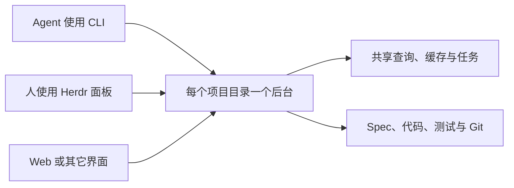

# 多客户端共享项目后台

Agent 在 CLI 中检查和修改项目，人在 Herdr 面板或 Web 中审阅，两者连接同一个项目后台。检查、文件变化和测试任务在各界面共享，切换界面不需要再启动一份测试。

后台跟随选定的[项目目录](../../concepts.md#project-directory)。在 main 上开发、原地切分支或使用多个检出目录，都使用同一套命令；不同目录彼此隔离（[适配项目的开发方式](../../taste.md#t-9)）。



## 一起工作

以下命令和结果是本 Roadmap 的预期行为。

```sh
# Agent 从项目的任意子目录执行检查；没有后台时自动启动。
concord check

# 人打开同一项目的工作台，连接同一个后台。
concord view

# Agent 提交测试并等待；面板与 Web 同时显示这个任务。
concord test run '<测试 ID>'
```

人和 agent 仍可直接编辑项目文件。后台发现变化、重新核验来源并更新各界面；编辑器有未保存草稿时保留草稿并提示冲突（[文件是界面，命令只是助手](../../taste.md#t-6)）。

## 日常运行

- 首个项目命令启动后台，后续命令复用它。帮助、版本与随包资源读取不需要后台。
- 关闭 CLI、面板或浏览器连接，不会终止已经提交的操作。取消使用明确的取消入口。
- 写入断线后按[操作票据](concepts.md#operation-ticket)查询原结果，不自动重新提交；后台重启后无法确认的结果明确标为未知。
- 后台没有客户端或任务时按空闲条件退出。`concord server stop` 显式停止并等待清理。
- CI 用 `concord --server=command check`，让同一套后台随这条命令结束；它不接管已存在的后台。

文件拥有产品事实，后台拥有运行状态。缓存可以重建；测试证据、发布 journal 与恢复材料不因清理缓存而删除（[一件事只写一次，其余推导](../../taste.md#t-3)）。

## 使用旅程

- [Agent 与人共享查询和测试](use-case/share-project-work.md)
- [断线后确认操作与在 CI 中退出](use-case/observe-and-stop.md)

调用、输出与失败见 [CLI 与客户端接口](cli.md)，进程归属、资源预算及内部协议见[架构](architecture.md)。
