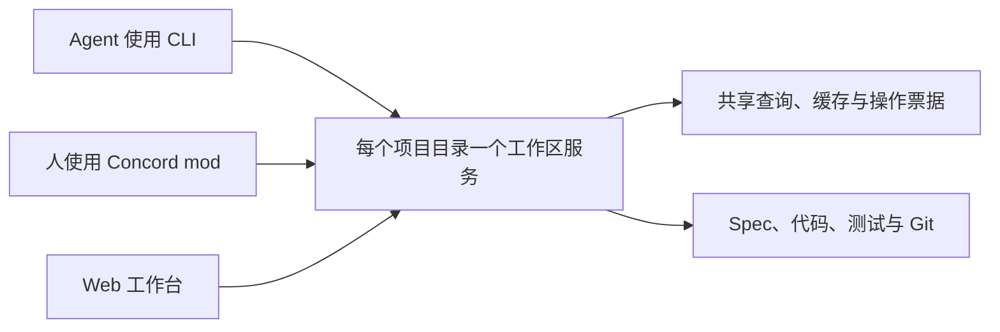

# 多客户端共享工作区服务操作

Agent 在 CLI 中修改项目并运行测试，人在 [Concord mod](../../feature/herdr-mod/README.md) 或 [Web 工作台](../../feature/web-workbench/README.md)中审阅，三者通过同一个[工作区服务](../../concepts.md#workspace-server)调度写入与测试任务。切换界面不需要再启动一份测试，断线后可以按[操作票据](concepts.md#operation-ticket)确认结果。

工作区服务的项目目录隔离、自动启动、锁与 `--server=command` 生命周期由[本地数据引擎](../../feature/local-data-engine/architecture.md#工作区服务)拥有（[适配项目的开发方式](../../taste.md#t-9)）。本 Roadmap 将 CLI 与 Herdr 的写入、恢复及测试执行也纳入同一个工作区服务调度。



## 一起工作

以下命令和结果是本 Roadmap 的预期行为。

```sh
# Agent 从项目的任意子目录执行检查；没有服务时自动启动。
concord check

# 人打开同一项目的工作台，连接同一个工作区服务。
concord view

# Agent 提交测试并等待；Concord mod 与 Web 同时显示这个任务。
concord test run '<测试 ID>'
```

人和 agent 仍可直接编辑项目文件。工作区服务发现变化、重新核验来源并更新各界面；编辑器有未保存草稿时保留草稿并提示冲突（[文件是界面，命令只是助手](../../taste.md#t-6)）。

## 日常运行

- 关闭 CLI、Concord mod 或浏览器连接，不会终止已经提交的操作。取消使用明确的取消入口。
- 写入或测试断线后按[操作票据](concepts.md#operation-ticket)查询原结果，不自动重新提交；服务重启后无法确认的结果明确标为未知。
- 缓存可以重建；测试证据、发布 journal 与恢复材料不因清理缓存而删除（[一件事只写一次，其余推导](../../taste.md#t-3)）。

## 使用旅程

- [Agent 与人共享查询和测试](use-case/share-project-work.md)
- [断线后确认操作与在 CI 中退出](use-case/observe-and-stop.md)

调用、输出与失败见 [CLI 与客户端接口](cli.md)，进程归属、资源预算及内部协议见[架构](architecture.md)。
