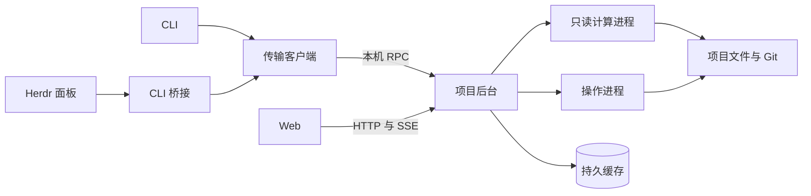

# 共享项目后台架构

每个[项目目录](../../concepts.md#project-directory)最多一个工作区服务。它拥有项目的运行状态；CLI、Herdr 与 Web 是同一应用层的客户端。不同目录独立，后台不承担跨项目调度（[适配项目的开发方式](../../taste.md#t-9)）。

本 Roadmap 的调用、输出、状态与失败由 [CLI 与客户端接口](cli.md)拥有。文件是事实来源，缓存可以重建；后台重启不自动续跑任务，不用可删除缓存保存操作事实（[文件是界面，命令只是助手](../../taste.md#t-6)）。

## 进程归属

| 所有者 | 资源与职责 |
| --- | --- |
| 服务主进程 | 服务锁、持久缓存、来源监听、事件状态、HTTP 监听、操作记录和子进程监督 |
| 计算进程 | 有界内存解析缓存、只读扫描与投影计算；向主进程返回候选，不发布持久结果 |
| 操作进程 | 一次操作的来源快照、短发布租约、journal 协议和受管子进程；不打开持久缓存 |
| 客户端 | 输入、确认、终端或界面展示、草稿、选择与阅读位置；不拥有项目任务和数据库句柄 |

主进程不执行领域扫描或消费者代码。文件、进程、网络与缓存能力通过 Effect 服务组合；操作进程的作用域包含它启动的全部子进程。

`app` 拥有传输无关的查询、操作输入、结果 Schema 和具名失败。`entry/server` 组合应用能力并调度进程。CLI、HTTP 与 Herdr 只做传输和展示适配，不各自组合 Repository 或执行领域操作。

纯模型和公开的 config、model、adapter、preview 子路径不要求连接后台。应用操作需要消费者模块或外部程序时在受管进程执行，不能装入主进程。

## 操作分派

| 操作类型 | 执行归属 |
| --- | --- |
| 项目查询、check、Git 读取、正文读取、配置检查 | 后台应用查询；计算需要的来源快照按请求建立 |
| init、文档与源码保存、Issue 处理、配置修改、恢复 | 后台调度的操作进程 |
| 测试执行、修复核验、原生收集、外部集成 | 后台拥有的操作与受管子进程 |
| cache status、clear、rebuild | 主进程拥有状态与写回；计算进程只生成派生行 |
| view、workspace、LSP | 使用后台的应用能力；LSP 的编辑器协议和未保存文本留在客户端 |

交互先在客户端完成，再提交类型明确的输入。后台不打开终端提示或编辑器，不提供任意 shell 命令执行接口。嵌套调用需要的能力通过应用端口提供，不借公共 CLI 重入同一操作。

普通文档写入可以并行规划，发布阶段仍取得短独占租约并复核前像。每个项目的测试与修复核验共用一个 runner 槽；长执行不持有文档发布租约。外部收集遵守受管进程预算。

发布、恢复和测试证据保持各自协议。文件发布成功后的刷新或缓存失败只能附带诊断，不能把已完成写入当作未执行。

## 启动与生命周期

客户端从 cwd 或 `--root` 定位规范项目根，再取得对应 Git-private 目录。项目根、privateDir、安装内容摘要、协议与实例 token 共同构成握手身份。子目录和指向同一根的路径别名不产生第二个服务。

首个项目请求自动启动后台。并发启动者争用同一服务锁，失败者连接胜者；只有锁持有者可以发布运行记录、绑定 socket 和打开持久库。文件锁、socket 路径安全与句柄保护沿用[工作区服务](../../feature/local-data-engine/architecture.md#工作区服务)。

冷启动握手上限十秒，已有实例握手上限一秒。`opening` 可以应答控制请求，项目请求等待就绪；握手成功不表示查询可用。不同安装或协议的活跃实例不能被普通请求自动停止。

持久缓存不可用时，已经取得服务锁的后台以进程内缓存继续服务。服务锁、项目路径或运行产物不可用则返回启动诊断，客户端不自行执行项目操作。

配置缺失、配置无效或未完成 journal 不阻止控制接口启动。诊断、定向原文读取与恢复使用不依赖有效配置或完整投影的组合；其它请求执行各自的配置和恢复检查。

默认后台独立于启动它的客户端。没有连接、HTTP 租约、在途操作或任务，且十分钟没有请求时退出。项目目录消失时停止受理，五秒内开始退出。

停止先拒绝新操作、发送 stopping 信号，再取消可取消工作，等待不可中断提交完成或留下 journal。随后收拢计算和操作进程，确认进程组清理，关闭 HTTP 和持久句柄，按实例 token 删除记录与 socket，最后释放服务锁。

三秒是正常等待预算，不授权跳过清理证明。清理无法确认时保留恢复材料和阻断。后台被杀后，新实例依据服务锁及现有恢复协议取得资源，不凭 PID、年龄或缓存认定旧任务成功。

## 命令作用域与临时检出

[命令作用域后台](concepts.md#command-service)运行同一服务实现，取得同一项目锁，由发起命令通过受管进程拥有。已有实例时拒绝启动，不能附着后停止它，也不能创建第二个所有者。

作用域标识绑定实例、规范 root、privateDir 和存活的所有者。同根 runner 子调用可继承标识；失效、跨根或失联时失败，不隐式重定向项目，也不启动普通后台。子 CLI 不承担创建后台的职责。

命令作用域禁止开启 HTTP 监听，包括 `view` 与底层 `http.open`。浏览器没有绕过作用域的端口；普通外部 RPC 客户端也不能加入。嵌套测试仍受同一 runner 槽约束。

修复核验拥有 D/F 临时检出目录。创建每个目录后，操作进程先启动该目录独立的命令作用域后台，再运行对应 runner；只向子进程传递该目录的新标识。查询读取对应候选，不能连接外层项目冒充核验。

操作先停止临时目录的后台并确认全部子进程清理，再删除目录。清理失败时保留目录、诊断与 runner 阻断。普通共享后台发起修复核验时也遵守这项归属。

runner 自行切到其它目录、且该目录没有操作拥有的受管实例时明确失败。各临时目录拥有自己的锁、句柄与缓存，外层后台只监督生命周期，不跨根提供来源。

## 执行上下文

查询在受理时、操作在 prepare 时冻结[执行上下文](concepts.md#execution-context)。CLI 使用本次调用环境；Web 使用后台启动环境；Herdr 使用启动桥接 CLI 的宿主环境。上传、submit 与重试不替换已绑定环境。

环境是完整映射：缺失项保持缺失，不能从后台环境补齐。cwd 是选定项目根，文件参数提前转换为受校验的项目相对路径。作用域标识由资源所有者绑定，不能由上传输入改变。

配置凭据读取、可执行文件定位、输入身份计算与程序启动使用同一上下文。预热操作进程只准备与请求无关的能力，收到输入后才组合相关 Layer；不临时修改主进程 `process.env`。

runner、adapter、Git 与远端集成沿用各自环境过滤规则。缓存身份仍包含对应消费者声明的环境输入，不同环境不能复用未经验证的外部收集结果。

原始环境只在请求及执行作用域内保留，终结时释放；不进入 HawDB、事件、回执、错误详情或日志。共享列表不包含凭据或输入正文。

## 操作接收与终结

应用操作的定义同时声明严格输入与结果 Schema、执行类别及结果字节上限。传输适配从同一定义执行准入，不维护另一份可执行命令登记表。

prepare 校验操作名、声明输入长度及摘要，冻结上下文并预留容量，签发实例内票据。这一步不执行领域操作；响应丢失只留下无执行权的准备记录。

输入接收器检查块偏移和重复块的一致性。完整上传后严格解码 UTF-8、验证长度与摘要，再按操作 Schema 解码。submit 先原子地将 prepared 改为 queued，再派发一次；重试不能再次转换或派发。

未知、过期或其它实例的票据拒绝执行。submit 已发出而响应丢失时，只查询同一票据；不能以新票据自动重跑。操作记录是实例内内存状态，不写入持久 HawDB 或另建通用操作数据库。

取得领域结果并确认全部受管进程组清理后，才发布普通终态。清理失败优先于完成、失败或取消，晚到结果不能覆盖 cleanup-failed；结果未知而清理已确认时才进入 unknown。

prepared 的取消释放输入、环境与回执承诺，留下最小 cancelled 记录；queued 取消停止派发。运行时取消在安全点响应；提交区不能用连接取消打断。

准备超期也释放输入与环境，保留带 OperationExpired 的最小 cancelled 记录；它可明确表示尚未派发。该记录淘汰后只报告结果未知，不能无限保留过期票据。

后台重启后，旧票据不能证明是否执行。来源、journal、runner 与证据依照领域协议恢复；相同文件内容或已有缓存不能替代操作回执。

## 准入与资源预算

每次接收和状态转换都在主进程内先检查并更新容量，再派发执行。应用定义自己的结果上限；普通操作上限不得超过 32 MiB，控制操作不得超过 1 MiB。

| 资源 | 普通操作 | 恢复与缓存维护 |
| --- | --- | --- |
| 未终结操作记录 | 256 条 | 独立 8 条 |
| 在途输入与环境 | 合计 64 MiB，单次输入 32 MiB | 独立合计 4 MiB |
| 未终结回执承诺 + 已保留终态实际字节 | 合计 64 MiB | 独立合计 8 MiB |
| 单个执行环境 | 256 KiB，计入输入池 | 256 KiB，计入输入池 |

prepare 按操作声明的最大回执预留。空间不足时先按完成顺序淘汰终态，再判定 Busy；未终结票据不参与淘汰。完成时原子地把预留换成实际回执，并释放输入与环境，不存在额外的无上限承诺池。

普通池最多保留 256 条终态，控制池最多 8 条终态；各自最多十分钟，容量不足时提前淘汰。失去记录始终意味着无法确认结果，不能重新派发。cleanup-failed 保留为未终结阻断，不能由终态淘汰释放。

状态、cancel 和 stop 是控制请求，不申请新操作票据。服务的 256 个在途请求名额中，普通请求最多占 248 个，控制专用 8 个；普通待发送结果最多 64 MiB，控制另留 1 MiB。恢复与缓存维护的票据使用独立池，普通请求不能借用。

恢复与缓存维护串行执行，仍遵守发布租约和清理阻断。保留容量保证控制可达，不承诺绕过正在提交的事务；操作可以明确返回领域 Busy 或 CleanupFailed。

结果的传输与留存分别计数。越过应用声明上限的结果按未知处理，不返回截断成功，不因输出失败重跑。所有数量限制同时生效，256 条上限不表示允许并发 256 个最大结果操作。

## 共享读取与事件

来源监听、投影刷新和缓存维护仅属于后台。当前查询逐次核验配置、来源及恢复状态；历史投影保留来源身份、时间、完整性和漂移标记，不授权当前事实检查成功。

主进程只接受通过来源复核的计算结果。文件变化、操作完成和恢复触发刷新；缓存写回失败不改变领域回执。编辑正文和前像来自定向读取，客户端不从导航投影构造写入基线。

事件使用实例与递增修订号，内容是完整状态信号。首次连接、重连或序号缺口后读取完整快照；慢连接合并未发送信号，不积累事件队列。RPC、SSE 与有界 CLI 长轮询读取同一状态。

共享模式的 HTTP 地址按租约管理，关闭监听不取消后台任务。Host、Origin 与浏览器沙箱沿用[Web 边界](../../feature/web-workbench/architecture.md)。增加客户端不会自动开放网络监听。

## Herdr 桥接生命周期

Herdr 通过公开 CLI 接入，不要求宿主提供 socket 或 stdin。产品正文读取、保存、检查与刷新均通过后台，宿主只拥有目录选择、编辑器和草稿。

面板只保留一个在途长轮询。关闭或换项目后使旧作用域失效、丢弃晚到结果，不再启动下一轮。已发起调用受 CLI 的整体期限约束，不能把取消视图回调当成子进程已经退出。

无 stdin 时按 [CLI 分块接口](cli.md#有界-cli-桥接)上传，普通 CLI 和 HTTP 也使用同一输入接收器。有效进展更新上传空闲期限，重复块不延长；绝对期限限制持续占用。

换项目或关闭面板时取消尚未提交的票据；取消无法送达则由准备期限释放。提交后的操作继续存在。超时不删除草稿，也不把不完整输入交给领域操作。

## 验收边界

| 场景 | 必须观察到的结果 |
| --- | --- |
| 两个子目录同时启动 CLI 与面板 | 同一实例，只有一组持久句柄 |
| 两个检出目录与同目录切分支 | 前者独立；后者核验来源，不按分支另开服务 |
| CLI 写入，面板有未保存草稿 | Web 收到变化，面板提示冲突并保留草稿 |
| CLI 启动测试，浏览器关闭再打开 | 同一操作与 runner，任务仍可观察 |
| submit 前后断线、回执送达前杀后台 | 未提交不执行；已提交不重派；重启后明确未知 |
| 票据过期、淘汰或未知 ID | 拒绝 submit，不产生新的副作用 |
| 两个最大回执预留、孤儿 prepare、同时完成 | 预留和实际留存总量有界，恢复及取消仍有容量 |
| 配置无效、缓存损坏、未完成 journal | 诊断和恢复可到达，事实查询不伪造成功 |
| A 有凭据、B 没有；上传与重试环境不同 | B 不继承 A；每张票据只使用准备时上下文 |
| D/F 临时检出内调用 Concord | 读取各自候选；后台先退出，目录后删除 |
| 跨根或失效作用域、命令作用域开启 Web | 具名拒绝，没有游离后台或 HTTP 端口 |
| 取消或关闭时清理失败、随后晚到成功 | 阻断保留，晚到结果不覆盖清理失败 |
| Herdr 上传超过一分钟且有进展，或切换项目 | 总期限内可继续；失效作用域不更新视图 |

验收使用真实 CLI、HTTP 与 RPC 入口，在提交边界切断连接和杀进程。fake 只模拟外部 provider 或 runner。Herdr 要通过宿主加载、真实编辑和关闭路径，不能用类型检查替代实机验收。

实现采用这份 Roadmap 时，高频命令、冷启动、跨客户端变化可见性与取消须同步拥有 Feature 预算和 benchmark 场景，并满足[性能验收](../../engineering/performance/README.md)；设计审查不证明性能达标。
