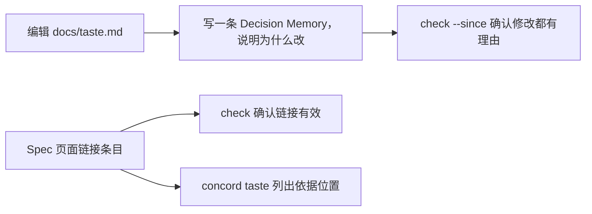

# 写下项目的品味

一个项目里，人和 agent 每天都在做规则写不到的选择：这段说明要不要拆成 Use Case，这个名字要不要先定义，这个检查值不值得为速度跳过。品味把项目对“什么是好的”的判断写成文件，让每个人和每个 agent 按同一个标准选择，审阅时也能指着某一条说“这里不合品味”。

## 你可以做什么

- 在 `docs/taste.md` 里写下项目的品味：每条一句话，说明它解决什么问题，再给出好的样子和坏的样子。
- 写下底线：少数绝对不能违反的约束，例如凭据不进入日志。
- 在依据某条品味的句子旁链接它，之后能查到哪些页面依据哪一条。
- 修改品味时记下理由，`check --since` 确认每次修改都有记录。

## 上手

以下为预期输出。初始化后，`docs/taste.md` 只有说明，没有条目。写下第一条品味：

```markdown
## T-1 读得懂胜过写得全 {#t-1}

Spec 没人看得懂，就没人认真审阅，也就没人维护。

- 好的样子：README 像使用教程，先讲能做什么，再给一个照着就能运行的例子。
- 坏的样子：README 开头就是字段、退出码和边界条件。
```

在 Feature 的正文里依据它：

```markdown
细则放在 cli 页，README 只讲能做什么（[T-1](../../taste.md#t-1)）。
```

查看品味和依据它们的页面：

```sh
concord taste
```

```text
T-1 读得懂胜过写得全
  docs/feature/cart/README.md:12
```

## 怎样工作

品味就是一个普通的 Markdown 文件，直接编辑。`concord taste` 只负责列出条目和依据它们的位置；`check` 确认链接指向存在的条目；`check --since` 确认每次修改条目都附了一条记下理由的 Decision Memory。



## 用户路径

写下和使用品味：

- [写下项目的第一条品味](use-case/write-taste.md)
- [依据品味写作和审阅](use-case/cite-taste.md)

修改品味：

- [修改品味并记下理由](use-case/change-taste.md)
- [修改品味却没有记下理由](use-case/change-without-reason.md)
- [删除仍被依据的条目](use-case/remove-cited-entry.md)

## 细节

- [命令](cli.md)：`concord taste` 的输出与错误码。
- [文件格式](format.md)：条目的写法与 ID 规则。

## 依据的品味与底线

- [读得懂胜过写得全](../../constitution.md#c-017)
- [一个词一个意思](../../constitution.md#c-018)
- [文件是界面，命令只是助手](../../constitution.md#c-022)
- [规则少而硬，机制留给实现](../../constitution.md#c-024)
