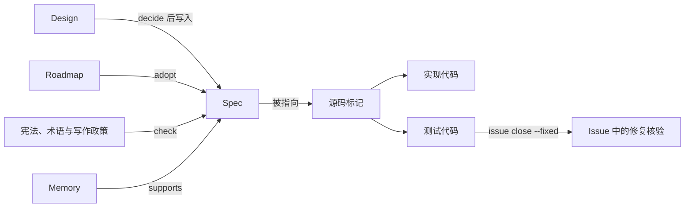

# 为什么需要 Concord

Concord 让 Spec 成为软件的唯一事实来源，并为人与 coding agent 提供同一套工作方法：人审阅 Spec 的变化，agent 按 Spec 实现并用测试证明，Concord 检查三者是否一致。

本页说明 Concord 面向的问题、每个问题对应的机制，以及这些机制刻意不承担的责任。文档的分组与字段见[文档模型](document-model.md)，具体行为 Spec 见[架构](architecture.md)，跨功能规则见[宪法](constitution.md)。

## 问题

软件项目同时维护三类信息：要做什么，怎么做的，为什么这样做。它们通常分散在不同位置，彼此之间没有可检查的关系。

| 信息 | 常见位置 | 典型失效 |
| --- | --- | --- |
| 要做什么 | 聊天记录、PR 描述、工单 | 需求只存在于某次对话；实现完成后无人能找到当初约定的行为 |
| 怎么做的 | 代码、测试 | 测试名称声称保护某个功能，没有人能确认它保护哪一条行为 |
| 为什么这样做 | 个人记忆、零散文档 | 设计取舍被反复讨论；同一个问题第二次出现时，没有人记得上次的根因 |

与 coding agent 协作时，这些失效更频繁：

- 每次会话从零开始。agent 不知道哪些语义已经定下，会重新决定公共命名、数据模型或模块边界。
- agent 按字面理解文字。同一个概念在两个文档里用两个词，agent 会把它们当成两件事。
- agent 会报告"已修复"。没有失败再通过的执行记录时，这个结论无法核验。
- agent 产出大量代码与测试。人工审阅时，最难回答的是"这个测试为什么存在"。逐行审阅生成的代码，也比审阅背后几句意图难得多。

## 机制

Concord 不新增服务，也不替代项目的语言、构建与测试工具。它在同一个 Git 仓库里给每类信息指定一个 owner，再从 owner 推导出它们之间的关系。人把审阅放在 Spec 的变化上，agent 按 Spec 实现并写测试，`concord check` 检查 Spec、实现、测试与记录是否一致。

文档按回答的问题分为六组：Spec（Feature 与 Engineering）、提案（Roadmap）、项目规则（宪法、术语与写作政策）、决策记录（Design 与 Research）、工作项（Issue）与知识（Memory）。

### Spec 先于实现

Feature 描述一项能力，Use Case 描述一条用户路径的主流程与验收。它们写在 `docs/feature/` 下，只声明目标、行为、约束与验收，不记录开发过程。

先写 Spec，实现者就不需要猜测语义。agent 在会话开始时运行 `concord list feature` 和 `show <feature>`，读到的是当前约定，而不是上一次对话的残留印象。

### 用 Feature 与 Use Case 书写

Feature 和 Use Case 用使用者的语言描述能力：谁要达成什么目标，从什么状态出发，经过哪些输入，看到什么结果。人审阅时按这条路径判断需求是否正确，agent 按同一条路径实现和写测试，两者读的是同一份文字。

模块名、类名和调用链只有读过代码的人才懂，也会随重构改变。用户目标和可观察结果不依赖这些知识，所以它们适合作为人和 agent 的共同语言，也适合作为测试标记指向的目标。

### 行为页写结果，architecture 页写实现

Feature 由四种页面组成，按读者分页。README 说明能力，Use Case 写用户路径与验收，cli 或 library 示例页给出具体调用与输出，它们声明外部能看到的行为；architecture 页说明这个 Feature 内部怎么实现。

cli 页直接写命令和输出：参数、人读输出、`--json` 字段、退出码和错误。读者不必推断"成功"是什么样子，测试可以逐项断言，agent 实现时也有明确的完成标准。

architecture 页写实体归属、数据流、不变量和失败阶段。功能演进时，实现方式经常调整：换存储、拆模块、改缓存。行为不变的重构只改 architecture 页，行为页和指向它们的测试标记保持稳定。行为确实改变时，先改行为页，再按需要调整 architecture 页。

跨 Feature 的系统边界写在项目根 `docs/architecture.md`。多种实现方式需要比较时，先写 Design，裁决后再把选中的方案落到 architecture 页。

### Roadmap 与 Engineering

Roadmap 和 Feature 使用同一种体裁，区别只在于是否已采用为当前 Spec。方向进入 Roadmap 有两种原因：设计还不完整，或者已经设计好但暂不安排实现。测试和实现不指向 Roadmap。准备实现时，`roadmap adopt` 把整个目录移入 `docs/feature/` 并改写指向它的链接；采用经过留在 Git 历史中。

这样做的好处是，未来方向可以提前用同样的语言写清楚，又不会被误读为已经承诺的行为。采用时不需要改写体裁。

Engineering 描述仓库自己的测试与维护机制，例如自举检查、持续集成和性能验收。它的读者是维护者，产品使用者看不到这些行为，所以不写进 Feature。Engineering README 按目标、机制、使用和验收组织，专题较大时再拆页。

### 选择有记录

有多个可行方案时，Design 在共同的目标与约束下比较候选。每个候选逐项回应 Goals 与 Limits，状态如实标为满足、部分满足、不满足或待验证。

`design decide` 校验全部候选与 Limits，把唯一选择写进 DECISION。选中方案中仍适用的规则随后写进 Spec，Spec 把裁决链接为决策依据。之后再有人提出被否决的方案，Design 里能直接看到它当时为什么没有被选中。

### 一个概念一个名字

`concepts.md` 为每个概念写一个二级标题：标题文字是唯一写法，`{#id}` 是稳定身份，第一段是定义，之后是解释。旧写法列为弃用名，`check` 报告它们并建议改为现行写法。正文可以链接到定义，链接断开时 `check` 会报告。

术语按目录划分作用域。两个 Feature 可以各自定义同名概念，全项目视图保留两者的来源，不静默覆盖。

### 写作可检查

`concord-writing.json` 声明禁用词、替代写法与理由，并限制句长与段长。禁用词针对 `helper`、`resolve` 这类不说明职责的词，以及 `目前`、`已实现` 这类把进度写进 Spec 的词。

写作检查是 `concord check` 的一部分。Spec 不清楚时门禁失败，问题在实现之前暴露。

### 关系由源码拥有

实现代码用 `@concord-implements` 指向 Spec，测试用 `@feature` 或 `@use-case` 指向 Spec，回归测试另用 `@issue` 指向它守护的 Issue。标记写在源码里，和代码出现在同一个 diff 中。

反向关系由工具推导：从 Spec 查到实现和测试，从代码行查到 Spec。仓库里没有第二份登记表，所以关系不会和代码脱节。

### 修复要有证据

缺陷写成 Issue。先提交会失败的回归测试，再单独提交修复；`concord issue close --fixed` 在缺陷提交上运行测试并要求失败，在当前 HEAD 上运行并要求通过，两者之间测试、runner 配置与所指 Spec 不变（[C-004-2](constitution.md#c-004-2)）。核验结论写进 Issue：缺陷提交、修复提交与测试。

结论随仓库共享，`concord test verify` 可以在任意 clone 中按记录重放。同一提交同时加入测试与修复、缺少提交或超时时，核验返回 `FixUnverifiable`，Issue 不能以 fixed 关闭（[决策依据](design/sdd-core-model/DECISION.md)）。

### 过程与声明分开

可复用的知识与不需要 Design 的决策写入 Memory，缺陷、请求与观察写入 Issue。`docs/` 只保留当前有效的声明，实施过程与排障经过不写进去。

### 直接编辑，门禁把关

人和 agent 直接编辑全部文件，包括 Issue 的状态与关闭结论、Memory 的状态与关系、宪法正文。命令是执行需要运行的步骤的助手：修复核验、Design 裁决与 Roadmap 采用都要运行检查，命令替你运行并把结果写进文件。

可信度由门禁保证（[C-001-5](constitution.md#c-001-5)）。`concord check --since <base>` 对照基线检查本次变化：新写入的修复核验会被重放，状态转换必须合法，修改 active 宪法必须同时记录一条修订决策。CI 对每个变化运行它。

### 写入可恢复

Concord 自己的写入（命令与 Web 工作台的保存）核对目标路径、前像摘要与完整变更集。中断时保留可解释的恢复现场，`concord recover` 按 journal 完成或回退，不覆盖未知编辑。

缓存只保存可重建的投影。删除缓存后，`check` 从源码重建出相同的结论。

## 一次完整的变更

1. 读取现状：`concord list feature`、`show <feature>`、`memory recall <query>`、`list --open`。
2. 方向未定时写 Design，比较候选后 `design decide`，把采用的规则写进 Spec。
3. 写或修改 Feature 与 Use Case，声明行为与验收。
4. 实现代码并加 `@concord-implements`，测试加 `@use-case`，每条验收至少一个测试。
5. `concord check` 检查关系、生命周期与写作政策，`trace gaps` 的缺口都有打开的 Issue。
6. 修复缺陷时先提交失败的回归测试，再提交修复，`issue close --fixed` 核验。
7. `review render` 或 `concord view` 生成审阅材料，reviewer 从 Spec 的变化出发核对代码与测试；CI 运行 `check --since <base>`。

## 不承担的责任

- 源码标记只声明关联，不证明测试执行过对应行为。
- 修复核验证明回归测试在两个提交上的退出码，不证明完整覆盖或正式 E2E 可靠性；逐 case 的原生证据与可靠性治理由项目自己负责，见[项目测试接入边界](repository-profile.md)。
- `check` 通过表示关系与写作规则成立，不表示功能完成。
- Concord 不运行项目构建，不安装依赖，不发送远端消息，不调用模型 API。
- Web 工作台默认只监听本机地址，没有认证；在不可信网络上不要对外暴露。
