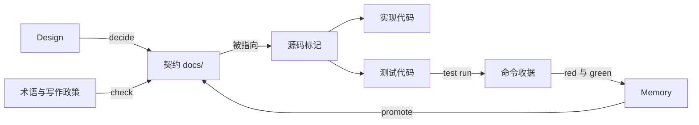

# 为什么需要 Concord

本页说明 Concord 面向的问题、每个问题对应的机制，以及这些机制刻意不承担的责任。具体行为契约见[架构](architecture.md)，跨功能规则见[宪法](constitution.md)。

## 问题

软件项目同时维护三类信息：要做什么，怎么做的，为什么这样做。它们通常分散在不同位置，彼此之间没有可检查的关系。

| 信息 | 常见位置 | 典型失效 |
| --- | --- | --- |
| 要做什么 | 聊天记录、PR 描述、工单 | 需求只存在于某次对话；实现完成后无人能找到当初约定的行为 |
| 怎么做的 | 代码、测试 | 测试名称声称保护某个功能，没有人能确认它保护哪一条行为 |
| 为什么这样做 | 个人记忆、零散文档 | 设计取舍被反复讨论；同一个问题第二次出现时，没有人记得上次的根因 |

与 coding agent 协作时，这些失效更频繁：

- 每次会话从零开始。agent 不知道哪些语义已经定下，会重新决定公共命名、数据模型或模块边界。
- agent 按字面理解文字。同一个概念在两个文档里用两个词，agent 会把它们当成两件事。
- agent 会报告"已修复"。没有失败再通过的执行记录时，这个结论无法核验。
- agent 产出大量代码与测试。人工审阅时，最难回答的是"这个测试为什么存在"。

## 机制

Concord 不新增服务，也不替代项目的语言、构建与测试工具。它在同一个 Git 仓库里给三类信息各自指定一个 owner，再从 owner 推导出它们之间的关系。

### 契约先于实现

Feature 描述一项能力，Use Case 描述一条用户路径的主流程与验收。它们写在 `docs/feature/` 下，只声明目标、行为、约束与验收，不记录开发过程。

先写契约，实现者就不需要猜测语义。agent 在会话开始时运行 `concord feature list` 和 `trace show`，读到的是当前约定，而不是上一次对话的残留印象。

### 用 Feature 与 Use Case 书写

Feature 和 Use Case 用使用者的语言描述能力：谁要达成什么目标，从什么状态出发，经过哪些输入，看到什么结果。人审阅时按这条路径判断需求是否正确，agent 按同一条路径实现和写测试，两者读的是同一份文字。

模块名、类名和调用链只有读过代码的人才懂，也会随重构改变。用户目标和可观察结果不依赖这些知识，所以它们适合作为人和 agent 的共同语言，也适合作为测试标记指向的目标。

### 行为页写结果，architecture 页写实现

Feature 包按读者分页。README、Use Case、cli 与 library 页声明外部能看到的行为；architecture 页说明这个 Feature 内部怎么实现。

cli 页直接写命令和输出：参数、人读输出、`--json` 字段、退出码和错误。读者不必推断"成功"是什么样子，测试可以逐项断言，agent 实现时也有明确的完成标准。

architecture 页写实体归属、数据流、不变量和失败阶段。功能演进时，实现方式经常调整：换存储、拆模块、改缓存。行为不变的重构只改 architecture 页，行为页和指向它们的测试标记保持稳定。行为确实改变时，先改行为页，再按需要调整 architecture 页。

跨 Feature 的系统边界写在项目根 `docs/architecture.md`。多种实现方式需要比较时，先写 Design，裁决后再把选中的方案落到 architecture 页。

### Roadmap 与 Engineering

Roadmap 和 Feature 使用同一种体裁，区别只在于是否已采用为当前契约。方向进入 Roadmap 有两种原因：设计还不完整，或者已经设计好但暂不安排实现。测试和实现不指向 Roadmap。准备实现时，`roadmap adopt` 把整个 package 复制为新 Feature，Roadmap 保留采用历史。

这样做的好处是，未来方向可以提前用同样的语言写清楚，又不会被误读为已经承诺的行为。采用时不需要改写体裁。

Engineering 描述仓库自己的测试与维护机制，例如自举检查、持续集成和性能验收。它的读者是维护者，产品使用者看不到这些行为，所以不写进 Feature。Engineering README 按目标、机制、使用和验收组织，专题较大时再拆页。

### 选择有记录

有多个可行方案时，Design 在共同的目标与约束下比较候选。每个候选逐项回应 Goals 与 Limits，状态如实标为满足、部分满足、不满足或待验证。

`design decide` 保存唯一选择、理由与采用目标。之后再有人提出被否决的方案，Design 里能直接看到它当时为什么没有被选中。

### 一个概念一个名字

`concepts.json` 为每个概念保存稳定 ID、定义、首选名、允许的别名与弃用名。只有弃用名会在 `check` 中报告，别名不算错误。

术语按目录划分作用域。两个 Feature 可以各自定义同名概念，全项目视图保留两者的来源，不静默覆盖。

### 写作可检查

`concord-writing.json` 声明禁用词、替代写法与理由，并限制句长与段长。禁用词针对 `helper`、`resolve` 这类不说明职责的词，以及 `目前`、`已实现` 这类把进度写进契约的词。

写作检查是 `concord check` 的一部分。契约不清楚时门禁失败，问题在实现之前暴露。

### 关系由源码拥有

实现代码用 `@concord-implements` 指向契约，测试用 `@feature` 或 `@use-case` 指向契约。标记写在源码里，和代码出现在同一个 diff 中。

反向关系由工具推导：从契约查到实现和测试，从代码行查到契约。仓库里没有第二份登记表，所以关系不会和代码脱节。

### 修复要有证据

`concord test run` 执行一个测试声明并保存命令收据。关闭一个 Problem 需要同一测试的两份收据：修改产品代码之前失败，修改之后通过，两次之间测试定义与契约不变。

超时、零执行和全部跳过都不能作为证据。问题复现时 `memory reopen` 开始新一轮，旧收据不能关闭新一轮。

### 过程与声明分开

调查经过、根因、决策与经验写入 Memory，待调查的观察写入 Issue。`docs/` 只保留当前有效的声明。

Memory 与 Issue 只能通过 Concord 命令维护，修改时携带最新摘要。成熟的 Memory 可以用 `memory promote` 升级为契约。

### 写入可恢复

所有写入核对目标路径、前像摘要与完整变更集。中断时保留可解释的恢复现场，`concord recover` 按 journal 完成或回退，不覆盖未知编辑。

缓存只保存可重建的投影。删除缓存后，`check` 从源码重建出相同的结论。

## 一次完整的变更

1. 读取现状：`concord feature list`、`trace show <feature>`、`memory recall <query>`。
2. 方向未定时写 Design，比较候选后 `design decide`。
3. 写或修改 Feature 与 Use Case，声明行为与验收。
4. 实现代码并加 `@concord-implements`，测试加 `@use-case`。
5. `concord check` 检查关系、生命周期与写作政策。
6. 修复 Problem 时，用 `test run` 取得 red 与 green，再 `memory resolve`。
7. `review render` 或 `concord view` 生成审阅材料，reviewer 从契约出发核对代码与证据。

## 不承担的责任

- 源码标记只声明关联，不证明测试执行过对应行为。
- 命令收据记录一次真实执行，不证明完整覆盖或正式 E2E 可靠性。
- `check` 通过表示关系与写作规则成立，不表示功能完成。
- Concord 不运行项目构建，不安装依赖，不发送远端消息，不调用模型 API。
- Web 工作台默认只监听本机地址，没有认证；在不可信网络上不要对外暴露。
